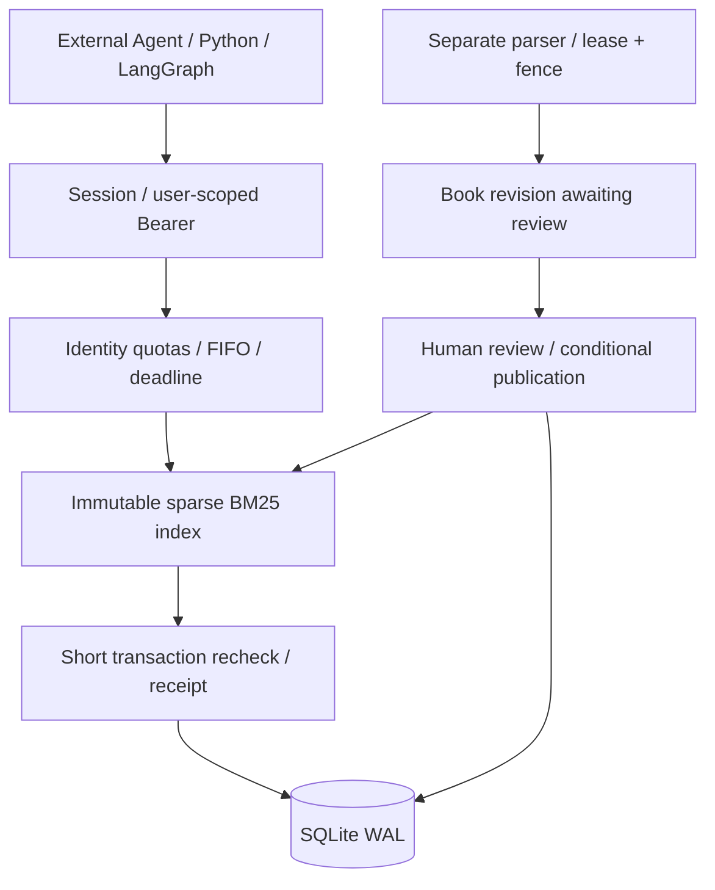

# ZhiWiki · Knowledge Evidence You Can Read Back and Maintain

[简体中文](README.md) | [English](README.en.md)

Go beyond finding documents: answers carry readable source passages, Wiki pages retain versions and source dependencies, and source updates identify pages needing review. The team API enforces knowledge-base permissions, read-only tokens, retrieval, source readback, and citation validation at the service boundary.

Start with the **key-free local workbench** to explore materials, Q&A, and Wiki relationships. Use the separate team service for multi-user authorization and external agents. These entry points use different ports and data directories.

[Local trial](#local-trial-from-material-to-citation) · [Wiki output](#save-results-as-a-maintainable-wiki) · [Team service](#start-the-team-evidence-service) · [Agent integration](#agent-integration) · [Documentation](#documentation)

## Local trial: from material to citation

Prepare Python 3.13. In Windows PowerShell:

```powershell
git clone https://github.com/kayaduster607-jpg/zhiwiki.git
cd zhiwiki
python -m venv .venv
.\.venv\Scripts\python.exe -m pip install -r requirements.txt -r requirements-parser.txt
.\.venv\Scripts\python.exe -B -m zhiwiki --config config.example.json seed
.\.venv\Scripts\python.exe -B -m zhiwiki --config config.example.json serve --port 8875
```

Open [http://127.0.0.1:8875](http://127.0.0.1:8875). Default offline mode needs no model key. Seeding loads fictional business documents and human-authored Wiki examples:

1. Ask “2026年退款政策与2025年有什么区别？” (how does the 2026 refund policy differ from 2025?).
2. Expand evidence and check original text, chunk ID, and version. Offline mode returns deterministic extracts, not real model reasoning performance.
3. Upload a small TXT / Markdown of your own, or import from another terminal:

```powershell
.\.venv\Scripts\python.exe -B -m zhiwiki --config config.example.json ingest examples/documents/shipping.md
.\.venv\Scripts\python.exe -B -m zhiwiki --config config.example.json ask "What do the shipping documents say?"
```

4. Ask a question directly covered by the file and check that evidence resolves to its chunks. Importing a new document differs from updating an existing document with the same source_key; only the latter demonstrates invalidation of existing knowledge dependencies.

## Save results as a maintainable Wiki

Create / open a Wiki page in the workbench, edit, save a draft, then explicitly publish. Pages record content versions and source relationships. Source changes require review rather than silently treating old pages as valid.

```powershell
.\.venv\Scripts\python.exe -B -m zhiwiki --config config.example.json wiki list
```

Copy an actual page ID from the list and run `wiki export <ID> --output exports/page.md`, replacing the angle-bracket placeholder. Output is a Markdown file; a page answer does not automatically become a download.

| Input / action | Result | Default location |
| --- | --- | --- |
| Import original | Document ID, chunks, version | Database under local data |
| Question / retrieval | Answer or evidence and execution state | Page / terminal |
| Edit and publish Wiki | Versioned knowledge page and source dependencies | Local database |
| Wiki export | Markdown | Specified output path |

## Start the team evidence service

The team entry point handles permissions and agents, using `data-team/` by default. The local workbench uses `data/`; one cannot simply substitute for the other as a multi-user deployment.

Create an administrator in the prepared dependency environment:

```powershell
.\.venv\Scripts\python.exe -B -m zhiwiki.service --config config.team.example.json bootstrap admin
```

Enter a password of at least 12 characters interactively. There is no default admin password. Then run in two terminals:

```powershell
# 终端 A；local-http 仅用于本机体验
.\.venv\Scripts\python.exe -B -m zhiwiki.service --config config.team.example.json serve --port 8872 --local-http
```

```powershell
# 终端 B；独立导入 Worker
.\.venv\Scripts\python.exe -B -m zhiwiki.service --config config.team.example.json worker
```

Open [http://127.0.0.1:8872](http://127.0.0.1:8872). Follow the [team manual](docs/TEAM_SERVICE.md) to create knowledge bases, users, and roles, then import and publish materials. Users obtain read-only tokens under their own identities for agents. Team mode disables legacy `/api/*`; do not reuse workbench endpoints.

## Why retrieval and readback are separate

Retrieval identifies what was found; readback confirms current text; final validation checks evidence identity, version, and hash. When permissions or source versions change, the outer agent must reconfirm the sources it actually uses.

The team API supplies controlled evidence rather than choosing every investigative step for the outer agent. `semantic_support=not_checked` means semantic support between an answer and its source has not been established.

## Agent integration

An external agent chooses its investigation and generates answers; RAG returns original evidence. The caller injects token, service address, and accessible bases rather than exposing them as model tool parameters.

```python
import asyncio
import os
from zhiwiki.service.client import RagClient

async def main():
    async with RagClient("http://127.0.0.1:8872", os.environ["ZHIWIKI_TOKEN"]) as rag:
        found = await rag.retrieve("退货运费如何确定？", ["你的知识库ID"])
        if not found["evidence"]:
            return found
        read = await rag.read(
            [found["retrieval_id"]],
            [item["evidence_id"] for item in found["evidence"]],
        )
        valid = await rag.validate([read["retrieval_id"]], [
            {"evidence_id": item["evidence_id"], "text_sha256": item["text_sha256"]}
            for item in read["evidence"]
        ])
        return {"evidence": read["evidence"], "validation": valid}

asyncio.run(main())
```

Reuse a long-lived client instead of rebuilding connection pools per call. `langgraph_node(rag_client, [kb_id])` integrates with StateGraph; a complete example is in the team manual. Client calls have a 3-second limit and server calls a 2-second limit. Retries of the same logical call retain the idempotency key; permission and version conflicts are not automatically retried.

Before the final answer, the outer agent should validate the citations it actually uses again. `semantic_support=not_checked` verifies identity, version, and text, not semantic entailment of the answer.

The local workbench can separately enable a model tool loop through an OpenAI-compatible interface. The team API makes no outbound model calls by default. See the [technical guide](docs/TECHNICAL_GUIDE.md) for model configuration and budgets.

## Design tradeoffs



| Choice | Reason | Cost and expansion conditions |
| --- | --- | --- |
| Separate evidence service and generation | Avoid nesting an internal agent inside an outer agent; explicit call counts and permissions | Caller owns synthesis and its model budget |
| One API plus separate import process | Query and long PDF parsing have separate throttling, cancellation, recovery | Single-machine failure domain; move global coordination before multiprocess expansion |
| SQLite WAL and short transactions | Atomic publication, invalidation, receipts, and version / citation facts | Single writer, no multi-machine HA; migrate according to write waits and availability needs |
| Persistent sparse BM25 + NumPy | Precomputed inverted contributions avoid scoring many candidates individually in Python | Lexical recall misses synonyms; compare vectors / reranking against fixed qrels |
| Immutable indexes + generation | Prepare indexes before switching factual pointers; verify on restart | Requires derived files, disk thresholds, recovery protocol |
| Opaque tokens | Check current authorization on every request and support immediate revocation | Extra DB authorization reads; SSO / identity federation require separate design |

Indexes use `sparse-bm25-v1`. SQLite stores little-endian inverted arrays and metadata; files are SHA-256-named, without pickle. Metadata filtering precedes top-k, and multiple bases use RRF fusion. Query results are not cached by default.

### Position relative to existing solutions

The following scope and delivery comparison was checked against official materials on 2026-10-16. It is not an accuracy or throughput ranking.

| Solution | Official scope | ZhiWiki's tradeoff |
| --- | --- | --- |
| [Dify](https://github.com/langgenius/dify) | Visual workflows, RAG, model management, agents, application APIs | Team entry point handles evidence only, reducing deployment / code scope but offering less application orchestration and model-ecosystem coverage |
| [RAGFlow](https://github.com/infiniflow/ragflow) | Deep document processing, OCR, multiple retrieval / reranking routes, agentic retrieval, Wiki-style knowledge compilation | Text PDFs and lexical BM25 only; substantial gaps for complex layouts, scans, and semantic recall. Wiki is not unique to this project |
| [LangChain retrieval components](https://docs.langchain.com/oss/python/deepagents/retrieval) | Composable loaders, splitters, retrievers, agent tools | This project implements authorization, version publishing, receipts, backpressure, and recovery as a service, with a smaller retrieval ecosystem |

The engineering value is traceability from code and tests to **permission checks, version switches, citation validity, and resource release**. Evaluate mature platforms against your deployment needs if you want a complete platform. There is no verified claim that this project outperforms market products.

### What concurrent users means here

Within-capacity acceptance means **20 authorized identities each submit one request simultaneously, all succeeding on time**. HTTP 429 / 503 do not count as success. Separate tests give each of 20 tasks 3 or 6 tool calls.

Defaults are 30 rpm per identity with burst 6, and 120 rpm globally with burst 120. There are 4 execution slots; remaining requests queue within bounds. After timeout or disconnect, a slot is released only when its thread really ends. Twenty online users does not imply a sustained 20 requests per second. Sustained-load testing uses a total of 1 req/s.

## Engineering verification

| Verification | Evidence and limits |
| --- | --- |
| Full regression | **226 Python + 68 JavaScript tests passed**, covering permissions, citation races, conditional publication, worker fencing, cancellation, recovery, UI state |
| Real book | A 531-page text PDF of Dive into Deep Learning imported and published through native HTTP, with 8 retrieval / readback / validation groups; missing-character flags retained for 93 pages |
| Agent connection | Two real LangGraph graphs shared a 20-connection pool and completed 6-step calls over loopback HTTP; cross-user receipts returned 403; see [record](reports/team-agent-http.json) |
| 20-user concurrency | With 50,000 synthetic chunks, 10 synchronized bursts achieved **200/200 success**; 20-task chains of 3 / 6 steps achieved **60/60 and 120/120 success** |
| Sustained load | Total 1 req/s for 30 minutes: **1,799/1,800 success**, one 504; P95 35.5 ms, P99 56.0 ms, meeting this run's ≥99% SLO with the timeout retained. See [full acceptance](docs/TEAM_ACCEPTANCE.md) for overload and fairness |
| Backup / restore | Consistent SQLite snapshot, file hashes, database-integrity checks, authenticated retrieval after recovery; timings retained in acceptance reports |

```bash
python -m pip install -r requirements-dev.txt
python -B -m pytest -q -p no:cacheprovider
node --test tests/*.cjs

# 使用新目录，实际执行 30 分钟持续阶段及独立突发/公平性阶段
python -B scripts/verify_team_capacity.py --data-dir data-team-verification --fragments 50000 --seconds 1800
```

Full-service CI installs pinned dependencies under Python 3.13 and runs pytest / LangGraph contracts. Another workflow checks standard-library core compatibility on Python 3.9 / 3.13. Actions defines remote results.

Capacity fixtures and the real book are tested separately. Health-check QPS and synthetic-corpus results do not establish answer quality. Earlier local-cache microbenchmarks and qrels tools remain reproducible; see the [retrieval benchmark](reports/showcase-retrieval-benchmark.json) and [evaluation design](docs/EVALUATION.md).

## Deployment scope

This is a **single-machine internal-team implementation**: one fixed workspace, knowledge-base isolation, and one API instance. It does not provide SSO, multi-tenant SaaS, multi-host HA, vector recall, reranking, or OCR. Real-model quality and agent gains remain unverified.

Before opening team access, prepare a real domain / TLS, controlled backup location and schedule, and verify on the target host. The app defaults to loopback. Keep Secure cookies in normal deployment, configure `allowed_hosts`, and do not simply add Uvicorn workers.

The default directory admission threshold is 10 GiB, not a filesystem hard quota. Originals, revisions, and audit records are not automatically deleted. Short-lived receipts and idempotency records expire by TTL. Original books, runtime databases, passwords, and tokens are not distributed; the project does not read `.env`.

## Documentation

| Goal | Document |
| --- | --- |
| Startup, authorization, uploads, publication, recovery | [Team deployment and Agent integration](docs/TEAM_SERVICE.md) |
| Requests, responses, errors, idempotency | [RAG API contract](docs/RAG_API_CONTRACT.md) · authenticated `/v1/openapi.json` |
| Requirements and acceptance goals | [Team service PRD](docs/PRD_RAG_SERVICE.md) · [actual acceptance](docs/TEAM_ACCEPTANCE.md) |
| Workbench demo and knowledge maintenance | [Three-minute demo](docs/SHOWCASE.md) · [Wiki revisions](docs/WIKI_REVISIONS.md) |
| Core, retrieval, evaluation | [Architecture](docs/ARCHITECTURE.md) · [retrieval](docs/RETRIEVAL.md) · [evaluation](docs/EVALUATION.md) |

Source entry points: `zhiwiki/service/` implements the team boundary; `engine.py`, `store.py`, and `compiler.py` implement workbench and knowledge core; `tests/` and `scripts/` hold tests and reproduction tools.

Report specific material and load scenarios through [Issues](https://github.com/kayaduster607-jpg/zhiwiki/issues). Vector search, reranking, multiple workspaces, and SSO extensions should include permission, consistency, and evaluation evidence.
