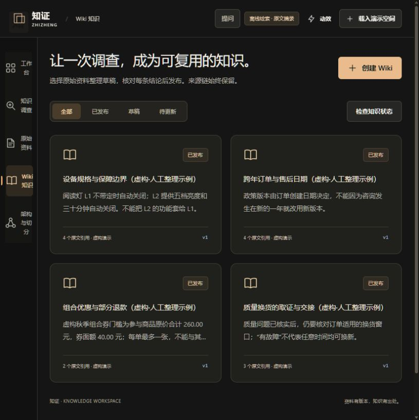
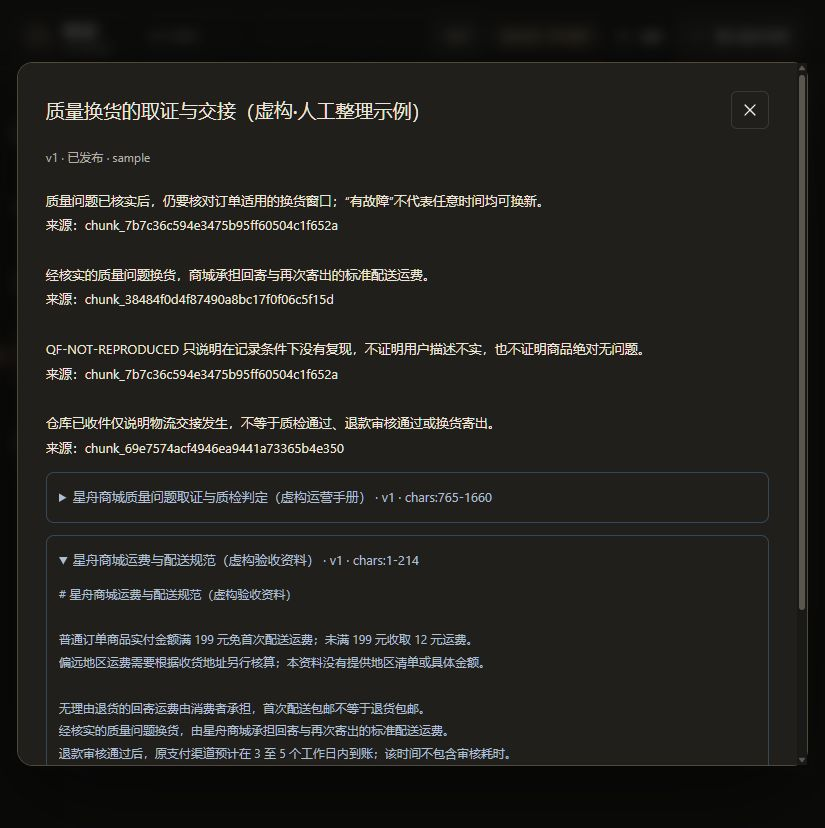
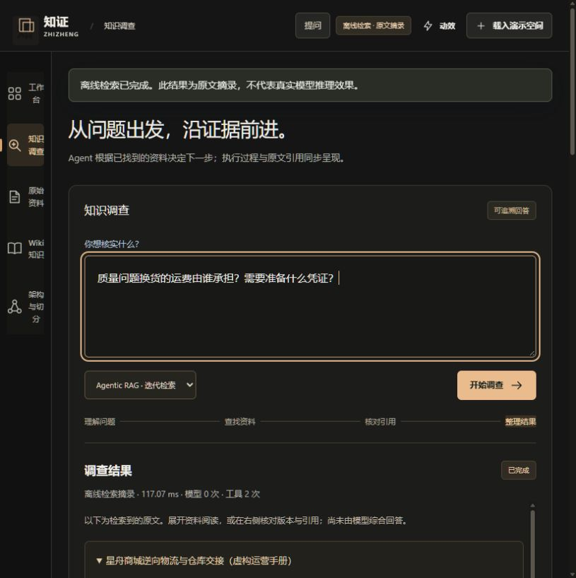
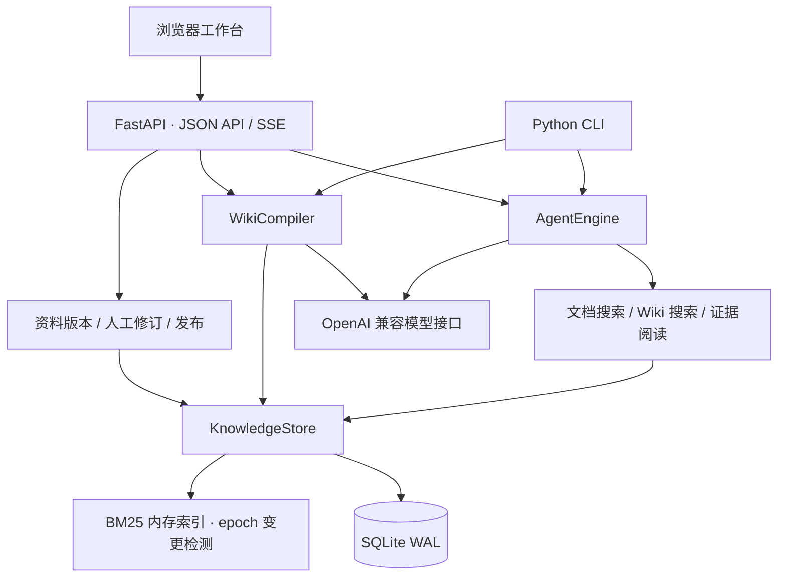
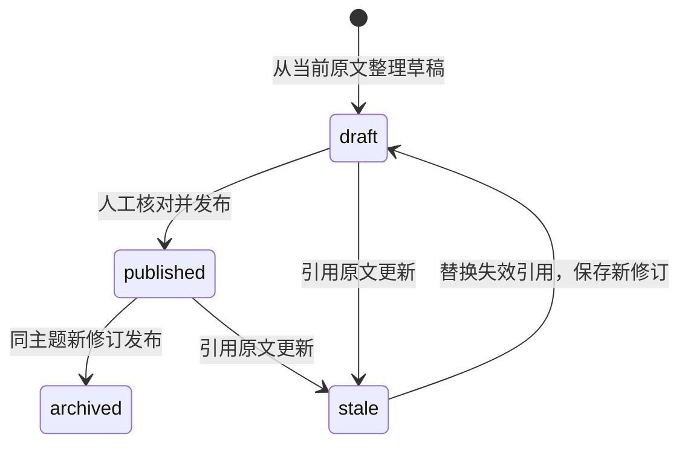

<div align="center">

# 知证 · ZhiWiki

**让知识问答有据可查，让沉淀的结论跟得上原文更新。**

Agentic RAG · 证据追溯 · 原文版本管理 · Wiki 知识维护


[运行截图](#运行截图) · [核心能力](#核心能力) · [系统架构](#系统架构) · [快速开始](#快速开始) · [技术文档](#技术文档)

</div>

知证是面向企业政策、产品和售后知识维护的本地工作台。它将**检索原文 → 带引用回答 → 整理 Wiki → 人工修订与发布 → 来源更新后失效**串成完整流程，既关注这次回答从何而来，也关注已经保存的知识是否仍然有效。

项目采用 Python / FastAPI / SQLite 与原生前端，浏览器、HTTP API 和 CLI 共用业务核心。Agent 通过 OpenAI 兼容工具调用接口选择搜索或阅读证据；应用负责工具边界、执行预算、引用核验和版本一致性。

## 运行截图

以下图片于 **2026-10-15** 启动本项目后，通过浏览器实际操作截取，使用仓库内置虚构资料。样例知识页为人工编写；本次截图展示检索、引用与知识维护流程，模型服务按下方配置接入。

### 知识空间首页


### Wiki 知识库

已发布、草稿和待更新知识分开管理，每页保留版本与原文引用。



### 从结论回到原文

展开引用即可核对原文、版本和字符定位，保留判断结论是否适用所需的上下文。



<details>
<summary>查看知识调查截图</summary>



</details>

## 核心能力

| 场景 | 实现方式 |
| --- | --- |
| 问题需要跨多份资料取证 | Agent 可调用 `search_documents`、`search_wiki`、`read_evidence`，按已取得的证据继续搜索或阅读 |
| 回答需要定位依据 | 引用包含来源、原文版本、片段 ID 与字符偏移；输出前核对引用已取得且仍有效 |
| 原文更新导致结论过时 | 原文新版本与依赖 Wiki 失效在同一 SQLite 事务提交；失效页面退出有效 Wiki 检索 |
| 有用结论需要持续维护 | 支持 Wiki 草稿、逐条人工修订、显式发布、历史查询、状态检查与 Markdown 导出 |
| 编辑基础已经过期 | 上传更新和 Wiki 修订使用预期版本校验；冲突返回 HTTP 409 |
| Agent 调用成本需要控制 | 限制轮次、工具次数、上下文、输出、累计 Token 与执行时间，并保存公开步骤 |
| 检索需要可复现对照 | BM25 检索、固定 RAG 基线、自编 dev/holdout 题集、检索指标和匿名人工复核包 |

资料导入支持 UTF-8 Markdown、TXT 与 DOCX 正文。普通上传创建独立来源，更新需要显式选择目标，避免同名文件意外覆盖。

前端提供五个工作视图、来源关系、查询执行记录、切分预览和键盘提问入口，无需 npm 构建或远程 CDN。

## 系统架构



采用模块化单体，减少本地运行的服务依赖。SQLite 保存原文、片段、Wiki 修订、依赖与查询轨迹；内存索引通过数据库 epoch 感知变更并重建，最终引用核验再次检查数据库中的来源状态。

### Wiki 生命周期



每次修订创建新记录，旧记录保留。新草稿不会提前撤下有效发布页；发布与来源检查在事务内完成。

### 检索与切分

- **BM25**：英文词项、中文单字与相邻双字，标题加权及词法锚点过滤。
- **索引缓存**：复用分词与词频结果，数据库变更后重建，避免每次查询完整重算。
- **默认分块**：900 字符目标窗口、120 字符重叠，保存字符偏移；参数计量单位是 Unicode 字符。
- **结构实验**：可预览 Markdown 标题、段落和代码围栏边界；目前未替换持久化导入的默认策略。

当前检索使用 BM25。Embedding、向量混合检索与 Reranker 是后续可扩展方向。

## 快速开始

完整服务已在 **Windows / Python 3.13.14** 环境验证，前端测试使用 **Node.js 22.22.2**。标准库核心另提供 Python 3.9 兼容验收入口。

```bash
git clone https://github.com/kayaduster607-jpg/zhiwiki.git
cd zhiwiki
python -m venv .venv
```

激活环境：

```powershell
# Windows PowerShell
.\.venv\Scripts\Activate.ps1
```

```bash
# Linux / macOS
source .venv/bin/activate
```

安装直接服务依赖并启动：

```bash
python -m pip install -r requirements.txt
python -B -m zhiwiki doctor
python -B -m zhiwiki --config config.example.json seed
python -B -m zhiwiki --config config.example.json serve --port 8875
```

打开 **http://127.0.0.1:8875**。`seed` 显式载入 16 份虚构原文、28 个片段与 4 页人工示例 Wiki；重复载入不覆盖已有手工修订。也可启动后点击“载入演示空间”。

默认配置无需密钥即可浏览、检索和维护样例知识。需要模型自主调用工具和综合回答时，按下一节连接模型服务。

已有运行环境可直接使用 `./start.ps1 -Python <解释器路径> -Port 8875`；Linux/macOS 提供 `sh ./start.sh`。本次实际验证环境为 Windows。

### 连接模型服务

复制 `config.example.json` 为 `config.local.json`，修改以下字段，其余预算设置可保留：

```json
{
  "provider": "openai",
  "base_url": "https://your-service.example/v1",
  "model": "your-model-id",
  "api_key_env": "RAG_API_KEY"
}
```

服务需支持 Chat Completions 的 `tools` / `tool_choice`。客户端在 `base_url` 后追加 `/chat/completions`；远程服务使用 HTTPS。

密钥由运行时进程环境变量 `RAG_API_KEY` 提供，可在 IDE 的运行配置中设置。JSON 只保存变量名，不保存密钥；项目不加载 `.env`。本机配置已经加入 Git 忽略规则。

```bash
python -B -m zhiwiki --config config.local.json serve --port 8875
```

### CLI 与 HTTP

```bash
python -B -m zhiwiki documents
python -B -m zhiwiki ask "阅读灯保修期多长？" --trace
python -B -m zhiwiki wiki list
python -B -m zhiwiki wiki lint
```

| 接口 | 用途 |
| --- | --- |
| `GET /api/health` | 模式、版本与输入限制 |
| `POST /api/documents/upload` | 新增或明确更新资料 |
| `POST /api/query` | 返回答案、引用、事件与用量 |
| `POST /api/query/stream` | SSE 执行步骤与最终结果 |
| `POST /api/wiki/draft` | 整理知识草稿 |
| `POST /api/wiki/{id}/revisions` | 保存人工修订 |
| `POST /api/wiki/{id}/publish` | 显式发布 |
| `GET /openapi.json` | 完整接口定义 |

查询调用方需检查 JSON 的 `status`。`completed` 表示执行与结构性引用检查完成，结论是否被原文支持仍需语义复核。SSE 展示执行步骤，不提供模型 Token 逐字流。

## 验证与评测

**2026-10-15 本地实际运行结果：Python 193 项通过，JavaScript 68 项通过。** Python 测试有 1 条现有 Starlette / httpx 弃用提示。

```bash
python -m pip install -r requirements-dev.txt
python -B -m pytest -q -p no:cacheprovider
node --test tests/*.cjs
python -B scripts/verify_core.py
```

测试覆盖导入幂等、版本失效、事务回滚、编辑冲突、检索缓存、查询中来源更新、工具协议、预算边界、HTTP/SSE 和前端状态竞争。

仓库提供 8 份独立虚构评测原文、dev/holdout 各 12 题，可复现检索指标：

```bash
python -B scripts/run_evaluation.py --split all --retrieval-only --output reports/local-retrieval.json
```

模型协议使用脚本模型与 Mock HTTP 测试；真实模型的答案质量、Agent 相对基线的收益和生产吞吐需要独立评测。指标定义、人工复核和真实模型调用入口见 [评测设计](docs/EVALUATION.md)。CI 配置见 [core-ci.yml](.github/workflows/core-ci.yml)，远端执行状态以 GitHub Actions 为准。

## 数据保存与运行范围

运行数据保存在 `data/knowledge.sqlite3`，重启后保留。备份使用 SQLite backup API，或停止服务后复制数据库并妥善处理 WAL；不要在服务写入时只复制主文件。

当前面向**单机、单工作区**，CLI 限定本机监听，没有公网账号、租户隔离或业务级权限体系。原文是提供给模型的不可信资料，模型工具仅提供受限只读取证能力。公开仓库只包含代码、自编样例和选定评测产物，不包含用户知识库、书籍正文或本机配置。

最终引用按条复查，尚未实现所有引用的原子快照核验；持续更新资料时的查询一致性仍有改进空间。

## 项目结构

```text
zhiwiki/
├── engine.py          # Agent 循环、工具调度与预算
├── provider.py        # OpenAI 兼容 HTTP 调用
├── store.py           # SQLite、版本与事务
├── retrieval.py       # 分词、BM25 与字符分块
├── search_index.py    # epoch 感知索引缓存
├── chunking.py        # 结构切分预览
├── compiler.py        # Wiki 草稿组织
├── api.py             # HTTP 与工作台装配
├── cli.py             # 命令行入口
└── web/               # 原生浏览器界面
examples/              # 虚构业务资料与评测集
tests/                 # Python 与 Node 测试
scripts/               # 核心验收、检索基准与评测
docs/                  # 技术说明与真实运行截图
```

## 技术文档

| 文档 | 内容 |
| --- | --- |
| [完整技术指南](docs/TECHNICAL_GUIDE.md) | 全量配置、CLI、API、预算与故障排查 |
| [系统架构](docs/ARCHITECTURE.md) | 数据关系、职责和事务边界 |
| [检索设计](docs/RETRIEVAL.md) | BM25、缓存协议和本地基准 |
| [切分设计](docs/CHUNKING.md) | 字符窗口、结构预览和边界例子 |
| [Wiki 修订](docs/WIKI_REVISIONS.md) | 修订、来源失效和并发冲突 |
| [评测设计](docs/EVALUATION.md) | 检索指标与匿名人工复核 |
| [产品需求](docs/PRD.md) | 已实现工作台的范围与验收目标 |
| [演示与面试说明](docs/SHOWCASE.md) | 可复现操作路径与技术追问 |

后续可扩展向量召回、重排、多工作区与权限管理。多人 RAG 服务方案见 [规划 PRD](docs/PRD_RAG_SERVICE.md)，目前属于设计文档。
