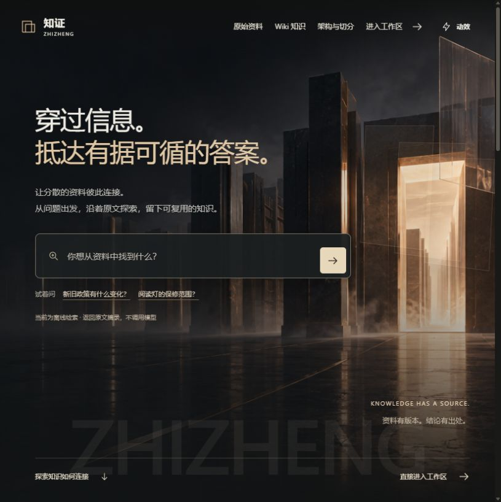
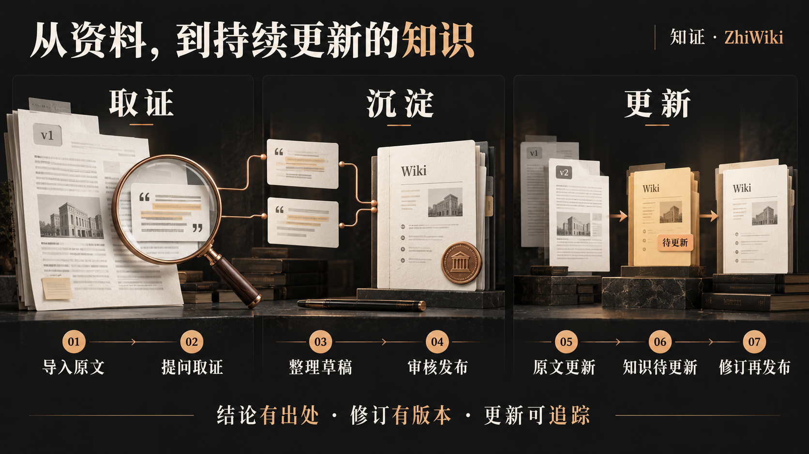
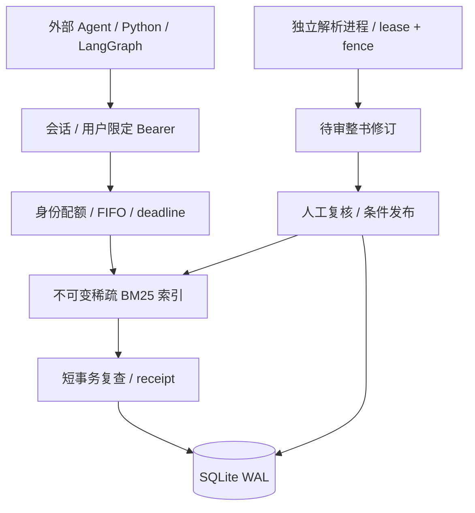

<div align="center">

# 知证 · ZhiWiki

### 让 Agent 取得有权限、有版本、可回读的证据。

**团队 RAG API · 原生书籍导入 · 版本化 Wiki**

[](https://github.com/kayaduster607-jpg/zhiwiki/actions/workflows/service-ci.yml)
[](https://github.com/kayaduster607-jpg/zhiwiki/actions/workflows/core-ci.yml)


[快速开始](#快速开始) · [Agent 接入](#agent-接入) · [工程验证](#工程验证) · [设计取舍](#设计取舍) · [部署手册](docs/TEAM_SERVICE.md)

</div>

一本书导入了一半，能不能被查到？政策改版后，旧引用还算不算有效？多个 Agent 同时调用，会排队还是直接被拒绝？

**知证把这些问题落实到版本、权限、任务和事务。** 外部 Agent 负责规划与生成，RAG 服务负责交付证据；原文更新时，依赖它的 Wiki 自动失效。适用于内部 10–20 人、单机共享知识库的研究和试运行。

项目有两个入口：独立的 `/v1` 团队证据 API，以及可演示调查、引用和 Wiki 维护的本地工作台。默认均可离线运行，团队 API 不调用模型。



<div align="center">截图为本地工作台；团队服务使用独立登录页、授权与 API。</div>

## 先用一次：从资料输入到回答、引用和Wiki

**个人演示先用8875，团队服务用8872。**它们是两套运行入口，默认数据目录与权限模型不同。

| 你输入什么 | 操作入口 | 输出 |
| --- | --- | --- |
| 示例或自己的MD/TXT/DOCX资料 | 本地导入命令/工作台上传 | 原文、分块、文档ID与修订版本 |
| 对资料的问题 | 页面提问或CLI ask | 回答、来源证据与执行状态 |
| 要整理的主题与来源 | Wiki草稿、人工修订、发布入口 | 有版本和来源依赖的Wiki页面，可导出Markdown |

### 无Key的第一次个人演示

按后文安装依赖后，从仓库根目录执行：

```powershell
python -B -m zhiwiki --config config.example.json seed
python -B -m zhiwiki --config config.example.json serve --port 8875
```

1. 打开 `http://127.0.0.1:8875`。默认offline模式不用Key，seed显式加载虚构资料与人工示例Wiki。
2. 提问“2026年退款政策与2025年有什么区别？”，再展开证据，检查原文、片段ID和版本。offline是确定性摘录流程，不等于真实模型推理效果。
3. 上传自己的小型TXT/Markdown，或运行下面的CLI导入；新建来源与更新旧来源是两种不同操作。

```powershell
python -B -m zhiwiki --config config.example.json ingest examples/documents/shipping.md
python -B -m zhiwiki --config config.example.json ask "What do the shipping documents say?"
python -B -m zhiwiki --config config.example.json wiki list
```

4. 在工作台打开Wiki，人工修订后先保存草稿，再显式发布。要观察知识失效，更新同一个source_key的原文，而不是仅增加一个相似文件名。
5. 需要文件时，先从wiki list拿到实际页面ID，再用 `wiki export <ID> --output exports/page.md`；尖括号占位符必须替换，命令不会替你自动选择页面。

**结果位置：**默认本地数据库在 `data/`，导出Markdown在你给出的路径；页面上的回答不会自动变成下载文件。团队入口还需建管理员、启动独立worker、分配知识库和只读令牌，按后文团队手册执行，不能拿个人演示入口直接替代团队服务。

## 核心能力

| 能力 | 实际行为 |
|---|---|
| 原生 PDF 导入 | HTTP 上传后返回持久 job；独立解析进程按页保存检查点，保留抽取原文、规范化文本、页码和质量标记 |
| 整书版本发布 | 待审页不进入默认检索；校订后重新复核，按 If-Match 原子切换整书版本，旧版保留 |
| 身份与库权限 | 可撤销会话/PAT、库授权与角色；查询、直接读取和 receipt 回读都重新鉴权 |
| 可追溯证据 | 返回 revision、物理 PDF 页码、字符位置、文本 SHA-256、质量提示及短期 receipt |
| 一致性校验 | 响应前在同一短事务中复查授权和全部证据并保存 receipt；更新后旧证据返回 409 |
| 并发调度 | 4 个执行槽 + 16 个 FIFO 排队位、每身份 1 个在途请求；排队包含在 2 秒截止内 |
| Agent 连接 | Python 异步客户端、LangGraph 节点、连接池、总 deadline、有界重试及幂等键 |
| Wiki 维护 | 草稿、人工复核、修订发布、Markdown 导出；来源更新与依赖失效在同一事务提交 |
| 运维 | 单 API 实例锁、租约/fence 恢复、管理员指标与审计、一致备份及校验恢复 |

文本 PDF 上限 200 MiB / 2,000 页，MD/TXT/DOCX 上限 2 MiB；每库最多 50,000 片段。检索为中文单字/双字及英文词项的 BM25，默认固定 900 字符窗口、120 字符重叠。

### 一本书从上传到可引用


缺字、空白页和低文本页会留下标记。任务处理完所有页，不代表 OCR、公式或全文都准确；扫描件和公式结构解析不在当前能力内。

### 把证据沉淀为可维护的 Wiki

本地工作台支持调查、来源展开、人工修订与发布。原文换版后，依赖旧片段的知识页进入待更新状态，历史依据仍可核对。



## 快速开始

使用 **Python 3.13**。完整服务依赖固定在仓库中，无需前端构建或 CDN。

```bash
git clone https://github.com/kayaduster607-jpg/zhiwiki.git
cd zhiwiki
python -m venv .venv
```

Windows 激活 `.\.venv\Scripts\Activate.ps1`；Linux/macOS 激活 `source .venv/bin/activate`。

### 启动团队证据 API

```bash
python -m pip install -r requirements.txt -r requirements-parser.txt
python -B -m zhiwiki.service --config config.team.example.json bootstrap admin
```

首次管理员密码交互输入，至少 12 字符，无默认密码。随后在两个终端分别运行：

```bash
# 终端 A：--local-http 仅用于本机演示
python -B -m zhiwiki.service --config config.team.example.json serve --port 8872 --local-http

# 终端 B：独立导入 supervisor
python -B -m zhiwiki.service --config config.team.example.json worker
```

打开 [http://127.0.0.1:8872](http://127.0.0.1:8872)。管理员通过受权 API 创建知识库、用户与角色，用户申请自己名下的只读令牌供 Agent 使用。团队页面提供基本登录和检索；导入、发布与授权示例见 [团队手册](docs/TEAM_SERVICE.md)。

配置使用显式 JSON，不读取 `.env`。可通过 `worker_python` 指定安装了 `pypdf==6.10.0` 的独立解析环境。

### 体验本地知识工作台

```bash
python -B -m zhiwiki --config config.example.json seed
python -B -m zhiwiki --config config.example.json serve --port 8875
```

打开 [http://127.0.0.1:8875](http://127.0.0.1:8875)，体验 16 份虚构业务原文、28 个片段和 4 页人工示例 Wiki。可以提问、展开引用、更新来源，再观察知识页进入待更新状态，详见 [三分钟演示](docs/SHOWCASE.md)。

团队入口与本地入口默认分别使用 `data-team/` 和 `data/`。团队模式关闭旧 `/api/*`；本地工作台只供回环使用，不作为多人部署入口。

## Agent 接入

外部 Agent 决定如何调查和生成答案，RAG 返回原文证据。令牌、服务地址和可访问库由调用方注入，不暴露给模型工具参数。

```python
import asyncio
import os
from zhiwiki.service.client import RagClient

async def main():
    async with RagClient("http://127.0.0.1:8872", os.environ["ZHIWIKI_TOKEN"]) as rag:
        found = await rag.retrieve("退货运费如何确定？", ["你的知识库ID"])
        if not found["evidence"]:
            return found
        read = await rag.read(
            [found["retrieval_id"]],
            [item["evidence_id"] for item in found["evidence"]],
        )
        valid = await rag.validate([read["retrieval_id"]], [
            {"evidence_id": item["evidence_id"], "text_sha256": item["text_sha256"]}
            for item in read["evidence"]
        ])
        return {"evidence": read["evidence"], "validation": valid}

asyncio.run(main())
```

复用一个长期客户端，不逐次重建连接池。`langgraph_node(rag_client, [kb_id])` 可直接接入 StateGraph，完整示例见团队手册。客户端每调用最多 3 秒、服务端最多 2 秒；同一次逻辑调用重试保留幂等键，不自动重试权限和版本冲突。

最终回答前，外层 Agent 应再次验证实际使用的引用。`semantic_support=not_checked` 表示校验身份、版本和文本，不证明答案与原文的语义蕴含。

本地工作台可另行通过 OpenAI 兼容接口启用模型工具循环；团队 API 默认没有模型出站调用。模型配置与预算见 [接口指南](docs/TECHNICAL_GUIDE.md)。

## 设计取舍



| 选择 | 原因 | 代价与扩展条件 |
|---|---|---|
| 证据服务与生成分离 | 避免外层 Agent 再触发内部 Agent，调用次数和权限边界明确 | 综合回答由调用方负责；模型预算另设 |
| 单 API + 独立导入进程 | 查询和长时间 PDF 解析分别限流、取消及恢复 | 单机故障域；多进程前必须迁出全局协调 |
| SQLite WAL 与短事务 | 复用版本/引用事实，发布、失效和 receipt 可原子提交 | 单写者，不提供多机 HA；写等待与可用性需求决定是否迁移 |
| 持久稀疏 BM25 + NumPy | 预计算倒排贡献，查询不用在 Python 中逐个评分大量候选 | 词法召回会漏同义表达；向量/重排应通过固定 qrels 对照选型 |
| 不可变索引 + generation | 索引先准备，再切换事实指针；重启可校验加载 | 需要派生文件、磁盘水位和恢复协议 |
| Opaque token | 每次检查当前授权，支持即时撤销 | 增加 DB 授权读取；SSO/身份联邦另行设计 |

索引使用 `sparse-bm25-v1`，SQLite 保存小端倒排数组与元数据，文件以 SHA-256 命名；不使用 pickle。元数据过滤在 top-k 前执行，多库使用 RRF 融合。默认不缓存查询结果。

### 与现成方案的定位

按2026-10-16官方资料核对，下面比较功能范围与交付方式，没有做跨产品准确率或吞吐量排名。

| 方案 | 官方能力与定位 | 知证的取舍 |
|---|---|---|
| [Dify](https://github.com/langgenius/dify) | 可视化工作流、RAG、模型管理、Agent和应用API | 团队入口只承担证据服务，部署与代码范围更小；完整应用编排和模型生态覆盖面有限 |
| [RAGFlow](https://github.com/infiniflow/ragflow) | 深度文档处理、OCR、多路召回/重排、Agentic检索及Wiki等知识编译 | 仅文本PDF和词法BM25，复杂版式、扫描件与语义召回存在明显差距；Wiki并非本项目独有能力 |
| [LangChain检索组件](https://docs.langchain.com/oss/python/deepagents/retrieval) | 可组合加载、切分、检索与Agent工具 | 本项目把库授权、版本发布、receipt、背压与恢复落实成可运行的服务；检索组件生态规模较小 |

知证的工程价值在于能从代码与测试追到**权限检查点、版本切换、引用有效性和资源归还**。如果目的是直接使用完整平台，应结合成熟方案的能力与部署要求评估；本项目没有“效果优于市面产品”的验证结论。

### 20 人同时用，具体指什么

容量内验收使用 **20 个授权身份各同时提交 1 个请求，全部按时成功**；429/503 不能计作成功。还分别测试 20 个任务各执行 3/6 次工具调用。

默认每身份 30 rpm、突发 6 次；全局 120 rpm、突发 120 次。执行槽只有 4 个，其余请求有界排队；超时或客户端断开后，线程真实结束才归还运行槽。20 人在线不代表可持续每秒产生 20 个请求，持续负载口径为总 1 req/s。

## 工程验证

| 验证 | 证据与边界 |
|---|---|
| 完整回归 | **226 项 Python + 68 项 JavaScript 通过**；覆盖权限、引用竞态、条件发布、worker fencing、取消、恢复与界面状态 |
| 真实书籍 | 《动手学深度学习》文本 PDF 531 页通过原生 HTTP 导入和整书发布，8 组检索/回读/校验；93 页缺字标记保留 |
| Agent 连接 | 两个真实 LangGraph 图共享 20 连接池，通过回环 HTTP 完成 6 步调用；跨用户 receipt 返回 403，见 [记录](reports/team-agent-http.json) |
| 20 人并发 | 50,000 合成片段下，10 轮同步突发 **200/200 成功**；20 任务的 3/6 步工具链分别 **60/60、120/120 成功** |
| 持续负载 | 总 1 req/s、30 分钟：**1,799/1,800 成功**，1 次 504；P95 35.5 ms、P99 56.0 ms，达到本轮 ≥99% SLO，超时完整保留。过载和公平性详见 [完整验收](docs/TEAM_ACCEPTANCE.md) |
| 备份恢复 | SQLite 一致快照、文件哈希、数据库完整性验证，以及恢复后认证检索；耗时随验收报告保存 |

```bash
python -m pip install -r requirements-dev.txt
python -B -m pytest -q -p no:cacheprovider
node --test tests/*.cjs

# 使用新目录，实际执行 30 分钟持续阶段及独立突发/公平性阶段
python -B scripts/verify_team_capacity.py --data-dir data-team-verification --fragments 50000 --seconds 1800
```

完整服务 CI 在 Python 3.13 安装固定依赖后运行 pytest/LangGraph 契约测试；另有 Python 3.9/3.13 标准库核心兼容性工作流。远端结果以 Actions 为准。

容量 fixture 与真实书籍分开验证，不以健康检查 QPS 或合成语料结果代替回答质量。旧本地检索缓存的微基准和 qrels 工具仍可复现，见 [检索基准](reports/showcase-retrieval-benchmark.json) 与 [评测设计](docs/EVALUATION.md)。

## 部署范围

当前是一份**单机内部团队实现**：固定一个 workspace、按知识库隔离、一个 API 实例，不提供 SSO、多租户 SaaS、多主机 HA、向量召回、重排或 OCR。真实模型质量与 Agent 收益尚未验证。

团队开放前需要实际域名/TLS、受控备份位置与调度，并在目标主机复验。应用默认仅监听回环地址，正常部署保留 Secure cookie，配置 `allowed_hosts`，禁止直接增加 Uvicorn workers。

目录默认 10 GiB 准入水位，不替代文件系统硬配额；原文、修订和审计不自动删除。短期 receipt/幂等记录按 TTL 过期。原始书籍、运行数据库、密码和令牌不随仓库分发，项目不读取 `.env`。

## 文档导航

| 目的 | 文档 |
|---|---|
| 启动、授权、上传、发布与灾备 | [团队部署与 Agent 接入](docs/TEAM_SERVICE.md) |
| 请求、响应、错误与幂等语义 | [RAG API 契约](docs/RAG_API_CONTRACT.md) · 登录后 `/v1/openapi.json` |
| 需求及验收目标 | [团队服务 PRD](docs/PRD_RAG_SERVICE.md) · [实际验收](docs/TEAM_ACCEPTANCE.md) |
| 本地工作台演示与知识维护 | [三分钟演示](docs/SHOWCASE.md) · [Wiki 修订](docs/WIKI_REVISIONS.md) |
| 业务核心、检索与评测 | [架构](docs/ARCHITECTURE.md) · [检索](docs/RETRIEVAL.md) · [评测](docs/EVALUATION.md) |

实现入口：`zhiwiki/service/` 为团队边界；`engine.py`、`store.py`、`compiler.py` 为工作台与知识核心；`tests/`、`scripts/` 保存测试与复现工具。

欢迎通过 [Issues](https://github.com/kayaduster607-jpg/zhiwiki/issues) 提交具体资料与负载场景。向量、重排、多工作区和 SSO 等扩展应同时补充权限、一致性与评测证据。
