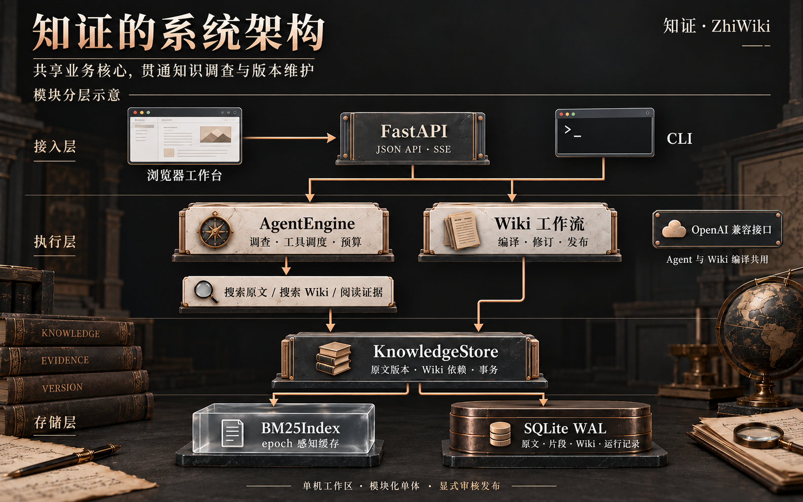

<div align="center">

# 知证 · ZhiWiki

### 把散落的资料，变成可追溯、可维护的知识。

**Agentic RAG × 版本化 Wiki × 本地知识工作台**

An evidence-first knowledge workspace that connects answers, sources, and revisions.

[](https://github.com/kayaduster607-jpg/zhiwiki/actions/workflows/core-ci.yml)


[为什么做知证](#为什么做知证) · [功能亮点](#功能亮点) · [快速体验](#快速体验) · [工程验证](#工程验证) · [⭐ Star](https://github.com/kayaduster607-jpg/zhiwiki/stargazers)

</div>

一份售后政策改了，哪些答案还可以用？哪些知识页需要重审？

**知证围绕“答案的来处”和“知识的变化”组织工作流。** Agent 沿着原文调查问题，把有用结论整理为带引用的 Wiki；原文形成新版本时，相关页面自动标记为待更新，保留历史，等待重新核对。


<div align="center">

**沿证据调查 · 将结论沉淀 · 让更新可追踪**

</div>

## 为什么做知证

企业政策、产品手册、客服规范和个人研究资料都在持续变化。找到一段相关文字只是起点，真正反复发生的工作是：**核对依据、整理结论、发现过时内容，再把知识更新回来。**

| 你会遇到的情况 | 知证怎样处理 |
| --- | --- |
| 一个问题涉及政策、费用和例外条款 | Agent 可继续搜索原文、查 Wiki、阅读证据，公开展示取证步骤 |
| 答案看起来合理，但需要检查依据 | 从引用回到原文版本和具体字符位置，核对完整上下文 |
| 同一问题被反复查询、反复整理 | 将结论保存为带来源的 Wiki，支持修订、发布与 Markdown 导出 |
| 政策改了，旧知识仍留在知识库里 | 更新原文时，在同一事务中使依赖页面失效，并将其移出有效 Wiki 检索 |
| 两个编辑窗口先后修改同一页面 | 校验预期版本，冲突返回 409，保留编辑内容供比较 |

### 从一条政策，走完一次知识更新

以仓库自带的虚构售后场景为例，你可以实际操作这条流程：


**每个结论都能展开来源，每次修订都留下版本。** 原文更新、Wiki 状态和人工发布共同构成知识维护的闭环。

## 功能亮点

### 01 · 沿着证据继续调查

接入支持工具调用的模型后，Agent 根据已取得的资料决定下一步操作。应用提供三个职责明确的只读工具：

| 工具 | 作用 |
| --- | --- |
| `search_documents` | 在当前原文片段中检索线索 |
| `search_wiki` | 检索有效的已发布知识，并带回底层来源 |
| `read_evidence` | 阅读指定证据，检查内容与当前有效状态 |

执行记录展示工具、参数、命中来源、用量和停止原因。轮次、工具次数、上下文、输出、累计 Token 与时间预算约束整个循环；同时保留固定 RAG 基线，便于在相同资料上做对照。

### 02 · 回答与依据，一起交付

引用保留**原文版本、片段 ID 和字符定位**。问答、Wiki 详情和导出都围绕这条来源链组织，方便核对适用条件与原文含义。

下面是实际运行中展开 Wiki 引用的界面：


### 03 · 让知识跟得上原文变化

原文与 Wiki 分别版本化，依赖关系落实到具体原文片段。更新资料后：

- 同一来源形成新版本，旧正文与旧片段保留。
- 依赖旧版本的 Wiki 标记为待更新，退出有效 Wiki 检索。
- 维护者重新核对结论与引用，保存新草稿，再显式发布。

**原文更新与依赖失效在同一 SQLite 写事务中提交。** 页面历史仍可查看，过时依据有迹可循。

### 04 · 把结论沉淀成可维护的 Wiki

从资料整理草稿，逐条改写结论、选择引用、记录维护备注，再发布为知识页。每次保存创建新的修订，已有发布版在仍然有效时继续可用。

支持草稿、已发布、待更新与归档历史；内置知识状态检查和 Markdown 导出。上传同名文件默认创建独立来源，只有明确选择更新目标时才产生下一版。

<details>
<summary><strong>展开真实运行截图：Wiki 知识库与知识调查</strong></summary>

#### Wiki 知识库


#### 知识调查


截图于 2026-10-15 从本地运行服务截取。所用资料为仓库内置虚构样例，示例 Wiki 为人工整理；模型服务可按下方配置接入。

</details>

### 05 · 轻量运行，也有完整的工程链路

**一个 Python 服务进程、一份 SQLite 数据库、原生浏览器界面。** 前端无需 npm 构建或 CDN，本地即可完成导入、检索、修订、发布和来源核对。

| 层次 | 实现 |
| --- | --- |
| 使用入口 | 浏览器工作台、HTTP API、CLI 共用业务核心 |
| 资料接入 | UTF-8 Markdown、TXT、DOCX 正文；显式新增与版本更新 |
| 检索 | 中文单字/双字与英文词项 BM25、标题加权、词法锚点过滤 |
| 分块 | 默认 900 字符窗口、120 字符重叠；提供结构切分预览 |
| 状态持久化 | SQLite WAL 保存原文、片段、Wiki 修订、依赖与查询轨迹 |
| 索引维护 | 内存 BM25 索引复用，数据库 epoch 变更时重建 |
| 交互反馈 | SSE 执行步骤、来源展开、版本冲突反馈与键盘提问入口 |

## 快速体验

推荐使用 **Python 3.13**。安装依赖后，即可从内置样例开始，无需先准备自己的资料或模型密钥。

```bash
git clone https://github.com/kayaduster607-jpg/zhiwiki.git
cd zhiwiki
python -m venv .venv
```

激活环境：

```powershell
# Windows PowerShell
.\.venv\Scripts\Activate.ps1
```

```bash
# Linux / macOS
source .venv/bin/activate
```

启动知识空间：

```bash
python -m pip install -r requirements.txt
python -B -m zhiwiki --config config.example.json seed
python -B -m zhiwiki --config config.example.json serve --port 8875
```

打开 **[http://127.0.0.1:8875](http://127.0.0.1:8875)**。

你会得到 **16 份虚构业务原文、28 个片段、4 页人工示例 Wiki**，可以直接浏览、提问、展开引用、修改资料和体验知识失效。重复载入样例不会覆盖已有手工修订。

### 建议先试这三个问题

> 对比 2025 和 2026 版售后政策，质量问题换货窗口有什么变化？
>
> 质量问题换货的运费由谁承担？需要准备什么凭证？
>
> 星舟阅读灯保修期多长，人为摔坏是否免费保修？

接着打开任意 Wiki，展开原文引用；再通过“更新已有资料”修改其来源，观察关联知识如何进入待更新状态。更完整的操作路径见 [三分钟演示](docs/SHOWCASE.md)。

### 连接你的模型

复制 `config.example.json` 为 `config.local.json`，修改以下字段，其余预算设置可保留：

```json
{
  "provider": "openai",
  "base_url": "https://your-service.example/v1",
  "model": "your-model-id",
  "api_key_env": "RAG_API_KEY"
}
```

服务需支持 Chat Completions 的 `tools` / `tool_choice`；客户端在 `base_url` 后追加 `/chat/completions`。在 IDE 运行配置或启动进程的环境变量中设置 `RAG_API_KEY`，然后启动：

```bash
python -B -m zhiwiki --config config.local.json serve --port 8875
```

原文和修订保存在本机；模型调用会将相关上下文发送给你配置的服务。密钥不写入 JSON，项目不加载 `.env`，本机配置已加入 Git 忽略规则。

## 系统架构



模块化单体让问答与知识维护共享数据规则：`AgentEngine` 管理取证循环，`KnowledgeStore` 管理版本与事务，`WikiCompiler` 组织草稿，发布由维护者显式执行。检索缓存、模型适配与 HTTP 层各有独立边界，方便单独测试和替换。

## 工程验证

### 检索优化有可复现的数字

**同一批查询，检索结果一致；暖缓存路径将每次查询的 SELECT 从 257 次降到 1 次。**

| 路径 | 每次查询 SELECT | 检索中位耗时 |
| --- | ---: | ---: |
| 旧路径：N+1 读取与逐查询重分词 | 257 | 53.897 ms |
| 索引冷路径 | 4 | 54.651 ms |
| 索引暖路径 | **1** | **3.299 ms** |

在这次本地微基准中，暖路径相对旧路径约为 **16.3×** 的检索速度。测试于 2026-10-16 在 Windows / Python 3.13.14 上重跑，使用 64 份合成文档、256 个片段，每条路径 12 次测量；数字对应检索环节。原始逐次结果、计量方法与一致性检查见 [本次报告](reports/showcase-retrieval-benchmark.json)，设计原理见 [检索文档](docs/RETRIEVAL.md)。

```bash
python -B scripts/benchmark_retrieval.py --output reports/local-retrieval-benchmark.json
```

### 261 项本地自动化测试

最近一次完整本地回归：**193 项 Python 测试 + 68 项 JavaScript 测试通过**（2026-10-15）。GitHub Actions 持续运行 Python 3.9 / 3.13 核心兼容性与前端状态检查。

| 覆盖方向 | 关注的实际问题 |
| --- | --- |
| 版本与事务 | 幂等导入、来源失效、修订冲突、写入失败回滚 |
| Agent 执行 | 多轮工具协议、预算、未知工具与无效引用 |
| 检索缓存 | 缓存复用、跨实例 epoch 变化、返回对象隔离 |
| HTTP / SSE | 输入边界、执行槽位、断连与步骤事件 |
| 浏览器状态 | 迟到响应、页面切换、引用选择与切分预览竞争 |

```bash
python -m pip install -r requirements-dev.txt
python -B -m pytest -q -p no:cacheprovider
node --test tests/*.cjs
```

### 可继续扩展的评测工具

提供独立的 **8 份虚构语料、dev/holdout 各 12 题**，保存 qrels、文件哈希、检索指标和匿名人工复核包，便于对照固定基线与 Agent 策略。

```bash
python -B scripts/run_evaluation.py --split all --retrieval-only --output reports/local-retrieval.json
```

评测入口、评分维度与真实模型调用方式见 [评测设计](docs/EVALUATION.md)。

## 深入阅读

| 想了解什么 | 从这里开始 |
| --- | --- |
| 快速看懂产品与完整演示 | [产品需求](docs/PRD.md) · [三分钟演示](docs/SHOWCASE.md) |
| 看懂版本、依赖和事务设计 | [系统架构](docs/ARCHITECTURE.md) · [Wiki 人工修订](docs/WIKI_REVISIONS.md) |
| 研究检索性能与分块策略 | [BM25 与索引缓存](docs/RETRIEVAL.md) · [文档切分](docs/CHUNKING.md) |
| 接入模型、CLI 或自己的应用 | [配置与接口指南](docs/TECHNICAL_GUIDE.md) · 运行服务的 `/openapi.json` |
| 复现与扩展实验 | [评测设计](docs/EVALUATION.md) · [基准报告](reports/showcase-retrieval-benchmark.json) |

<details>
<summary><strong>代码导航</strong></summary>

```text
zhiwiki/
├── engine.py          # Agent 循环、工具调度与预算
├── provider.py        # OpenAI 兼容 HTTP 调用
├── store.py           # SQLite、版本与事务
├── retrieval.py       # 分词、BM25 与字符分块
├── search_index.py    # epoch 感知索引缓存
├── chunking.py        # 结构切分预览
├── compiler.py        # Wiki 草稿组织
├── api.py             # HTTP 与工作台装配
├── cli.py             # 命令行入口
└── web/               # 原生浏览器界面
examples/              # 虚构业务资料与评测集
tests/                 # Python 与 Node 测试
scripts/               # 验收、基准与评测
docs/                  # 技术文档与真实运行截图
```

</details>

<details>
<summary><strong>运行范围与评测说明</strong></summary>

当前定位是单机、单工作区的知识工作台，完整服务已在 Windows / Python 3.13.14 实际运行；Linux/macOS 提供启动入口，CI 验证标准库核心与前端状态。公网使用、多租户和权限管理需要额外设计。

默认样例流程无需模型密钥；接入模型后启用模型工具决策与综合回答。工具协议通过脚本模型与 Mock HTTP 测试，真实模型的答案质量与 Agent 收益应在目标资料上独立评测。`completed` 表示执行与结构性引用检查完成，语义支持仍需复核；最终引用按条检查，尚未提供所有引用的原子快照核验。SSE 传输执行步骤与最终结果。

当前检索基于 BM25；结构分块提供预览，尚未替换持久化导入默认策略。检索微基准用于比较本地实现路径，不代表模型回答时延或生产并发容量。

数据持久化在 `data/knowledge.sqlite3`。备份使用 SQLite backup API，或停服后复制数据库并妥善处理 WAL。运行数据库、书籍内容和本机配置不随仓库分发。

</details>

## 一起把知识维护做得更好

欢迎通过 [Issues](https://github.com/kayaduster607-jpg/zhiwiki/issues) 分享使用场景、复现问题和改进建议，也欢迎围绕下面的方向提交 PR：

- **检索能力**：向量召回、混合检索、Reranker 与业务评测。
- **知识维护**：版本差异展示、来源变更提示与引用一致性增强。
- **使用范围**：多工作区、身份权限与团队协作；初步方案见 [多人服务 PRD](docs/PRD_RAG_SERVICE.md)。

<div align="center">

**如果你也在做有据可查、持续更新的 AI 知识库，欢迎点个 [⭐ Star](https://github.com/kayaduster607-jpg/zhiwiki)。**

也欢迎跑一遍“原文更新 → 知识失效 → 修订发布”，看看你希望它下一步解决什么问题。

</div>
