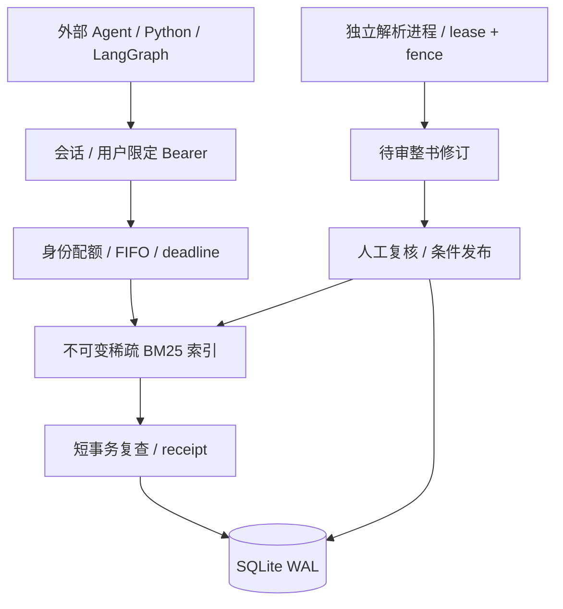

# ZhiWiki · 可回读、可维护的知识证据

[简体中文](README.md) | [English](README.en.md)

让文档不止“被搜到”：回答带可回读的片段，Wiki 保留版本和来源依赖，原文更新后能识别需要重新审阅的知识页。团队接口进一步把知识库权限、只读令牌、检索回读和引用校验放在服务边界内。

第一次可运行**无 Key 的本地工作台**，观察资料、问答与 Wiki 的完整关系；需要多人授权和外部 Agent 接入时，再启动独立团队服务。两个入口使用不同端口和数据目录。

[本地体验](#本地体验从资料到引用) · [Wiki 输出](#把结果保存为可维护的-wiki) · [团队服务](#启动团队证据服务) · [Agent 接入](#agent-接入) · [文档](#文档导航)

## 本地体验：从资料到引用

准备 Python 3.13。在 Windows PowerShell：

```powershell
git clone https://github.com/kayaduster607-jpg/zhiwiki.git
cd zhiwiki
python -m venv .venv
.\.venv\Scripts\python.exe -m pip install -r requirements.txt -r requirements-parser.txt
.\.venv\Scripts\python.exe -B -m zhiwiki --config config.example.json seed
.\.venv\Scripts\python.exe -B -m zhiwiki --config config.example.json serve --port 8875
```

打开 [http://127.0.0.1:8875](http://127.0.0.1:8875)。默认 offline 模式不使用模型 Key，seed 加载虚构业务资料和人工 Wiki 示例：

1. 提问“2026年退款政策与2025年有什么区别？”。
2. 展开证据，检查来源原文、片段 ID 和版本；offline 返回确定性摘录，不展示真实模型推理效果。
3. 上传自己的小型 TXT / Markdown，或在另一个终端运行导入：

```powershell
.\.venv\Scripts\python.exe -B -m zhiwiki --config config.example.json ingest examples/documents/shipping.md
.\.venv\Scripts\python.exe -B -m zhiwiki --config config.example.json ask "What do the shipping documents say?"
```

4. 再问文件直接覆盖的问题，检查证据能回到对应片段。导入新文档和更新同一 source_key 的旧文档不同，只有更新同一来源才能观察已有知识依赖失效。

## 把结果保存为可维护的 Wiki

在工作台创建 / 打开 Wiki，编辑后先保存草稿，再明确发布。Wiki 记录内容版本及来源关系，原文变化后需要重新审阅，而不是悄悄把旧页当作仍然有效。

```powershell
.\.venv\Scripts\python.exe -B -m zhiwiki --config config.example.json wiki list
```

从列表复制实际页面 ID，再运行 `wiki export <ID> --output exports/page.md`，替换尖括号占位符。输出是 Markdown 文件；页面上的一次回答不会自动变成下载文件。

| 输入 / 操作 | 结果 | 默认位置 |
| --- | --- | --- |
| 导入原文 | 文档 ID、块与版本 | 本地 data 下数据库 |
| 提问 / 检索 | 回答或证据及执行状态 | 页面 / 终端 |
| 编辑并发布 Wiki | 版本化知识页与来源依赖 | 本地数据库 |
| Wiki export | Markdown | 指定的 output 路径 |

## 启动团队证据服务

团队入口面向权限与 Agent，默认数据在 `data-team/`；本地工作台默认 `data/`，两者不能直接互换为多人部署。

在已安装依赖的环境中创建管理员：

```powershell
.\.venv\Scripts\python.exe -B -m zhiwiki.service --config config.team.example.json bootstrap admin
```

交互输入至少 12 字符的密码，没有默认管理员密码。然后在两个终端分别运行：

```powershell
# 终端 A；local-http 仅用于本机体验
.\.venv\Scripts\python.exe -B -m zhiwiki.service --config config.team.example.json serve --port 8872 --local-http
```

```powershell
# 终端 B；独立导入 Worker
.\.venv\Scripts\python.exe -B -m zhiwiki.service --config config.team.example.json worker
```

访问 [http://127.0.0.1:8872](http://127.0.0.1:8872)，按 [团队手册](docs/TEAM_SERVICE.md)创建知识库、用户、角色并导入发布资料。用户申请自己名下的只读令牌给 Agent；团队模式关闭旧 `/api/*`，不能照搬本地工作台接口。

## 为什么把检索和回读分开

检索结果标识“找到了什么”，回读确认当前文本，最终校验检查证据身份、版本和哈希。权限或原文版本发生变化时，外层 Agent 需要重新确认实际使用的来源。

因此团队 API 的职责是提供受控证据，而非替外层 Agent 决定所有调查步骤；`semantic_support=not_checked` 只说明尚未证明回答与原文的语义支持关系。


## Agent 接入

外部 Agent 决定如何调查和生成答案，RAG 返回原文证据。令牌、服务地址和可访问库由调用方注入，不暴露给模型工具参数。

```python
import asyncio
import os
from zhiwiki.service.client import RagClient

async def main():
    async with RagClient("http://127.0.0.1:8872", os.environ["ZHIWIKI_TOKEN"]) as rag:
        found = await rag.retrieve("退货运费如何确定？", ["你的知识库ID"])
        if not found["evidence"]:
            return found
        read = await rag.read(
            [found["retrieval_id"]],
            [item["evidence_id"] for item in found["evidence"]],
        )
        valid = await rag.validate([read["retrieval_id"]], [
            {"evidence_id": item["evidence_id"], "text_sha256": item["text_sha256"]}
            for item in read["evidence"]
        ])
        return {"evidence": read["evidence"], "validation": valid}

asyncio.run(main())
```

复用一个长期客户端，不逐次重建连接池。`langgraph_node(rag_client, [kb_id])` 可直接接入 StateGraph，完整示例见团队手册。客户端每调用最多 3 秒、服务端最多 2 秒；同一次逻辑调用重试保留幂等键，不自动重试权限和版本冲突。

最终回答前，外层 Agent 应再次验证实际使用的引用。`semantic_support=not_checked` 表示校验身份、版本和文本，不证明答案与原文的语义蕴含。

本地工作台可另行通过 OpenAI 兼容接口启用模型工具循环；团队 API 默认没有模型出站调用。模型配置与预算见 [接口指南](docs/TECHNICAL_GUIDE.md)。


## 设计取舍



| 选择 | 原因 | 代价与扩展条件 |
|---|---|---|
| 证据服务与生成分离 | 避免外层 Agent 再触发内部 Agent，调用次数和权限边界明确 | 综合回答由调用方负责；模型预算另设 |
| 单 API + 独立导入进程 | 查询和长时间 PDF 解析分别限流、取消及恢复 | 单机故障域；多进程前必须迁出全局协调 |
| SQLite WAL 与短事务 | 复用版本/引用事实，发布、失效和 receipt 可原子提交 | 单写者，不提供多机 HA；写等待与可用性需求决定是否迁移 |
| 持久稀疏 BM25 + NumPy | 预计算倒排贡献，查询不用在 Python 中逐个评分大量候选 | 词法召回会漏同义表达；向量/重排应通过固定 qrels 对照选型 |
| 不可变索引 + generation | 索引先准备，再切换事实指针；重启可校验加载 | 需要派生文件、磁盘水位和恢复协议 |
| Opaque token | 每次检查当前授权，支持即时撤销 | 增加 DB 授权读取；SSO/身份联邦另行设计 |

索引使用 `sparse-bm25-v1`，SQLite 保存小端倒排数组与元数据，文件以 SHA-256 命名；不使用 pickle。元数据过滤在 top-k 前执行，多库使用 RRF 融合。默认不缓存查询结果。

### 与现成方案的定位

按2026-10-16官方资料核对，下面比较功能范围与交付方式，没有做跨产品准确率或吞吐量排名。

| 方案 | 官方能力与定位 | 知证的取舍 |
|---|---|---|
| [Dify](https://github.com/langgenius/dify) | 可视化工作流、RAG、模型管理、Agent和应用API | 团队入口只承担证据服务，部署与代码范围更小；完整应用编排和模型生态覆盖面有限 |
| [RAGFlow](https://github.com/infiniflow/ragflow) | 深度文档处理、OCR、多路召回/重排、Agentic检索及Wiki等知识编译 | 仅文本PDF和词法BM25，复杂版式、扫描件与语义召回存在明显差距；Wiki并非本项目独有能力 |
| [LangChain检索组件](https://docs.langchain.com/oss/python/deepagents/retrieval) | 可组合加载、切分、检索与Agent工具 | 本项目把库授权、版本发布、receipt、背压与恢复落实成可运行的服务；检索组件生态规模较小 |

知证的工程价值在于能从代码与测试追到**权限检查点、版本切换、引用有效性和资源归还**。如果目的是直接使用完整平台，应结合成熟方案的能力与部署要求评估；本项目没有“效果优于市面产品”的验证结论。

### 人同时用，具体指什么

容量内验收使用 **20 个授权身份各同时提交 1 个请求，全部按时成功**；429/503 不能计作成功。还分别测试 20 个任务各执行 3/6 次工具调用。

默认每身份 30 rpm、突发 6 次；全局 120 rpm、突发 120 次。执行槽只有 4 个，其余请求有界排队；超时或客户端断开后，线程真实结束才归还运行槽。20 人在线不代表可持续每秒产生 20 个请求，持续负载口径为总 1 req/s。


## 工程验证

| 验证 | 证据与边界 |
|---|---|
| 完整回归 | **226 项 Python + 68 项 JavaScript 通过**；覆盖权限、引用竞态、条件发布、worker fencing、取消、恢复与界面状态 |
| 真实书籍 | 《动手学深度学习》文本 PDF 531 页通过原生 HTTP 导入和整书发布，8 组检索/回读/校验；93 页缺字标记保留 |
| Agent 连接 | 两个真实 LangGraph 图共享 20 连接池，通过回环 HTTP 完成 6 步调用；跨用户 receipt 返回 403，见 [记录](reports/team-agent-http.json) |
| 20 人并发 | 50,000 合成片段下，10 轮同步突发 **200/200 成功**；20 任务的 3/6 步工具链分别 **60/60、120/120 成功** |
| 持续负载 | 总 1 req/s、30 分钟：**1,799/1,800 成功**，1 次 504；P95 35.5 ms、P99 56.0 ms，达到本轮 ≥99% SLO，超时完整保留。过载和公平性详见 [完整验收](docs/TEAM_ACCEPTANCE.md) |
| 备份恢复 | SQLite 一致快照、文件哈希、数据库完整性验证，以及恢复后认证检索；耗时随验收报告保存 |

```bash
python -m pip install -r requirements-dev.txt
python -B -m pytest -q -p no:cacheprovider
node --test tests/*.cjs

# 使用新目录，实际执行 30 分钟持续阶段及独立突发/公平性阶段
python -B scripts/verify_team_capacity.py --data-dir data-team-verification --fragments 50000 --seconds 1800
```

完整服务 CI 在 Python 3.13 安装固定依赖后运行 pytest/LangGraph 契约测试；另有 Python 3.9/3.13 标准库核心兼容性工作流。远端结果以 Actions 为准。

容量 fixture 与真实书籍分开验证，不以健康检查 QPS 或合成语料结果代替回答质量。旧本地检索缓存的微基准和 qrels 工具仍可复现，见 [检索基准](reports/showcase-retrieval-benchmark.json) 与 [评测设计](docs/EVALUATION.md)。


## 部署范围

当前是一份**单机内部团队实现**：固定一个 workspace、按知识库隔离、一个 API 实例，不提供 SSO、多租户 SaaS、多主机 HA、向量召回、重排或 OCR。真实模型质量与 Agent 收益尚未验证。

团队开放前需要实际域名/TLS、受控备份位置与调度，并在目标主机复验。应用默认仅监听回环地址，正常部署保留 Secure cookie，配置 `allowed_hosts`，禁止直接增加 Uvicorn workers。

目录默认 10 GiB 准入水位，不替代文件系统硬配额；原文、修订和审计不自动删除。短期 receipt/幂等记录按 TTL 过期。原始书籍、运行数据库、密码和令牌不随仓库分发，项目不读取 `.env`。


## 文档导航

| 目的 | 文档 |
|---|---|
| 启动、授权、上传、发布与灾备 | [团队部署与 Agent 接入](docs/TEAM_SERVICE.md) |
| 请求、响应、错误与幂等语义 | [RAG API 契约](docs/RAG_API_CONTRACT.md) · 登录后 `/v1/openapi.json` |
| 需求及验收目标 | [团队服务 PRD](docs/PRD_RAG_SERVICE.md) · [实际验收](docs/TEAM_ACCEPTANCE.md) |
| 本地工作台演示与知识维护 | [三分钟演示](docs/SHOWCASE.md) · [Wiki 修订](docs/WIKI_REVISIONS.md) |
| 业务核心、检索与评测 | [架构](docs/ARCHITECTURE.md) · [检索](docs/RETRIEVAL.md) · [评测](docs/EVALUATION.md) |

实现入口：`zhiwiki/service/` 为团队边界；`engine.py`、`store.py`、`compiler.py` 为工作台与知识核心；`tests/`、`scripts/` 保存测试与复现工具。

欢迎通过 [Issues](https://github.com/kayaduster607-jpg/zhiwiki/issues) 提交具体资料与负载场景。向量、重排、多工作区和 SSO 等扩展应同时补充权限、一致性与评测证据。
