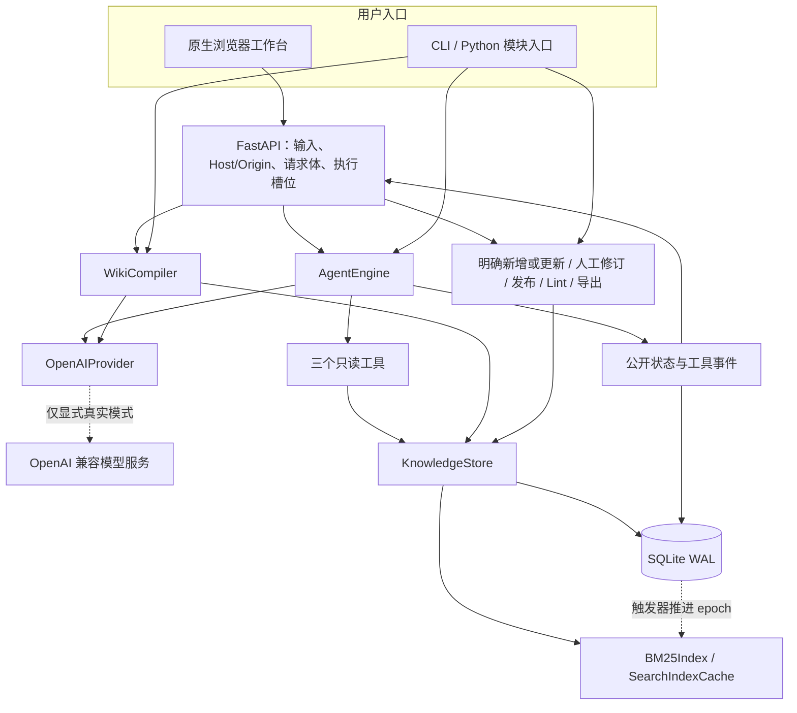
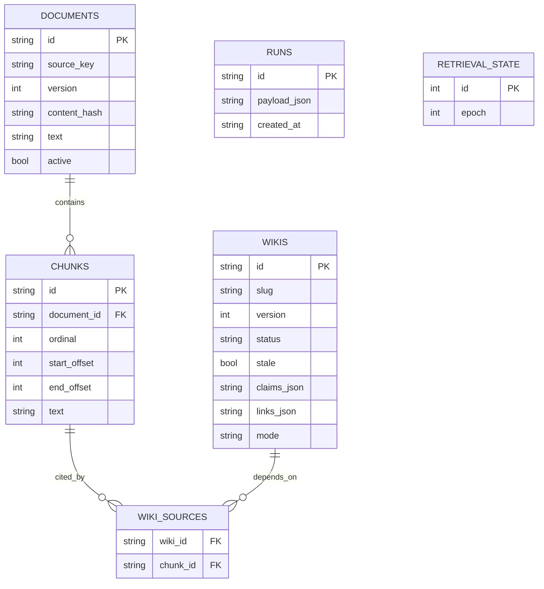
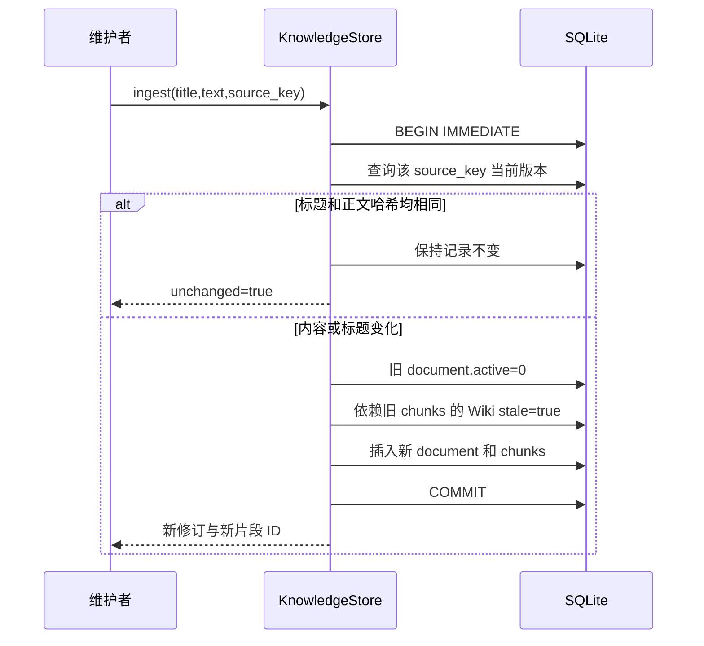
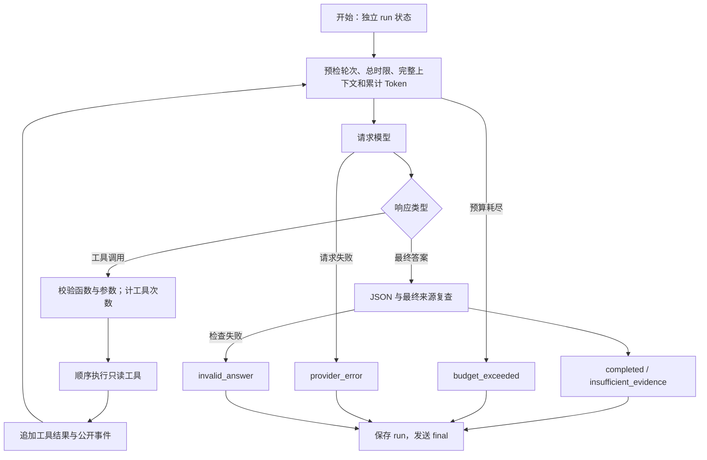

# 知证架构设计

本文描述当前代码的模块、状态与数据一致性设计。业务范围见 [PRD](PRD.md)，操作与完整参数见 [README](../README.md)，切分细节见 [CHUNKING](CHUNKING.md)，官方文档与维护方源码核查见 [STRATEGY_SOURCES](STRATEGY_SOURCES.md)。外部工程参考与本地实现需要分别核对：相同设计方向不代表使用相同组件，更不代表取得相同效果。

## 1. 架构要解决什么

知证处理两条相关但不同的流程：

1. **查询过程**：面对跨资料问题，模型需要根据已经找到的内容继续取证。应用需要知道它查了什么、为什么停止、最终引用是否有效。
2. **知识维护过程**：把结论沉淀为 Wiki 后，系统需要知道结论依赖哪些原文版本；资料更新时，关联页面需要退出有效检索并等待复核。

原文和版本是证据基础，Agent 是一次运行中的决策者，Wiki 是有来源依赖的知识修订。把这三者分开保存，可以避免生成文本回写原文，也能避免模型把自己过去生成的页面当成无需核查的事实。

当前采用模块化单体，目标是本地单工作区内可运行、可核查、便于测试的闭环。没有公网身份认证、分租户检索、后台队列或分布式执行。引入更多服务之前，先用真实资料和模型测出需要解决的瓶颈。

## 2. 模块与调用关系

| 代码模块 | 责任 | 不在该层完成的事情 |
|---|---|---|
| `api.py / api_models.py` | 路由、输入约束、业务结果与 HTTP 错误映射 | 不在路由复制 Agent 或 Wiki 生命周期逻辑 |
| `http_support.py` | 请求体/跨站边界、4 个任务槽位、同步线程到 SSE 的桥接 | 不执行模型推理，不修改资料 |
| `cli.py / diagnostics.py` | 命令解析、显式文件选择、JSON 输出与退出码；doctor 只读环境检查 | 不安装依赖，不扫描工作目录；doctor 不建库 |
| `ingest.py` | MD/TXT/DOCX 受限读取及正文转换 | 不联网补全资源，不做 PDF/OCR |
| `retrieval.py / search_index.py` | 切分兼容入口、词项/锚点、BM25Index、由数据库 epoch 失效的内存缓存 | 不做 Embedding、Reranker、持久倒排或单文档增量更新 |
| `chunking.py` | 固定窗口与结构策略的纯计算预览，保存精确 offset 与结构元数据 | 不更换持久化导入策略，不自动迁移已有片段 |
| `store.py / schema.py / conflicts.py` | 版本、Wiki 依赖、条件写入、事务、数据库 epoch 和轨迹持久化 | 不调用远端模型，不自动合并编辑冲突 |
| `engine.py` | 固定基线、Agent 循环、预算、工具参数和最终引用检查 | 不给模型业务写权限 |
| `provider.py / config.py` | 显式配置、运行时凭据、Chat Completions 适配与错误脱敏 | 不读取 dotenv，不自动更换供应商 |
| `compiler.py` | 所选原文转为有引用的草稿，独立预算 | 不自动发布，不批量递归编译全库 |
| `bootstrap.py / evaluation.py` | 明确清单的虚构演示资料与隔离问题集 | 不收集真实业务数据，不宣称样例等于业务效果 |
| `benchmarks.py` | 独立原文与题集、qrels 检索指标、哈希记录、匿名人工评分与成对汇总 | 不将参考答案入库，不用未评值冒充答案正确率 |

`create_app` 是显式应用工厂，provider 可注入脚本替身，HTTP 适配可注入 MockTransport。导入包不会启动服务或连接模型；构造 `KnowledgeStore` 才创建目录与 schema。HTTP 和模型依赖懒导入，使已有 3.9 标准库环境也能运行离线核心。

前端 `revisions.js` 管理编辑器的本地结论、引用选择与请求代次；路由将 `expected_version` 传入存储，并把共享 `ConflictError` 映射为 HTTP 409。浏览器校验用于及时反馈，真正的版本与引用约束在写事务内执行。

## 3. 数据模型：原文与结论分别版本化

### 3.1 标识符的含义

- `source_key` 表示需要持续更新的同一来源。CLI 默认解析后的绝对文件路径；浏览器新增上传生成 `upload:<uuid>:<filename>`，同名文件不会隐式归入同一来源。上传更新须指定当前 document ID 与预期版本，并沿用目标来源键；可选标题用于区分同名资料，未填时沿用更新目标标题。
- `doc_...` 标识一次原文修订，`chunk_...` 标识该修订下一个片段。新修订产生新 ID，旧记录和定位保留。
- `slug` 表示一个 Wiki 主题，`wiki_...` 标识主题的一次修订。
- `run_...` 标识一次查询。存档保留当次返回的来源快照与公开轨迹，历史 run 不会随着资料更新自动改写。

原文表的 `(source_key, version)` 唯一，部分唯一索引限制同一来源只能有一个 `active=1` 的版本。片段按 `(document_id, ordinal)` 唯一；Wiki 按 `(slug, version)` 唯一。Wiki 结论的 JSON 保存逐条引用，`wiki_sources` 保存去重后的依赖集合，便于反向失效查询。

`retrieval_state` 只保存 `id=1` 的 epoch 计数，不保存索引正文。`documents/chunks/wikis/wiki_sources` 各自的 INSERT/UPDATE/DELETE 触发器递增该值，与业务写入同事务提交；`runs` 不影响语料，不触发索引重建。初始化以写事务安装兼容旧工作区的新增表和触发器；这是一项明确兼容升级，并非通用迁移框架。

业务政策的“2025 版”与数据库 `version=2` 是不同概念。如果 2025/2026 两份政策用不同来源键导入，两者都可以是当前 v1，便于对比；是否适用于订单仍需要条款与业务条件判断。`active` 表示该来源的数据库当前修订，不表示模型已经判断法律或业务上的生效性。

### 3.2 原文完整性与偏移

`documents.text` 保存入库正文；内容哈希为该正文 UTF-8 的 SHA-256。`chunks.text` 对应 `[start_offset,end_offset)` 精确切片，定位输出为 `chars:start+1-end`。MD/TXT 是解码文本，DOCX 是正文 XML 转成的文本，HTTP 字符串经过边界规范化，因此位置需要相对 `documents.text` 解读。

片段与原文不是 Parent-Child 检索层级：当前没有“命中小块后自动返回父级章节”的恢复逻辑，也没有标题树。文档元数据参与来源追溯，不等于结构感知切分。详见 [切分设计](CHUNKING.md)。

结构策略在独立预览路径提供章节元数据，尚未写入上述数据库表。`POST /api/chunk-preview` 直接运行纯计算策略，返回原文切片与重复统计；输入上限 20,000 字符、size 200–2,000、overlap 不超过 500 且不超过 size 的一半。预览不会调用模型、创建原文版本或改变当前导入默认值，避免在没有策略迁移设计时悄然改变来源身份。

## 4. 事务与版本更新

每次操作使用独立 SQLite 连接，开启外键与 5 秒 `busy_timeout`。普通读取用事务快照；原文更新、草稿建立、发布使用 `BEGIN IMMEDIATE`。没有跨线程共享连接，也不在模型网络等待期间长时间持有数据库事务。

### 4.1 同一来源更新

标题改变也会形成修订，避免引用元数据在历史中悄然变化。失效更新会将 `draft/published` 页面状态转为 `stale`；原本 `archived` 的修订仍归档，但 `stale=true`。正文更新和 Wiki 失效原子提交，不存在应用主动安排的半更新阶段。

上传另增加明确意图：`mode=new` 采用独立来源键并要求新建；`mode=update` 在 API 核对 `target_document_id/expected_version` 后，把目标 ID 交给 `ingest` 在同一写事务再次核对当前身份。另一个更新先提交时拒绝，而不是按后来读取到的最新版本继续覆盖。JSON 原文接口和 CLI 仍允许显式稳定来源键导入；旧上传 `source_key` 参数会被拒绝，避免文件名碰撞触发隐式更新。

### 4.2 发布和原文更新相遇时

发布事务检查目标是该主题最新修订、没有 stale 标记、所有引用的原始 chunk 对应当前原文，然后归档同 slug 旧发布页并发布目标。若更新先获得写锁，发布检查看到旧来源已失效而拒绝；若发布先获得写锁，后续更新会在同一事务失效该页面。

`list_wiki()` 默认显示每个 slug 的最新修订，适合维护工作；检索读取 `published AND stale=0` 并再核验来源。两种选择规则不同，因此在旧发布页仍有效时建立新草稿，不会让线上可用知识提前消失。

异常时整笔事务回滚。Markdown 只作为导出，不承担事务事实源；导出失败不改变 Wiki 发布状态，重新导出即可恢复文件。

### 4.3 人工修订与并发编辑

`revise_wiki` 接受 base ID、必填 `expected_version`、标题和逐条原文引用。写事务内读取 base、核对该 ID/版本仍是同 slug 最新修订、检查可编辑状态与所有原始引用，再通过 `_insert_wiki_revision` 插入 `manual` 新草稿及依赖。共享小函数复用已有连接，避免检查与插入分属两笔事务。

两个编辑者从同一版本保存时，只有先提交的一次成功，后者得到 `ConflictError`。旧页面保持不变，新草稿不自动发布；stale base 可以修复，但必须替换所有失效引用。来源更新与修订仍由 SQLite 写事务排序：更新先发生则拒绝旧引用，修订先发生则随后一起失效。

`revision_note` 存在不可变 Markdown body 的明确维护段中，不新增数据库列。`_wiki` 以规范的有源正文长度和固定后缀验证后派生备注字段，避免误识别结论里的同名标记；检索候选和 Wiki 证据读取从 title/claims/mode 重建知识正文，排除备注。历史详情和导出保留备注。完整参数、异常与测试见 [WIKI_REVISIONS](WIKI_REVISIONS.md)。

## 5. 检索与证据协议

### 5.1 候选与排名

文档搜索只取得当前非空白原文片段；Wiki 搜索只取得有效发布页的有源正文。`BM25Index` 预计算词项 Counter、候选长度、词项到候选的倒排集合，并为 all/document/wiki 各自计算 DF 与平均长度。标题参与两次文本计数，这会同时影响词频和长度归一化，不应解释成最终得分严格乘二。

中文 tokenizer 生成单字与相邻双字，英文/数字保留词项并小写化。查询词去重；锚点预过滤要求命中内容词，减少仅共享通用问句词产生的结果。BM25 参数是 `k1=1.5`、`b=0.75`，分数相同用来源 ID 排序。

当前没有稠密检索后端、EmbeddingProvider、VectorIndex、RRF 或跨检索器融合。固定基线分别取得原文 top 5 与 Wiki top 3 后拼接；Agent 可按需调用两种搜索，但不是自动实现了混合向量召回。

`SearchIndexCache` 每实例保留一份索引。一次搜索先在读取事务内查询 epoch；相等时复用，不等时用同一事务中的三次批量候选查询重建。热路径 1 条 SELECT，冷路径共 4 条 SELECT，不按每个片段回读整份原文。`list_documents` 用两条 SQL 且不读取正文，单个原文证据由一次 JOIN 取得。

同实例使用 `RLock` 串行冷构建，排名在锁外运行，结果 deepcopy 防止调用方修改缓存；不同实例通过同一个数据库 epoch 感知写入。较旧事务可以返回自己的快照，但不会覆盖缓存中较新的 epoch。它是内存快照缓存，每次相关变化仍重建全部当前语料；高频写入和大语料下需要重新评估增量或持久索引。

`cache_stats()` 经 `GET /api/system/retrieval` 暴露 epoch、数据库 epoch、current、hits/misses/builds、候选与词项数量及上次构建耗时，仅含聚合信息。详细实现、官方来源和带口径的本地微基准见 [RETRIEVAL](RETRIEVAL.md)。缓存保证的是所读快照一致性，最终证据检查仍直接读库。

### 5.2 三个只读工具

| 工具 | 参数约束 | 返回内容 |
|---|---|---|
| `search_documents` | query 1–1,000 字符，limit 1–10，默认 5 | 当前原文证据列表 |
| `search_wiki` | 同上 | 有效发布页及展开的原文来源 |
| `read_evidence` | evidence_id 1–128 字符 | 指定原文或 Wiki，历史可读但 active=false |

应用记录本次取得的 ID。Wiki 命中时继续读取其 `source_ids`，将底层原文明确供给模型并纳入本次证据集合；这不是把一个未读取的来源 ID 直接当成可用引用。

统一 evidence 包含 `id,kind,title,text,source_key,version,locator,document_id,active,score`；Wiki 另有 `source_ids`，执行器附 `source_evidence`。此返回约定可用于未来适配器，但目前 `store.search` 固定调用 BM25，没有可切换 backend。

### 5.3 三层引用检查及其边界

1. **结构**：最终 JSON 字段、答案文本、引用列表和不足标志符合约定。
2. **取得范围**：每个引用 ID 必须在本次已取得集合中；数据库中真实存在也不够。
3. **当前来源**：生成结束后重新读取 active；Wiki 自身与每条原始依赖都要有效。

不持有跨模型调用的长事务，意味着检索后来源可能被别人更新。最终复查会拒绝已发生的失效，而不是使用开始时的旧快照继续宣称当前有效。该保证对应**复查读取时点**，并不承诺返回后来源永不变化；需要最新状态时应重新读取来源或查询。

上述检查不能证明生成文本被原文语义蕴含。来源中提到“7 天”不自动证明模型把期限和适用对象对应正确；答案正确率、条件完整性与引用支持率需单独评测。Lint 同样只检查版本、状态、引用和链接，不是语义矛盾识别。

## 6. Agent 状态、预算与失败

### 6.1 执行状态

同一模型响应里的多个工具调用当前顺序执行；有界循环不意味着工具并行执行。模型可连续搜索、读全文片段、再搜索，也可因证据不足直接结束。测试替身证明这些分支可执行，真实模型是否会选择合适路径需要联调评测。

`baseline` 使用原问题（工具限制下最多取前 1,000 字符）固定搜索，再调用一次无工具模型；`offline` 无论策略值为何都固定搜索并摘录，结果始终标记 `mode=offline`、`stop_reason=offline_extract`。

### 6.2 预算的计算口径

`RunBudget` 为每次查询与 Wiki 编译单独创建，不在并发请求间共享计数。

| 预算 | 实施位置 |
|---|---|
| 模型轮次 | 发送前检查，默认 6 |
| 工具次数 | 每个调用先计数，未知工具/无效参数也计数，默认 12 |
| 上下文字符 | 每轮完整 messages 加工具定义的 JSON 字符数，默认 24,000 |
| 累计 Token | 每次完整输入重新计入；本轮输出按剩余额度收紧 |
| 总时间 | `monotonic` 截止，在模型、工具及最终验证边界复查 |
| 网络与正文 | 单请求取剩余时间和请求上限较小值；逐块读正文，限制 2,000,000 字节 |

输入预检使用序列化 UTF-8 字节数加包装余量，属于保守估算。只有供应商 usage 字段齐全且内部一致才作为其报告数值；缺失或异常时，输出也估算并标记 `token_usage_known=false`。失败请求不能证明零消耗，因此记录已派发输入/输出 allowance 的估计。任何估计都不是价格结算或精确模型 tokenizer。

网络同步 I/O 无操作系统级总时限强制取消。正文慢滴流在下一到达分块时检查截止；响应头尚未返回或某个阻塞 I/O 内仍依赖 HTTPX 的分阶段超时。README 不把它描述成严格墙钟硬中断。

### 6.3 公开观察与 SSE

运行事件记录开始/结束状态、模型请求轮次、工具名称与参数、结果 ID/数量、用量标志，不索取或保存私有思维链。适配器丢弃供应商 reasoning 字段。回答失败仍保存明确状态与此前工具轨迹；未通过校验的引用不会进入可信答案列表。

HTTP 用 `queue.Queue(maxsize=64)` 将同步线程事件传给异步 SSE。4 个执行槽位是进程内保护，不是吞吐指标。`SlotLease` 幂等归还槽位：线程未启动而响应头发送失败时由 Response 清理，线程启动后由线程 finally 清理。

客户端断线触发取消标志，回调会抛出取消异常阻止后续模型/工具步骤；已经发出的同步请求不能撤销。SSE 输出状态/工具/最终事件，没有实现模型 Token 流；正常查询结果会入库，取消过程不保证产生完整 run 存档。

## 7. Wiki 编译与发布责任

编译器接受主题与当前 document IDs，读取所选原文的全部非空白片段。数量最多 12 份、20 片段，还要通过 evidence JSON 字符及完整消息预算；12 篇长文并不保证能合并编译，应按主题分批。

OpenAI 模式要求返回 `claims:[{text,evidence_ids}],links:[]`。每条结论只可引用本次提供的原始 chunk；离线模式每条仅保存带标签的原文摘录。创建草稿前再次通过存储事务检查来源当前状态，避免模型生成期间原文更新却留下可发布的旧来源草稿。

当前没有自动对全库做分层归纳、逐条蕴含判定、知识合并或冲突裁决，也不自动重建失效页。维护者可通过人工修订逐条核对结论并替换引用，或重新编译同 slug 草稿；两条路径都需显式发布。引用依赖跟踪负责告诉人“依据变了”，模型或人仍需判断“结论是否需要改变”。

显式载入演示语料另有受限的样例发布路径：`seed_workspace` 用固定 `wiki_samples.json` 中人工结论及逐字原文引用，首次建立并发布 `sample-` 页面，标记 `mode=sample`；已有页面会核对并跳过，不覆盖用户修订、不自动重发失效页。它不是模型拥有发布权限，也不是模型编译器的隐式行为。

## 8. 输入、配置与本地边界

- 文件只由用户显式选择；原路径与解析后真实路径都先拒绝 `.env*`。
- 上传在内存中解析，不提供任意磁盘路径读取；仅 MD/TXT/DOCX。DOCX 限 ZIP 条目和展开体积，正文 XML 拒绝 DTD，不加载宏或外部关系。
- 配置仅显式 JSON，拒绝未知字段；密钥在请求时由指定进程环境变量读取。
- 远端模型只允许 HTTPS；本机 loopback 可 HTTP；不跟随重定向、不默认读取系统代理配置。
- HTTP 限制 3 MiB 请求体，单文件另限 2 MiB，Host/Origin 限制帮助约束本地使用，不是用户身份验证。
- `GET /api/examples/catalog` 只返回固定 manifest 的公开元数据；实际样例载入需显式调用 `POST /api/examples` 或 CLI `seed`。
- 原文在前端以文本方式展示，避免直接执行资料中的 HTML；异步详情需要请求代次校验，防止迟到响应覆盖当前页面。

## 9. 测试边界与维护路线

存储事务、导入边界、分块偏移、预算控制、HTTP 协议与前端异步状态由确定性测试检查。脚本 provider 和 MockTransport 无需真实远程服务；隔离临时库的样例评测不修改用户实际知识库。最新通过结果见 [验收报告](ACCEPTANCE.md)，不把历史测试数当作新增功能验证。

第二领域评测将 corpus 与 dev/holdout 问题、参考答案及 qrels 分开，只导入明确原文清单。纯检索路径按原文去重计算 Recall/MRR/nDCG；生成路径分别保留两策略输出，另产生匿名人工复核包与私有映射，按 run ID 和答案 hash 核对评分。默认强制 offline，只有 `--live` 加 openai 配置允许真实调用；本轮跳过该模式。语料、问题与实现哈希有助复核版本条件，不将可见自编预留题描述为外部盲测，详见 [EVALUATION](EVALUATION.md)。

`doctor` 在创建存储之前返回环境信息，不写工作区。PowerShell 启动器优先使用显式解释器或 `RAG_PYTHON`，其次检查已有 `.venv` 和 PATH；shell 入口也只调用已有 Python。核心 CI 已定义 Python 3.9/3.13 矩阵，测试步骤无 pip/npm 安装，但尚未远端触发。定义、局部脚本校验和完整环境运行是三个不同验证范围。

维护顺序按证据推进：

1. 配置已有真实模型，验证 tool calling、结构输出和错误处理。
2. 加入独立业务问题与人工核验，比较基线与 Agent 的效果、引用、时延和费用。
3. 观察长文、跨条款和同义问法的实际失败，再决定结构感知切分或稠密检索。
4. 语料规模和写入竞争增长后，再设计索引持久化、任务队列或存储迁移。

当前没有策略版本字段和自动重分块迁移。将来调整分块/检索方案时，需要保留原文可追溯性、生成新片段身份、重建或失效关联 Wiki，并在同一问题集验证。只改变函数参数或引入新框架不能自动解决这些生命周期问题。
