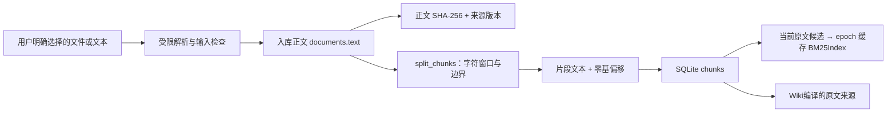

# 文档切分设计与参数解释

本文回答三个问题：当前代码到底怎样切、为什么采用这一基线、后续如何用真实问题选择参数。默认入库实现是 [`zhiwiki/retrieval.py`](../zhiwiki/retrieval.py) 的 `split_chunks`，导入入口由 [`KnowledgeStore._insert_chunks`](../zhiwiki/store.py) 调用；独立性质测试见 [`tests/test_chunking.py`](../tests/test_chunking.py)。官方文档与维护方 GitHub 依据见 [策略来源](STRATEGY_SOURCES.md)。

**默认入库是字符窗口加换行/中文句号边界调整，另有仅用于预览的结构策略。900/120 是本地基线，不是由生产数据证明的最佳配置。**结构感知、Token 切分和 Parent-Child 是不同方案，不能用相似概念代替已经实现的代码。

## 1. 切分处于数据流程的哪一层

切分的输入是**解析后、实际存入数据库的 Python 字符串**。MD/TXT 由 UTF-8 解码；DOCX 仅读取主正文 XML，将段落、换行与制表符转换成文本；HTTP JSON 字符串有首尾空白规范化。因此，片段定位承诺针对 `documents.text`，不是 Word 页码、PDF 坐标、原始文件字节或 DOCX XML 字节。

`documents` 保存原文，`chunks` 保存精确切片，是为了版本追踪与证据读取；这不构成 Parent-Child 检索。当前持久化检索没有“小块命中后自动读取父章节”的逻辑，也没有用于召回的 Markdown 标题树。预览结构元数据不等于已建立父子索引。

### 1.1 两个策略的职责

[`chunking.py`](../zhiwiki/chunking.py) 提供 `fixed/structure`，`retrieval.split_chunks` 以兼容包装调用它。默认原文导入仍为 fixed，structure 用于纯计算预览，没有切换已有片段和索引。

| 方面 | `fixed`：默认入库基线 | `structure`：结构预览实验 |
|---|---|---|
| 顶层边界 | 连续字符窗口 | ATX Markdown 标题划分章节 |
| 窗口尾部 | 换行/中文句号谁靠右选谁 | 段落优先，其次中英文句末，最后硬上限 |
| 标题 | 不建立标题路径 | 返回 `heading_path`，不拼进原文 |
| 代码围栏 | 不特殊识别 | 围栏内不认标题；保护可完整保留的块，超长块仍硬切 |
| 重叠 | 相邻块精确 overlap | 不跨章节；围栏处理可能减至 0，返回实际值 |
| 单位与定位 | 字符与原文 offset | 相同；不是 Token 或语义切分 |
| 持久化 | 当前资料按此策略入库 | 未写库、未用于现有 BM25 索引 |

### 1.2 结构策略的依据与实际步骤

依据是 [Azure 按内容结构选择切分](https://learn.microsoft.com/en-us/azure/search/vector-search-how-to-chunk-documents)、[LangChain 标题分节与节内重叠](https://docs.langchain.com/oss/python/integrations/splitters/markdown_header_metadata_splitter)、[Markdown 标题/围栏源码](https://github.com/langchain-ai/langchain/blob/master/libs/text-splitters/langchain_text_splitters/markdown.py) 及 [LlamaIndex 段落/句子/字符兜底](https://github.com/run-llama/llama_index/blob/main/llama-index-core/llama_index/core/node_parser/text/sentence.py)。本地用标准库实现这些原则，不调用其库，也不复现其 tokenizer 或效果。对应差异见 [策略来源](STRATEGY_SOURCES.md)。

扫描时保留原文行结束符，维护 1–6 级 ATX 标题栈，识别反引号和波浪号围栏；围栏里的 `#` 不开启章节。元数据中的标题可去除装饰，`text` 仍严格是原始切片，补充标题不会改变 offset。

每节独立分块，短节整体保留。若窗口上限落在稍后开始的围栏内部，当前块在围栏前结束，下一块从围栏起点开始；围栏本身超长时有界硬切。普通窗口在 `start+max(size//2,overlap)` 之后，依次选择最后一个段落末端、最后一个句末、字符上限。段落按空行识别，句末使用有限正则处理中文句末和部分英文标点、避开典型小数点，不是完整缩写和语言学分句。

章节间无重叠。章节内通常按目标 overlap 回退；围栏开始处、或回退会复制已闭围栏的一段尾部时，重叠可变成 0。返回的 `overlap_chars` 是实际重叠，不能描述为处处精确 120。

结构片段另含 `strategy,heading_path,section_start,section_end,boundary,overlap_chars`。边界原因是 `section_end/fence_start/paragraph/sentence/hard_fence/hard_limit`。没有完整支持 Setext 标题、Markdown 表格、HTML、程序 AST 或 DOCX 标题样式；超长代码仍会截开。

以下第 2–5 节解释**默认 fixed 基线**，其固定重叠性质不能直接套到 structure。

## 2. 参数与实际算法

| 参数 | 默认值 | 核心函数合法范围 | 单位 |
|---|---|---|---|
| `text` | 必填 | 必须是字符串；空字符串返回空列表 | Python Unicode 字符串 |
| `size` | `900` | 非 bool 的整数，至少 1 | Unicode code points |
| `overlap` | `120` | 非 bool 的整数，`0 <= overlap < size` | Unicode code points |
| `strategy` | `fixed` | `fixed/structure`；本节算法解释 fixed | 策略标识 |

Python 的一个 code point 不等于一个模型 Token，也不一定等于屏幕上的一个完整字符组合。一个中文字符通常是一个 code point，UTF-8 却可能占多个字节；家庭 emoji、肤色修饰和组合重音可能含多个 code points，窗口不保证避开其内部边界。

每个窗口执行以下顺序：

1. 取 `end = min(start + size, len(text))`。
2. 如果尚未到全文末尾，计算 `lower = start + max(size // 2, overlap)`。
3. 在 `[lower,end)` 中分别查找最后一个 `\n` 与最后一个 `。`。
4. 若存在分隔符，选择**位置更靠右**的一个，设置 `end = boundary + 1`；否则保留窗口末端。
5. 保存 `text[start:end]` 和起止偏移，包括非空的纯空白片段。
6. 若已到全文末尾结束；否则设置 `start = max(start + 1, end - overlap)` 继续。

默认 900/120 下，`max(450,120)=450`，因此在后半窗口找边界。通用算法使用 `max(size//2,overlap)` 是为了高重叠参数仍能保证 `end` 前进，不是对默认参数的语义优化。

换行与中文句号没有“段落优先、句子其次”的类型优先级；它们按位置竞争。单个换行即算边界，并不要求空行分段。英文句号 `.`、问号、分号、标题符号和 Markdown 表格竖线都没有特殊处理。

## 3. 三个例子

### 3.1 没有可用边界

正文长 1,650 字符，前 900 字符内没有位于后半窗口的换行或中文句号：

| 片段 | 零基右开区间 | 长度 | 与前片重叠 |
|---|---|---:|---:|
| 1 | `[0,900)` | 900 | — |
| 2 | `[780,1650)` | 870 | 120 |

两个片段都含 `[780,900)`。重叠帮助模型看到边界附近的条件，却也使这部分内容在候选和模型输入中重复。

### 3.2 窗口内有中文句号

假设第一窗口后半段最后的合法分隔符位于零基 700，则第一片结束于 701，保留该句号；第二片从 `701-120=581` 开始。切分尊重这一处局部边界，但第二片的起点不一定是句子开头，因为它仍由字符重叠计算得到。

所以“优先让尾部落在中文句号/换行”不能描述为“每片都是完整句子”。特别长的句子仍可能被硬切，跨片引用条件也需要检索与回答阶段继续核对。

### 3.3 中文句号和换行都存在

在同一搜索窗口内，若最后换行位于 650、最后句号位于 700，选择句号；若位置反过来，则选择换行。选的是靠右的分隔符，不是按文档结构选择更高层级边界。

## 4. 偏移、重叠与完整性

每个片段存储：

| 字段 | 含义 |
|---|---|
| `document_id` | 所属原文修订，更新后产生新 ID |
| `ordinal` | 原文内从 0 开始的片段顺序 |
| `text` | 与原文对应切片完全相同的文本 |
| `start_offset` | 零基、包含的起始位置 |
| `end_offset` | 零基、不包含的结束位置 |

证据展示的 `chars:1-900` 是一基闭区间，对应底层 `[0,900)`。历史修订不会被新内容覆盖，因此旧来源 ID 仍能读出当时正文和定位，只是 `active=false`。

当前函数保留纯空白窗口，避免长空白区域在分块结果中消失。合法输入满足：窗口起点和终点严格前进；片段长度不超过 size；相邻片段精确重叠 overlap 字符；每个片段等于原文同区间切片。按偏移去掉重叠后，可以逐字符重建**入库正文**。

不能直接把所有片段 `text` 相连，否则重叠内容被重复。重建应按前一个已覆盖的终点，跳过当前片段已覆盖的前缀。完整覆盖是存储性质，不表示模型需要看到所有空白内容；BM25 和 Wiki 编译器都会过滤纯空白正文片段，避免仅凭标题命中空片段或生成空结论。

导入层拒绝整篇空白正文；核心切片函数仍允许纯空白字符串，以便保持函数对任意合法字符串的一致行为。

## 5. 为什么先采用 900/120

约束是不能下载包或模型，已有环境需要可重复运行，项目还需要原文精确定位与版本依赖。字符窗口的优势是算法简单、成本可见、可在 3.9 标准库环境验证，也不依赖某个供应商 tokenizer。

| 决策 | 预期收益 | 代价与风险 |
|---|---|---|
| 900 字符窗口 | 一段政策中的条件、结果和部分例外有机会共同出现 | 可能混合不同主题；BM25 词项被更长内容稀释；一条目标信息消耗较多上下文 |
| 120 字符重叠 | 边界附近的限定词、金额条件或后续句能在相邻块重复出现 | 更多片段、更长输入；相邻命中可能高度重复 |
| 窗口后半段找边界 | 不因窗口前部出现句号就频繁切出很短片段 | 无法识别真正章节；条件与例外仍可能分开 |
| 保留精确偏移 | 引文定位、历史查证和测试可直接比对 | 入库前文本转换需要另行解释，不能伪造原文件页码 |

在没有边界调整、正文很长且忽略尾块时，重叠的近似扩张比例为 `size/(size-overlap)`。900/120 对应 `900/780≈1.154`，约多 15.4% 的片段文本；这是理想连续窗口的数学近似，**不是实际语料的存储或费用实测**。窗口因标点提前结束时，重复比例可能更高。

900 和 120 尚未经过业务参数搜索。它们不来自本项目已经完成的生产优化，也不能用外部文档常见的另一种 Token 参数为其背书。外部策略应明确标注来源、单位和本地适配差异，再由本项目的问题集验证。

## 6. 与检索和模型预算的相互影响

### BM25

每个非空白 chunk 是一个词法候选，标题文本重复两次参加计数。片段更短会让目标词在局部更集中，但适用条件可能落到相邻片段；更长有利于上下文完整，却容易把多个主题一起返回。重叠使相邻候选共享词项，当前没有专门的重叠去重或 MMR 重排。

v3 使用 `BM25Index` 和数据库 epoch 缓存复用这些计数。片段仍按默认 fixed 入库；索引缓存没有改动切片文字、offset、默认参数或来源身份。相关表变化后会在下一次读取同一快照时批量重建全部当前语料索引，热查询不重复读取正文和对语料分词。缓存减少重复计算，不能补齐边界丢失或改善语义召回；实现与基准见 [检索设计](RETRIEVAL.md)。

中文单字/双字生成和查询锚点过滤独立于切片算法。锚点要求至少命中内容词，减少通用词导致的无关召回，同时可能漏掉同义或缩略表达。当前过滤移除“是什么”“的含义”等完整问句结构，不按单字符裁剪词首尾；双字词仅在两个字均属连接字时排除，避免误删“和田”“异或”“目的”“求是”。它仍是词法规则，换窗口大小或调整停用词都不能补齐缺失的语义检索能力。

### 模型上下文

900 字符不会自动满足一个“900 Token”预算。中文 UTF-8 字节估算可能明显大于字符数，且模型输入还包含标题、来源 ID、定位、工具定义和历史对话。

`max_context_chars` 检查完整 messages 的 JSON 字符数，`max_total_tokens` 则控制累计输入输出；每轮重复发送先前工具结果都会再次占用输入预算。一个大窗口被多轮反复携带，成本影响可能比单次搜索的片段数更大。

### Wiki 编译

编译器读取所选当前原文的全部非空白片段；一次最多 12 份资料、20 片段，还需通过 evidence JSON 与完整请求预算。因而“选择数量合法”不代表“可以一次处理全部长文”。当前没有把超限资料自动摘要后继续编译的隐式降级，也没有分层 Map-Reduce 编译；应按主题缩小来源范围。

## 7. 当前参数入口和迁移要求

实际导入使用函数默认值 900/120。JSON `Settings` 没有 `chunk_size` 或 `chunk_overlap` 字段，增加未知字段会被拒绝。核心函数支持传参用于测试和预览，但这不意味着已经存在工作区级策略管理。

对已有知识库修改策略，需要处理：

1. 记录策略名称、版本、单位和参数，能解释每批片段从何而来。
2. 决定是否为同一原文创建新的切分修订，确保旧 ID 和旧引用仍可追溯。
3. 重新生成片段和检索数据，并重建或失效关联 Wiki；不能让结论指向已不存在的片段。
4. 对业务问题集重跑基线与 Agent，比较答案、引用和成本后再切换。

当前 schema 未保存独立策略版本，没有自动重分块或依赖迁移命令。修改函数默认值只影响之后新插入的片段；相同标题和哈希的幂等导入不会自动重建已有块。

工作台与 `POST /api/chunk-preview` 提供独立的 `fixed/structure` 预览。请求字段为 `text,size,overlap,strategy`，其中正文最长 20,000 字符、size 200–2,000、overlap 最多 500 且不超过 size/2；默认仍为 fixed、900、120。返回原文长度、片段数、重复字符数和完整切片。预览保留正文空白，不调用模型、不入库、不把滑块值保存为导入策略。

## 8. 怎样选择后续方案

先观察实际失败类别，再选实验变量。以下是面向持久化检索的待验证或待接入路线，结构预览已存在，但没有据此得到生产推荐参数。

| 失败表现 | 可测试的方向 | 额外维护问题 |
|---|---|---|
| 条件与例外常落在不同片段 | 调整窗口/重叠，或按可识别的段落/章节切分 | 小片段与章节长度分布、标题元数据 |
| 表格行、代码或列表被截断 | 文件类型感知解析和结构保护 | 表格/代码的定位与序列化规范 |
| 小块召回准但回答缺上下文 | 小块检索加父级上下文读取 | 父子 ID、父级长度、版本依赖与预算 |
| 跨语言或同义问法漏召回 | 真实 Embedding 与向量索引对照 | 模型来源、费用、索引更新、权限与供应商依赖 |
| 中文长文频繁达到预算 | 模型 tokenizer 计数，或按主题分批编译 | 多供应商 tokenizer 差异、估算回退路径 |

实验应固定原文版本、问题集、检索数量、模型和提示，在独立调参集选择参数，最终用未参与调参的问题核验。至少记录来源覆盖、边界条件完整性、引用支持、无答案处理、实际模型调用量与时延。只有获得对照数据后，才能把“900/120 是基线”改写成某个特定语料上有效的选择。

## 9. 已有验证与证据边界

独立切分测试覆盖短文、边界长度、中文长段落、换行/句号选择、英文句号不特殊处理、重叠边界、纯空白区域、高重叠、非法参数、存储定位与逐字符重建。它们检查算法性质，不证明任何业务检索参数最优。

切分检查和完整工程最新结果见 [验收报告](ACCEPTANCE.md)。源码、明确的输入输出与可复现性质测试，构成本文当前实现说明的依据；GitHub 工程或官方文档的策略参考需要与这些本地事实分别列出。
