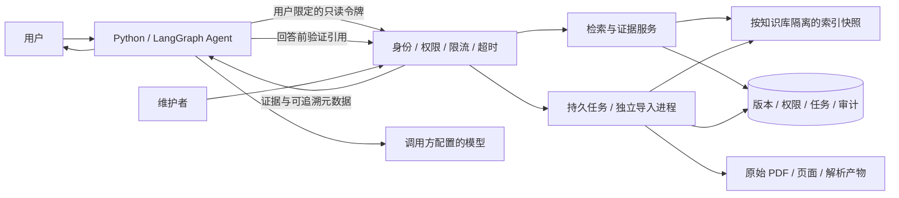

# 知证 RAG 服务产品需求文档

版本：3.0 · 日期：2026-10-16 · 状态：M1–M3 单机团队实现已交付，性能与部署边界按独立验收记录核对。

本文件定义单机团队阶段，不覆盖 [原始 PRD](PRD.md)。实现位于 `zhiwiki/service/`，接口细则见 [API 契约](RAG_API_CONTRACT.md)，启动/运维见 [团队手册](TEAM_SERVICE.md)，实测结果见 [团队验收](TEAM_ACCEPTANCE.md)。下文标为候选的指标仍是验收目标，不自动变成所有硬件上的承诺；旧 `reports/book-full-run/` 保留历史验证口径。

## 1. 已确认范围与判断

### 1.1 用户已确认

1. 先跑通真实书籍资料链路，再把多人使用与 Agent 调用需求写成 PRD。
2. 本轮不用真实模型，不采购、不安装模型，不产生模型服务调用费用。
3. 产品以独立 HTTP API 提供，兼容 Python/LangGraph 调用。
4. 第一阶段面向内部 10–20 人，单机起步，共享知识库，使用角色权限。
5. 禁止读取任何 `.env` 文件。已有知识库、原始书籍和历史文件必须保留。
6. 2026-10-15 先交付需求、契约与验证；2026-10-16 用户进一步授权按 PRD 实现、更新 README 并提交/推送 GitHub。

### 1.2 改造前基线（2026-10-15，历史）

- 当前是 FastAPI、SQLite WAL、Python BM25 的模块化单体；前端与 CLI 复用业务层。
- 原生导入仅支持 MD/TXT/DOCX，文件 2 MiB，正文 500,000 字符。PDF 页面抽取是此前单独执行的验证步骤，不是产品原生能力。
- 已有只读 Agent 工具循环、离线摘录、来源版本、Wiki 修订/发布/失效和 SSE 步骤流。
- 现有 HTTP 服务无登录和角色校验。4 个查询/编译槽位只在单个 app 实例内生效。
- 已复现最终逐条引用复查与 run 保存之间的竞态；文本 upsert 接口没有交互编辑的预期版本检查。
- 已有测试和微基准不能证明 20 人使用容量、真实答案质量或生产可用性。

### 1.3 本轮实现与范围

| 阶段 | 实现 | 验证入口 |
|---|---|---|
| M1 | 原生 PDF 持久任务、页检查点、原始/规范化文本、质量复核与校订、整书条件发布；旧工作台最终引用检查与 run 保存改为原子事务 | `tests/test_team_service.py`、`tests/test_team_failures.py`、`scripts/verify_team_book.py` |
| M2 | `/v1`、可撤销 opaque 会话/PAT、库授权/角色、用户限定 receipt、只读 Agent API、Python/LangGraph 适配；团队模式关闭 `/api/*` | 完整 HTTP 契约/权限/撤销测试与真实 StateGraph 节点调用 |
| M3 | 4 执行/20 接纳、每身份1在途、FIFO、2秒总截止、120全局突发、不可变持久稀疏索引、lease/fence、指标/审计、一致备份与校验恢复、完整服务 CI | `scripts/verify_team_capacity.py` 与独立验收记录 |
| M4 | 本轮不启用真实模型、向量、重排、OCR、公式结构解析 | 用户已明确先不用真实模型 |

固定一个 workspace，按库隔离；没有多主机 HA 或 SaaS 租户管理。每库上限50,000片段、单索引512MiB、目录默认10GiB准入水位。水位检查不替代操作系统硬配额。自动过期仅处理 receipt/幂等记录，原文/历史/审计保留；定时备份位置、TLS域名与灾备计划属于部署配置，未由代码自动决定。

### 1.4 产品判断

外部 Agent 负责规划、改写问题和生成最终回答；RAG 主接口负责按权限检索并返回可追溯证据。默认调用路径不再次启动内部 Agent，也不自动调用 LLM。保留内部调查/回答模式供独立工作台使用，但它是后续显式能力，独立计预算、授权和指标。

10–20 个用户账号不等于 20 个同时检索请求，更不等于 20 个同时模型生成任务。一个 Agent 在一次用户任务中也可能多次或并行调用检索，容量必须分别统计用户数、Agent 任务数、HTTP 到达率、在途检索数、后台任务数和供应商额度。

用户进一步明确要求20人同时使用。一期必须满足：20个授权用户各提交1个RAG请求时全部接纳并在截止时间内完成，不能用16个429来通过验收；还需验证20个Agent任务各连续调用检索、回读、引用验证的完整链路。超出约定容量后的有界拒绝属于独立的过载保护验收。

### 1.5 尚未验证、不得写成事实

目标主机硬件、内网域名/TLS 证书、真实使用频率、最终语料规模、模型接口及效果、OCR/公式解析工具、备份存储位置尚未确定。下文的容量与 SLO 是拟议验收目标和初始配置，需实测后冻结，不是当前能力承诺。公网多租户和跨主机高可用不在一期。

## 2. 产品目标与用户故事

### 2.1 目标

让 Agent 在多人共享资料中获取有权限、版本明确、可回读的证据；大文件导入、索引更新和某个用户的高频调用不应拖垮其他人的查询；失败能够被调用方识别、重试或转交人工，不能把错误包装成“没有资料”。

### 2.2 用户与需求

| 角色 | 用户故事 | 可验收结果 |
|---|---|---|
| 阅读者 | 在自己的 Agent 中查询书籍或工作资料 | 得到片段、书名、版本、PDF 物理页码和合法证据 ID |
| 编辑者 | 上传大书、查看解析失败并替换错误文本 | 上传后异步处理，错误页明确，现有查询持续可用 |
| 审核发布者 | 核对解析质量和 Wiki，决定何时启用 | 新版本准备好并显式发布后才进入默认检索 |
| 管理员 | 开通账户、分配角色、撤销令牌并恢复备份 | 越权被拒绝，操作留审计，恢复有演练记录 |
| Agent 开发者 | 稳定调用 RAG，知道超时、空结果与过载的区别 | 有版本化契约、错误码、调用示例和兼容性验收 |

### 2.3 一期完成定义

完成标准不是“能启动网页”，而是：一整本可提取文本的书经过完整处理，抽样质量检查可追踪；两个真实用户身份和一个只读 Agent 调用方按权限调用新 API；并发、更新竞态、重试、取消与恢复验收通过；独立记录模型未接入部分。

## 3. 范围与优先级

| ID | 需求 | 优先级 | 阶段 |
|---|---|---|---|
| F01 | 可恢复的大 PDF 文本提取、页码与质量报告 | P0 | 一期；先支持有文本层的 PDF |
| F02 | 书籍/文档/版本/页面/片段身份与原文回读 | P0 | 一期 |
| F03 | 按授权检索、证据读取、引用批量验证 | P0 | 一期 |
| F04 | HTTP API 与 Python/LangGraph 工具适配 | P0 | 一期；默认无 LLM |
| F05 | 账户、只读令牌、角色、知识库授权与审计 | P0 | 多人开放之前 |
| F06 | 全局与用户并发门禁、队列、预算和过载响应 | P0 | 一期 |
| F07 | 后台任务、索引代次、原子版本切换和冲突检测 | P0 | 一期 |
| F08 | 日志、指标、备份恢复与完整持续回归 | P0 | 一期发布前 |
| F09 | 扫描 PDF OCR、公式/图表结构解析 | P1 | 确定解析器与资源预算后单独验收 |
| F10 | 混合召回、向量和重排 | P1 | 根据真实漏召回样本做对照实验 |
| F11 | 内部模型回答/Agentic 调查服务 | P1 | 真实模型配置和效果验收之后 |
| F12 | 多实例、跨主机、多租户、公网服务 | P2 | 容量或业务边界触发后另立范围 |

扫描页必须被识别为需要处理，不能因 OCR 尚未实现而静默作为已完成资料进入检索。公式抽取不完整的资料可供文字检索，但界面和结果需附质量警告，不能宣称完整支持公式推导。

## 4. RAG 与外层 Agent 的职责

### 4.1 三种能力必须分开

| 模式 | 调用方得到什么 | 模型调用 | 一期状态 |
|---|---|---|---|
| retrieve | 相关证据列表和定位，不生成答案 | 0 | 新服务的主能力 |
| read / validate | 原文片段或有效性验证结果 | 0 | 新服务必需 |
| answer / investigate | 服务内部生成回答或多轮调查 | 显式启用、独立预算 | 当前旧工作台已有实现；新服务一期不开放 |

外层 Agent 可以多次调用 retrieve/read，但不得通过参数要求服务执行任意工具、读取任意本机路径、访问任意 URL 或代为发布知识。模型输出的知识库 ID、过滤条件和 evidence_id 同样必须重新授权。

### 4.2 调用方责任

Agent 负责限制每次用户任务的工具总次数、总耗时和最终模型上下文，不能无限重试；不把 BM25 分数当正确概率；把返回内容视为不可信资料；回答前调用 validate 检查最终使用的引用。服务返回的“有效”只表示指定检查点的身份、版本和权限检查，不自动证明语义支持。

会话历史保留在调用方。RAG 请求只携带当前检索词与必要过滤条件，不默认上传完整聊天记录。多个用户之间不得复用可变 messages、seen-evidence 集合、预算对象或浏览器编辑状态。

## 5. 书籍导入与数据质量

### 5.1 导入链路

1. 维护者上传文件，服务边收边计大小并计算 SHA-256；上传限制与原有文本请求限制分开。
2. 文件写到知识库私有的临时区，校验 MIME/文件头、PDF 页数、加密状态及显式配额。服务端不接受用户指定的任意输出路径。
3. 创建持久 job，返回 202 和 job_id，HTTP 不等待整本解析。
4. 单独导入进程按页解析，记录空页、低字符页、乱码迹象、异常和解析版本；保留原文件，原始抽取与规范化文本区分存储。
5. 页面/章节内分块；分块策略、参数、规范化版本参与 pipeline_version。每个片段保留 book_id、revision_id、PDF 页码范围和字符偏移。
6. 对扫描/异常页进入 needs_review；正常文字书完成页数核对与人工质量抽查。缺失不能被静默跳过。
7. 建立待发布版本及派生索引。验证后由有发布权限的人切换当前版本；默认查询在准备期间继续读旧的完整版本。
8. 原子切换当前版本、Wiki 依赖失效、检索代次与审计。新版本尚无可加载索引时不标 ready，不返回成功发布状态。

### 5.2 初始资源限制（拟定）

| 项 | 一期初值 | 超限处理 |
|---|---:|---|
| 单 PDF | 200 MiB | 413；支持现有目录中最大约 153 MiB 的资料 |
| 单 PDF 页数 | 2,000 | 422，建议按卷拆分，不自动截断 |
| 同时解析 | 全机 1 本 | 进入持久队列 |
| 等待导入任务 | 10 本 | 429 + Retry-After，保留已上传文件的有限期清理规则 |
| 单次上传时限 | 180 秒 | 关闭接收，临时文件清理；调用方确认 job 是否创建后再重传 |
| 空闲接收时限 | 30 秒 | 防止长期占连接，408 |
| 单页解析软限制 | 30 秒 | 记录异常；硬内存/CPU限制由导入进程与操作系统监督实现 |
| 单任务总时限 | 30 分钟（纯文本层） | checkpoint 后明确超时，可重试；OCR 另立预算 |

上述值是配置上限，不是把整书读入一个 Python bytes 或一次 JSON 正文的理由。页数、文件解压/对象数量、抽取字符量、临时磁盘和内存都要限制；超限必须终止进程并标记可诊断错误。可用磁盘不足以容纳原文件、解析产物、暂存版本和一次备份时拒绝新导入。

### 5.3 身份、重复与更新

- book_id 为逻辑书籍身份，revision_id 为不可变资料版本，page_id/chunk_id 属于该版本。
- 文件 SHA 用于字节级重复检测；不同 PDF 文件名不能据此判为不同书，也不能据同名自动覆盖。内容近似重复只提示人工合并。
- 幂等范围至少含知识库、逻辑来源、文件哈希和 pipeline_version；同文件使用新解析策略须创建新处理版本。
- 技术最新版与业务适用时间分开。策略类资料另有 effective_from/effective_to/scope，缺失时不猜测。
- 创建更新修订显式携带expected_revision_id，编辑基础过期返回409；发布使用HTTP条件请求，If-Match失败返回412、缺失条件返回428。同一当前版本的并发发布只允许一份成功切换。
- 整书处理必须原子发布。此前“每页作为独立 document”只适用于本轮验证，不能用这种方式在生产中逐页撤换整书。

### 5.4 质量与定位

PDF 页码从 1 开始，是文件物理页码；印刷页码为可空的独立字段。章节路径只从解析/维护结果取得，无法确认时为空。offset 是指定 text_revision 的 Unicode 字符位置，不是 PDF 坐标。

保留 raw_text 与 normalized_text 的身份/哈希；使用 NFKC 等规范化须标注版本，不默认声称字符能一一映射回 PDF。数字、公式和代码的规范化需要专门对照，不能对所有内容盲目替换。

出版物、扫描件和含隐私的企业资料均保留本地处理优先；外部 OCR/模型发送资料属于另一个显式能力和数据边界。原始 PDF、备份与全文导出只向授权身份提供。

## 6. 身份与角色权限

### 6.1 一期模型

一个组织/工作区，支持多个知识库；首个共享知识库对团队授权。工作区和知识库 ID 从路径与服务端授权记录共同决定，不信任请求体中的 user_id、role、tenant_id 或模型声明。

| 能力 | reader | editor | publisher | admin |
|---|---|---|---|---|
| 检索/读取授权原文/验证引用 | 是 | 是 | 是 | 是 |
| 上传/创建修订/修复解析 | 否 | 是 | 是 | 是 |
| 发布原文版本与 Wiki | 否 | 否 | 是 | 是 |
| 用户/角色/令牌/知识库授权 | 否 | 否 | 否 | 是 |
| 备份恢复/保留策略/运维配置 | 否 | 否 | 否 | 是 |

权限是知识库授权与角色能力的交集。知识库级权限为一期边界；一期不允许把不同密级资料混在一个“全员共享”库后只靠前端隐藏。需要文档级 ACL 时，检索候选、直接读取、缓存、导出、Wiki 底层引用和批量验证必须一起升级。

共享知识库不意味着共享个人提问和运行历史。receipt、用户问题与run默认只对本人可读，运维管理员可见最小审计元数据，读取完整问题正文需独立明确权限。旧run操作者未知的记录迁移后仅限管理员处理，不能自动公开给全体reader。上传任务对任务本人及授权维护者可见，不能靠猜测job_id读取他人文件。

### 6.2 浏览器与 Agent 的连接身份

- 浏览器使用服务端可撤销会话；密码使用带独立盐的成熟 KDF，bootstrap 管理员通过本地 CLI 建立，无默认密码或开放自注册。TLS 部署 cookie 设置 Secure/HttpOnly/SameSite，写请求另有 CSRF 校验。
- Python/LangGraph 使用按用户或明确服务账户签发的可撤销只读 Bearer 令牌。令牌只显示一次，数据库仅保存哈希；绑定工作区、知识库和 scope，默认过期 7 天，可缩短、轮换并立即撤销。
- 一期采用 opaque token 与服务端查询，避免在没有撤销机制时依赖长寿命自包含 JWT。身份验证结果不得无期限缓存。
- Agent 代表个人时必须使用该用户限定的令牌；共享服务令牌以自己的 service principal 计费审计，不能仅加一个 user_id 请求头就冒充用户。
- 不把 RAG 服务访问令牌和模型供应商密钥混用；任何密钥均不得出现在 URL、工具参数、日志或 trace baggage 中。禁止读取 `.env`。

内部共享网络也必须认证与 TLS。API 仍绑回环地址，经正确配置的反向代理开放内网；仅信任明确代理网段的转发头。Host/CORS/Origin 检查不是鉴权。

### 6.3 撤销语义

授权版本 acl_epoch 参与缓存键，变更后每个新请求立即重新判断；进行中的请求在响应前再查权限。用户撤销后，旧检索 receipt 不自动授权读回原文。已被调用方取得的明文无法远程收回，需明确此数据边界。

## 7. HTTP API 产品契约

完整字段、错误和示例见 [RAG_API_CONTRACT.md](RAG_API_CONTRACT.md)。以下 `/v1` 为拟实现接口，现有 `/api/query` 不能被直接当成此契约。

| 路径 | 用途 | 权限 |
|---|---|---|
| `GET /v1/capabilities` | 能力/限制/契约版本；一期声明 retrieve/read/validate，无 LLM | 已认证 |
| `POST /v1/workspaces/{wid}/retrievals` | 检索授权知识库，返回证据与 receipt | retrieve |
| `POST /v1/workspaces/{wid}/evidence:read` | 带 receipt 的批量证据回读 | read |
| `POST /v1/workspaces/{wid}/citations:validate` | 校验拟使用引用的权限、身份、版本与 receipt 归属 | validate |
| `POST /v1/workspaces/{wid}/uploads` | 流式文件上传并创建导入 job | ingest |
| `GET /v1/workspaces/{wid}/jobs/{job_id}` | 导入进度/质量问题/结果 | 任务本人或维护者 |
| `POST /v1/workspaces/{wid}/jobs/{job_id}:cancel` | 请求取消导入 | 任务本人或维护者 |
| `POST /v1/workspaces/{wid}/documents/{book_id}/revisions/{rid}:publish` | 条件发布待审版本 | publish |
| `GET /health/live`、`GET /health/ready` | 进程存活、依赖/索引就绪；内网运维使用 | 不暴露正文/秘密 |

维护 API 还需分页文档列表、修订详情、Wiki 草稿/发布、令牌撤销与审计查询；复用现有业务规则但必须补授权。协议版本通过路径主版本与响应 schema_version 表达；新增可选字段向后兼容，删除或改义字段需升级主版本。

检索失败不得伪装成 200+空数组。合法查询没有命中返回 200/empty；超时返回 504，未就绪或系统容量满返回 503，用户配额超限返回 429。所有响应有 request_id；模型可见的正文不回显堆栈、磁盘绝对路径或供应商秘密。

## 8. 并发与资源隔离

### 8.1 一期部署决策

单机模块化单体，**一个 API 进程**负责鉴权、限流、短请求与公开事件；**一个独立导入进程**负责 PDF 解析与持久任务。使用本机磁盘 SQLite WAL 和本机私有文件目录；不把 WAL 数据库放在网络共享盘。

检索采用专用有界执行池，避免在事件循环直接执行 Python 分词/BM25/同步 SQLite；初始线程数 4，只用于隔离阻塞和限制在途量，不声称绕过 GIL 提升 CPU 并行。PDF 解析与 OCR 必须在独立进程，不能丢给不受控的默认线程池或 FastAPI BackgroundTasks 后就宣称可恢复。

API 线程各用自己的数据库连接，不跨线程共享。所有任务写库使用短事务；解析、索引构建、HTTP/模型等待不能持有写锁。API 进程负责查询配额，后台任务另有配额，二者不能共用现有的 4 槽位。

### 8.2 初始配额与队列

| 资源 | 一期初值 | 达到上限后的行为 |
|---|---:|---|
| 正在执行的 retrieve/read/validate 总数 | 初值4，必须由20人验收确定最终值 | 进入最多16个请求的有界等待区 |
| 全局已接纳未完成请求 | 20（执行4+等待16） | 超出容量才503；同一20人正常突发不得因此失败 |
| 单principal已接纳未完成请求 | 1，执行和等待合计 | 重复并行请求429；一期SDK将同用户tool调用串行化 |
| 等待最长时间 | 1,500ms，且不得超过总deadline剩余量 | 504；正常20人验收中出现此项即判容量失败 |
| 单用户请求速率 | 平均30次/分钟，短突发6 | 429；read/validate同样计数 |
| 全局请求速率 | 平均120次/分钟，短突发120 | 超额503；突发额度覆盖20个Agent每任务最多6次调用 |
| Agent 单任务工具预算（调用方建议） | 最多 6 次检索/读取/验证，总计 30 秒 | 调用方停止并说明不足 |
| 独立导入进程 | 1，队列 10 | 上传与导入单独限流，不抢查询槽 |
| 文件上传连接 | 全局2、每principal1 | 接收正文前429/503；与解析任务分别计数 |
| 索引构建 | 单知识库 single-flight，全机 1 | 合并同代次请求，禁止每请求重建 |

每用户队列按 principal 轮转，防止先到的一批任务长期阻塞其他人；未授权请求在排队前拒绝。请求体有限且通过校验后才取得昂贵资源，读取响应/SSE 慢的客户端受发送超时约束。

4执行+16等待只解决接纳20请求，还必须满足处理速度。简化估算：20请求由4个执行位分5批，若并发负载下每批4请求用250ms，则末批约1.25秒完成；该批耗时是假设，实际GIL、数据库锁、尾延迟与调度都要测，不能拿单请求耗时代替。总服务deadline仍为2秒，排队计入其中。

若实测20人无法全部按时完成，验收失败；优先定位全量分词/索引重建、CPU、数据库短写或连接池等待，再选择持久索引、专用检索进程或增加有效执行能力。不得仅扩大队列、反复客户端重试或把超时调大来宣布通过。也不能把4改成20就推断得到5倍吞吐。

全局120个突发令牌不等于同时执行120个请求：在途仍最多20，每用户最多1。它避免第一批20次检索耗光原20个突发令牌后，紧接着的read/validate被错误限流。长期总平均仍受120次/分钟约束；高于此负载需重新冻结容量目标。20用户各自并行多个tool不是一期默认负载，需单独扩容验收。

### 8.3 请求生命周期与取消

`received → authorized → admitted/queued → running → validating → completed/empty`，任何未完成状态可进入 `failed/timed_out/cancel_requested/cancelled`。

deadline 从服务接收请求时开始，覆盖排队、执行与最终验证。等待中断线立即移出队列；执行中设置取消标记并阻止后续工具/模型步骤。已运行的同步线程不宣称能强制杀死，它继续计入资源占用直到真正结束；不能超时返回就提前释放槽位。

SQLite查询/receipt写入的busy_timeout取200ms与剩余deadline的较小值，不能沿用旧服务5秒等待却声称总时限2秒。SQL长查询使用进度检查，BM25在有界批次检查取消与deadline；索引全量重建移出普通请求执行路径。线程失控/无法结束时监测仍占用资源并进入受控重启，不能用无限创建替代线程掩盖。

导入任务取消按页面/checkpoint 合作检查；无法及时停止的解析由监督进程到硬限制时终止。终止前未发布的数据不可检索，清理任务不删除仍被当前版本或审计引用的文件。

### 8.4 多进程扩展的明确闸门

一期配置禁止随手加 `uvicorn --workers N`。那会复制索引、内存缓存和信号量，导致全局配额失效；对任意进程的单槽释放也无法控制其他进程。

当实测需要多个 API 进程时，先迁出全局 admission、限流/额度/取消状态、幂等记录与任务 lease 的协调边界。可选择数据库租约或独立协调服务；任务使用 attempt、lease_until、fencing_token 防止过期 worker 提交。届时再决定 PostgreSQL、Redis 和专门检索进程，不能把它们的名称作为一期生产能力证明。

## 9. 版本、一致性与缓存

### 9.1 默认快照语义

每次检索选择一个已发布知识库 generation。同一次响应内不可混入同一本书的两个 revision，也不可将旧 epoch 与新内容配对。返回 generation、revision_id、checked_at；它们表示检查点，不保证外层 Agent 生成答案期间资料始终不变。

发布版本与 Wiki 失效同一短事务。查询返回前以同一最终校验事务验证全部引用与权限，并写最小receipt；解决此前逐条独立读与保存run之间的竞态。知识变化导致证据失效时返回409/KNOWLEDGE_CHANGED，由Agent有界重检索；授权撤销返回403/PERMISSION_DENIED并停止。不能在锁里调用LLM。

Agent 最终回答前再验证 receipt 与实际使用的引用。来源改变后旧原文可供有历史权限的维护者查看，但不能被默认 current 模式当成当前依据。receipt 绑定 principal/workspace/knowledge bases/generation/证据集合，不能跨用户拼接使用。

### 9.2 索引发布

待发布解析产物与索引先构建、校验，文件写临时名并原子重命名；文件已准备好后，事务内切换 DB 中的发布指针和 generation。DB 是事实源，未被引用的准备产物可回收；禁止持久化并加载不可信 pickle。

API 读到新 generation 但内存索引尚未加载时，该知识库返回 503/INDEX_NOT_READY，不能继续返回失效旧索引。发布 job 只有在服务确认该代次可检索后才进入 ready；若准备阶段失败，旧版继续服务。重启按 DB 指针加载并校验索引产物，不依赖内存通知才能保持正确性。

实现采用 `sparse-bm25-v1`：SQLite 不可变文件保存文本元数据与小端 uint32/float32 倒排贡献，NumPy 用请求私有数组求分，中文单字/双字及英文词项、标题加权和词法锚点保留。构建版本/文件 SHA-256 明确，不使用 pickle；多库以 RRF 融合。纯 Python BM25 在50,000片段的20次查询约5.23秒，原生FTS5的高频词评分也曾使20人突发超时，因此改为预计算贡献，最终容量另测。禁止用这项实现选择宣称检索语义效果提升。

索引按代次预热并切换；导入仍有CPU/磁盘/写锁竞争，“导入完全不影响查询”不是承诺，必须看干扰实测。

### 9.3 缓存键与隔离

- 索引缓存：workspace + knowledge_base + published_generation + pipeline/index_version。
- 检索结果缓存（一期默认关闭）：另含有效授权集合/acl_epoch、规范化 query、filters、top_k、context_budget、retrieval_version。
- 不默认缓存最终答案；未来缓存也需知识代次、模型/提示版本与权限域。
- 角色撤销后重新授权；响应返回副本或不可变对象，防止并发请求修改缓存对象。
- 构建使用 single-flight；限制双份索引切换时的峰值内存。冷启动未完成预热时 readiness 不宣称该知识库可用。

## 10. 持久任务与失败恢复

导入状态：`queued → parsing → needs_review/indexing → awaiting_publish → publishing → ready`；终态还有 `failed/cancelled`。needs_review 需维护者处理后显式续行；重试增加 attempt，不覆盖已发布版本。

job 持久保存：job_id、owner、scope、source hash、pipeline_version、当前页、页结果、attempt、lease_until、fencing_token、质量报告与公共错误码。一个 worker 领取 lease 后定期续租，重启时仅可回收已过期 lease；旧 worker 提交必须匹配 fencing_token。

本机单 worker 也要通过事务领取任务，防止误启动第二个进程造成双执行。交付保证为 at-least-once 执行加幂等提交，不宣称 exactly-once。持久队列与处理中产物均设磁盘配额及保留期限。

## 11. API 连接、超时、重试与幂等

### 11.1 外部 Agent → RAG

使用长生命周期 HTTP 客户端与连接池；连接池上限也要有界。禁用无限重试，keep-alive 不等于无限并发；取消信号和剩余 deadline 由 LangGraph 节点传递到 HTTP 调用。

检索服务时限初值 2,000ms，包含排队；客户端整体时限建议 3,000ms，connect/pool 各不超过 500ms，read/write 不超过剩余总期限。HTTPX 的分段 timeout 不自动等于端到端硬截止，调用方必须另施加总 deadline。

在同一总 deadline 内，连接失败且确认未发送、429/503 且允许重试时最多重试 1 次，带抖动并尊重 Retry-After。401/403/404/409/413/422 不自动重放；409 由外层重新取证策略处理。超时未知结果时用同一幂等键读取原结果，不能无条件新建任务。

### 11.2 幂等

Agent 为每个逻辑工具调用生成 Idempotency-Key，传输重试复用该键；下一次有意检索生成新键。服务以 principal + workspace + operation + key 建唯一约束，绑定规范化请求哈希；同键异体返回 409/IDEMPOTENCY_CONFLICT。

首次请求仍执行时重放返回 409/REQUEST_IN_PROGRESS 与 Retry-After，以及可供查询的结果状态 Location；完成后返回同一结果/receipt，并重新检查当前权限。授权撤销后返回 403/PERMISSION_DENIED，知识变化后返回 409/KNOWLEDGE_CHANGED，不盲目重放旧片段。令牌续期后同一 principal 可查询结果，不允许跨 principal 复用。

检索幂等结果保留 10 分钟；上传/发布任务键保留 24 小时，重复上传识别另靠文件哈希与逻辑来源。幂等过期和网络错误不能保证供应商计费撤销或严格一次处理。

### 11.3 RAG → 模型/Embedding/Reranker（后续）

一期默认没有这条出站调用。启用后必须独立配置连接池、并发/RPM/TPM、每日预算、熔断和请求截止；模型调用不占数据库写事务，超时未知消费记 estimated/unknown，不能记零。

调用方不得每次传任意 base_url/密钥让服务代理请求；模型端点由管理员白名单配置，远程 HTTPS、无自动跨域重定向。RAG 访问令牌不能转发给模型服务。重试在一个层级负责，防止 Agent/HTTP客户端/RAG/模型客户端各重试造成乘法放大。

## 12. 性能、可用性与运维目标

### 12.1 负载口径与候选验收线

| 场景 | 数据/到达模型 | 拟议验收目标 |
|---|---|---|
| 常态纯检索 | 冻结主机和 50,000 片段以内语料；20 个登录用户，总到达率 1 req/s，持续 30 分钟，已预热 | 成功/正常空结果比例≥99%，P95≤1s、P99≤2s；排除明确越权输入，不能排除系统错误 |
| 容量内同步突发 | 20个授权身份各同时提交1个有效请求，无额外占用；固定语料/已预热，重复10轮并按速率预算间隔 | 每轮20/20返回200（ok或正常empty），0个429/503/504；服务端≤2s、客户端≤3s，无资源泄漏 |
| 20人完整Agent工具链 | 20个独立身份同时启动，每任务retrieve→read→validate，任务内串行、任务间并发；另测每任务6次工具调用 | 所有步骤按时成功、身份和receipt隔离；后续read/validate不能因突发令牌耗尽被拒绝；总deadline按任务预算记录 |
| 超容量突发 | 40个请求同时到达，包含超出一期身份数或同用户重复并行 | 有界接纳/拒绝，429用于用户超额、503用于全局超额，已接纳请求不饥饿；该项不能替代20人成功验收 |
| 单用户抢占 | 单一身份连续高频请求，其他 3 人正常请求 | 抢占者被限制，其他请求成功率≥99%；按身份分别报告 |
| 导入干扰 | 上述常态期间后台处理一份约 500 页文本书 | 健康检查可用，查询 P95 不超过无导入基线的 1.5 倍且≤1.5s；新代次切换就绪窗口≤5s |
| 权限/更新 | 检索、发布、撤销授权交错执行 | 每个响应在其检查点满足授权和单一版本，越权泄漏为 0 |
| 资源 | 长测/重建/慢客户端 | RSS、磁盘、文件句柄、线程数、队列均有上限并恢复；禁止仅报告时延 |

这些是验收目标，实际结果和未覆盖项见 [团队验收](TEAM_ACCEPTANCE.md)。50,000片段使用合成高频词语料、20个不同查询和独立身份，容量测试不评估回答质量。主机软件、CPU逻辑核、资源样本、逐次请求与代码哈希随报告保存；本机通过不代表其他硬件或任意语料分布同样达标。

### 12.2 监控与日志

指标至少含：按操作的请求量、HTTP/业务状态、P50/P95/P99、队列等待与深度、活动槽位/超时后仍运行数、索引 generation/构建时长/大小、SQLite busy与写事务耗时、导入页速率/质量/失败、磁盘/RSS、令牌拒绝及授权撤销。

结构化日志带 request_id、traceparent 对接、agent_run_id/tool_call_id、principal_id、操作、知识库、耗时与错误码；敏感检索词与正文默认不入普通日志，必要审计由访问受控存储保存。外来 trace ID 校验长度与格式，不把身份/密钥放进 trace baggage。

live 只判进程事件循环可响应；ready 检查数据库读写、任务存储、必要目录/磁盘及目标索引。后续供应商故障只影响该模型能力 readiness，不能拖垮纯检索健康。

### 12.3 备份与恢复

一期拟议 RPO≤24h、RTO≤2h，需管理员确认存储位置并通过演练。使用 SQLite 一致备份 API/停写快照，不能只复制活跃主库而漏 WAL。备份包括原文件、版本元数据、任务/权限/审计和配置模板；索引可重建但须测重建时间，供应商密钥不进入普通备份。

启动/恢复后校验引用、权限、发布指针和文件哈希；先只读检查再恢复写入。迁移有 schema_version、备份、幂等升级与回滚/恢复方案；单写者运行迁移，禁止多个 API worker 同时改 schema。

运行记录正文保留初值 7 天，最小审计元数据 90 天，过期临时上传 24 小时，幂等与事件按各自期限。实际保留策略可配置，删除必须尊重历史依赖、恢复点和权限审计要求。

## 13. 长期维护成本与技术取舍

| 决策 | 当前选择与理由 | 代价/替代与触发条件 |
|---|---|---|
| 进程结构 | 单 API + 独立持久导入进程，边界明确 | 单机故障域；需求超过负载验收或需HA再拆服务 |
| SQLite / PostgreSQL | 一期保留 SQLite，已有版本关系可用短事务维护 | 单写者与本地文件约束；busy/写等待或多主机需求触发 PostgreSQL评估 |
| BM25 / 向量 | BM25 作可解释基线，先完成真实语料评测 | 同义/跨语言漏召回；通过固定 qrels 比较向量、混合与重排 |
| 同步 / 异步 | 短检索同步响应，长导入持久 job | 多出状态和清理逻辑；避免长 HTTP/不可恢复后台任务 |
| 内部 Agent / 检索模块 | 默认仅证据服务，外层一次编排 | 独立调查需另接口和预算；不能递归规划 |
| 本地索引 / 外部索引 | 一期版本化本地派生索引 | 需准备/发布/恢复协议；大规模或多机时评估专用检索服务 |
| opaque token / JWT | 一期服务端可撤销 token | 每请求有授权查询；多服务身份联邦再评估短时 JWT 与撤销策略 |
| SSE / JSON | 短工具默认 JSON，任务默认轮询 | 长调查可选 SSE，但必须处理慢读、断线、事件重放与状态读取 |

设计要点是有界执行池（bulkhead）、背压、策略可替换与乐观并发控制，名称服务于故障边界。工具参数、检索后端、解析器与输出 schema 有独立版本，不能把每次功能修改都变成全库无条件重建。

### 13.1 容量估算与触发依据

工具请求到达率约等于 `活跃用户数 × 每人每分钟任务数 × 每任务RAG调用数 / 60`。例如20人、每人每分钟1个任务、每任务3次RAG调用，平均约1 req/s；这是估算场景，不是用户已确认的实际使用率。

平均在途量约为到达率乘平均服务时间；P95尾延迟、突发和导入竞争另测，不能用平均值设置无限队列。线程数增加也不会自动消除Python CPU/GIL瓶颈。

后续模型模式的可用请求速率还受供应商RPM、TPM、每任务平均模型轮次/Token和并发槽/平均耗时共同约束，取最紧约束。API服务器扩容不能绕过同一供应商账户额度；排队前预留预算，最终按真实usage结算，未知消费单列。

### 13.2 旧服务的迁移边界

`/api/*` 与 `/v1/*` 必须经过同一身份与权限边界。不能只保护新接口，却让旧的资料读取、上传、Wiki发布、导出或样例载入成为绕过入口。团队部署默认关闭seed/评测/本地任意文件CLI暴露；管理员操作也需要审计。

旧数据库迁移前做一致备份，增加workspace/knowledge_base/owner/revision等映射，保留原ID与引用；既有历史操作者未知就标unknown，不补造审计。管理员显式分配知识库授权，未分配之前默认不可被普通用户检索。页面级验证库与正式书籍库分开，不能把每页document的验证模型无损迁移假装成既有整书版本。

### 13.3 旧校验结果不是新服务承诺

2026-10-15 本轮完整书籍验证处理531页，其中530页有文字、782片段，8个问题经过旧HTTP接口完成离线摘录与引用回读。20个匿名请求一次突发返回4个200和16个429；该结果只有实例门禁口径，没有用户身份、公平队列、持续负载或新/v1接口验证。93页存在缺失字形标记，需要复核；“处理完全部页”不等于“全文与公式均正确”。原始记录在 `reports/book-full-run/report.json` 与 `http-report.json`。

## 14. 验收矩阵与失败场景

| ID | 场景 | 必须满足 |
|---|---|---|
| A01 | 完整文本书导入 | 每页有结果，页数/哈希可核对；异常明确，不静默截断 |
| A02 | 扫描/乱码/公式 | 进入需复核或附质量限制，不声称完整解析 |
| A03 | 重复导入/换解析版本 | 同逻辑同哈希幂等，新 pipeline 形成独立待审版本 |
| A04 | 两个用户同时更新/发布 | 编辑基础冲突409，发布If-Match冲突412；只有一份发布成功，不覆盖较新编辑 |
| A05 | 来源在引用复查之间变化 | 最终检查+receipt 原子一致，失败重检索，禁止带失效引用完成 |
| A06 | 书籍半途失败/发布崩溃 | 旧版本持续可检索，新页不得半本混入；prepared产物可恢复/回收 |
| A07 | 越权直接 ID/过滤器/receipt | 无检索、回读、导出或Wiki底层来源泄漏；跨用户receipt拒绝 |
| A08 | 容量内20人及超容量突发 | 20身份各1请求必须20/20按时成功；超额部分才允许429/503，不能混为一种验收 |
| A09 | 客户端超时/断线 | 等待任务移除，运行资源真实结束后归还，不出现槽泄漏或提前释放 |
| A10 | 同键重试/同键异体 | 同一次逻辑执行与receipt；异体409；处理中和过期语义明确 |
| A11 | Agent 多轮/并行工具 | 相同用户预算共享；总deadline传递；不额外启动内部Agent |
| A12 | 索引过期/缓存污染 | generation与授权键正确；返回对象不污染其他请求 |
| A13 | 导入worker被杀/双启动 | lease过期恢复，旧fencing token无法发布，重复执行不重复激活 |
| A14 | 权限撤销/令牌轮换 | 新请求拒绝，进行中响应前复查，旧receipt回读也拒绝 |
| A15 | 数据库busy/磁盘满/索引损坏 | 明确503/任务错误，停止新写入；不回空结果伪装成功 |
| A16 | 慢客户端/连接池耗尽 | pool与响应时限有界，无无限线程/连接增长 |
| A17 | 备份恢复/schema迁移 | 恢复点、数据/权限/引用一致；实测RPO/RTO与回滚 |
| A18 | 真实模型服务不可用 | 一期无模型出站；未来只影响模型模式，不静默改为摘录 |
| A19 | 协议兼容 | 按JSON schema核对请求/响应/错误；Python与LangGraph集成测试，拒绝多余危险参数 |
| A20 | 全新部署/完整CI | 服务pytest、鉴权隔离、并发调度、客户端取消及API契约均实际执行，不只编译 |

## 15. 交付顺序

1. **本轮 D0**：本 PRD、独立 API 契约；完整书籍的本地离线运行、真实 HTTP 接口与 Python调用验证；区分现有接口与拟实现接口。不开模型、不改成已上线多人服务。
2. **M1 数据与正确性**：书籍原生异步导入、稳定身份/页码、质量复核、条件更新、引用原子校验与整书版本发布。
3. **M2 模块 API 与权限**：新增 `/v1`、只读令牌、角色/库授权、receipt、Python/LangGraph适配；旧工作台通过适配层迁移，不双写两套事实。
4. **M3 并发与运维**：独立导入进程、队列/lease、门禁/取消/幂等、索引代次与预热、监测、备份恢复、负载验收。已实现的单机模块和证据见本文件1.3；真实部署仍需目标主机复验。
5. **M4 可选模型与召回增强**：只有用户配置/授权后进行真实模型联调，按固定评测决定向量、重排、OCR或结构解析组件。

M1–M3 全部验收后才允许向团队开放，不能完成某个接口就宣称整体生产就绪。每阶段有版本化契约、测试结果、迁移说明和回滚点。

## 16. 实施前待定清单

| 项目 | 当前处理 | 谁/何时确认 |
|---|---|---|
| 真实模型 | 本轮明确不用 | 后续模型阶段用户提供非.env配置与运行时凭据 |
| 第一批书籍 | 本轮完整验证《动手学深度学习》文本版；原书不改 | 批量正式入库前维护者选择 |
| 硬件/语料/负载 | 用上文候选验收线做基准，不当承诺 | M3前记录目标服务器并实测 |
| TLS/域名/账号来源 | 本地账号与令牌为一期提案 | 团队开放前管理员确认 |
| OCR/公式工具 | 识别并报告，不偷偷下载或调用外部服务 | 单独选型和质量/资源验收 |
| 文件与备份留存 | 采用候选保留期，禁止擅自删除现有资料 | 开启自动清理前管理员确认 |

2026-10-16 实施补充：默认目录水位与短期记录 TTL 已落实；原文、历史和审计未自动删除，备份调度/目标位置及生产 TLS 未擅自配置。用户原始书籍和原本地库未改动，验收使用独立忽略目录。

## 17. 一手依据与适用边界

- [FastAPI 并发与 async](https://fastapi.tiangolo.com/async/)：同步阻塞调用不能因放进 async 函数就自动非阻塞；本PRD据此要求隔离解析和有界执行。具体池大小是本项目提案。
- [FastAPI 部署概念](https://fastapi.tiangolo.com/deployment/concepts/)：多进程的内存与资源需要单独考虑；本PRD据此不把进程内信号量当全局配额。
- [SQLite WAL](https://sqlite.org/wal.html)：WAL允许读写并行，但同一时刻只有一个写者，依赖同机共享内存；本项目的单机/短事务选择据此作出。
- [LangChain 检索文档](https://docs.langchain.com/oss/python/deepagents/retrieval)：检索工具可供Agent按需调用；本项目把取证与生成拆成明确产品能力，未声称复现框架效果。

所有并发数字、SLO、权限模型、幂等期限和发布协议是本项目需求决策，不是上述来源提供的性能保证。
