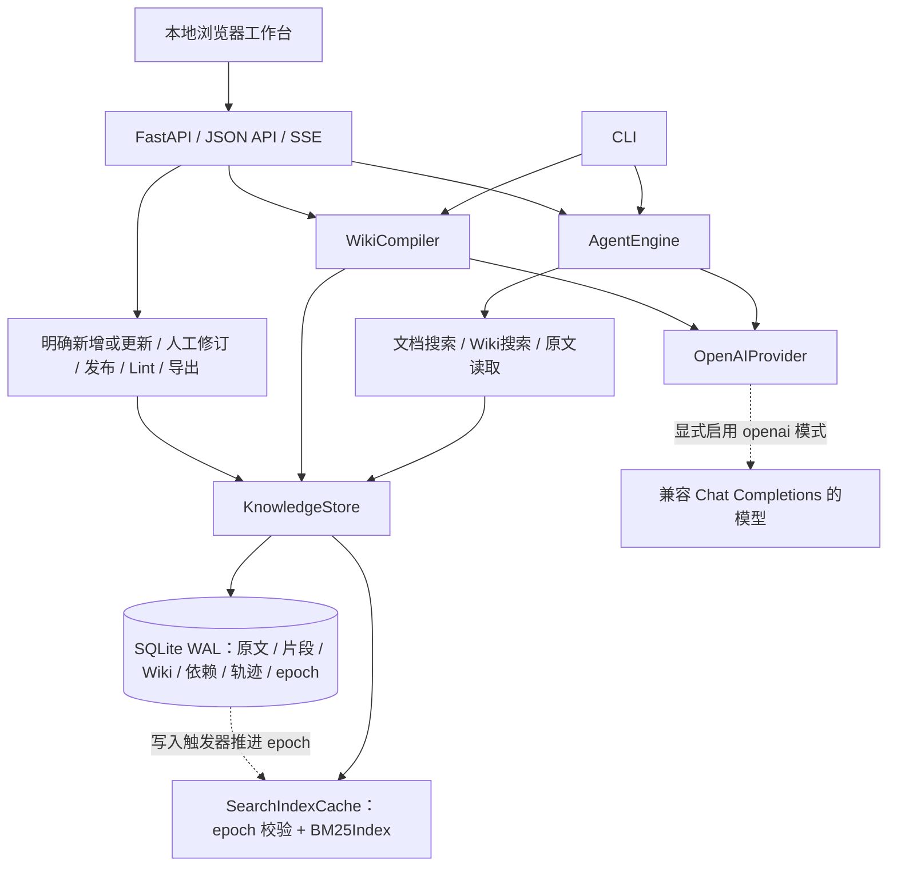
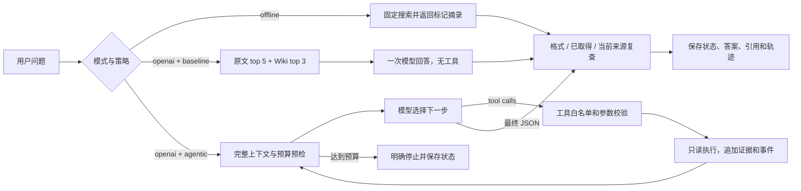
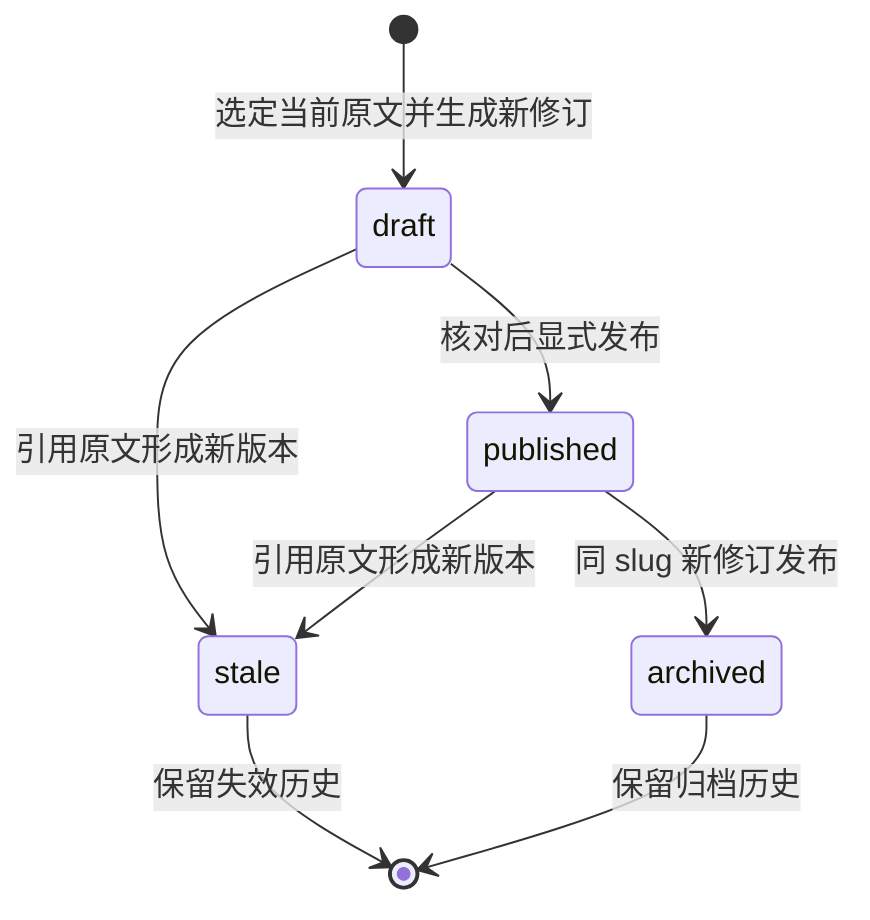

<div align="center">

# 知证 · Agentic RAG + Wiki

**让知识问答有据可查，让沉淀的结论跟得上原文更新。**

Python · FastAPI · SQLite WAL · OpenAI 兼容接口 · 原生 HTML / CSS / JavaScript

</div>

知证是面向企业支持与知识维护的本地工作台。提问时，Agent 根据已取得的证据自主选择搜索和原文阅读工具；维护时，Wiki 把带来源的结论保存为可审核、可发布的知识页。原文形成新版本后，依赖旧版本的页面立即退出有效 Wiki 检索，保留历史供复核。

项目把**调查、引用、人工修订、发布、更新失效**做成可追踪的闭环：回答能回到具体原文片段，知识页能说明自己依赖哪一版资料，每次模型调用有公开步骤和预算。当前面向单机、单工作区，没有公网账号与租户权限体系。

已按 [PRD](PRD.md) 先明确范围再实现。完整服务在已有 **Python 3.13.14** 环境运行；标准库核心另有 **Python 3.9.24** 验收入口。没有安装库、包或模型，不读取 `.env`。第五轮经用户授权临时下载设计参考后清理，并生成本地原创背景；运行不依赖远程 CDN。真实模型地址、模型名和运行时凭据仍需配置；默认可直接体验明确标记的离线摘录流程。

## 阅读导航

- [多人 RAG 服务 PRD（待实现）](PRD_RAG_SERVICE.md)、[Agent HTTP API 契约（待实现）](RAG_API_CONTRACT.md)
- 完整书籍离线运行记录（本地生成）（本地书籍验证记录，不随公开仓库分发）
- [解决的问题与功能](#解决的问题与功能)
- [架构与核心流程](#架构与核心流程)
- [文档如何切分与检索](#文档如何切分与检索)
- [策略的工程依据](#策略的工程依据)
- [运行环境与快速开始](#运行环境与快速开始)
- [配置 OpenAI 兼容模型](#配置-openai-兼容模型)
- [完整配置表](#完整配置表)
- [CLI 使用](#cli-使用)
- [HTTP API](#http-api)
- [样例、测试与评测](#样例测试与评测)
- [数据保存与备份](#数据保存与备份)
- [代码目录与设计取舍](#代码目录与设计取舍)
- [故障排查与扩展方向](#故障排查与扩展方向)

## 解决的问题与功能

企业知识问答有两个时间尺度：当前问题的依据分散在多份资料中，而整理出来的答案又会随着政策更新变旧。知证分别用有界调查和版本化知识维护处理它们。

| 业务困难 | 项目中的处理方式 | 可以检查的结果 |
|---|---|---|
| 一次搜索拿不到适用条件、费用与例外条款 | 模型决定搜索、读取、追加搜索，应用控制预算 | 公开工具顺序、参数、命中来源与停止原因 |
| 引用可能是编造的或已经过期 | 最终只接受本次取得、结束时仍有效的证据 | 引用包含版本、定位；Wiki 附底层原文 |
| 有价值的结论反复查询、反复整理 | 按主题编译带引用的 Wiki 草稿，核对后显式发布 | 不可覆盖的修订与 Markdown 导出 |
| 原文修改后，旧知识页继续参与回答 | 原文更新与依赖页面失效在同一事务提交 | 旧来源可读，关联 Wiki 退出有效检索 |
| Agent 增加了调用，却缺少效果对照 | 保留共享语料、共享检索工具的固定 RAG 基线 | 两种策略的来源覆盖、状态、调用量和耗时 |

| 功能模块 | 当前能力 |
|---|---|
| 工作台 | 沉浸式档案馆、首屏提问、真实结论与原文联动；五个视图、前进后退、键盘入口及手机导航；无需前端构建和 CDN |
| 资料导入 | UTF-8 Markdown / TXT、DOCX 正文；上传默认新增独立来源；更新时明确选择原文与预期版本；稳定来源键导入保持幂等 |
| 原文版本 | 完整正文、SHA-256、版本号、片段 ID 与字符偏移；同一来源只有一个当前版本 |
| 检索 | 中文字符/双字组合与英文词 BM25；标题加权；查询锚点过滤；批量候选读取与 SQLite epoch 感知的内存索引缓存 |
| Agent | OpenAI 兼容 function calling；三个只读工具；轮次、工具次数、上下文、输出和累计 Token 限制 |
| 回答追踪 | 格式检查、已见来源检查、当前版本复查、明确失败状态、公开运行记录与 SSE 步骤事件 |
| Wiki 生命周期 | 逐条人工修订与原文选择；版本冲突检查；草稿、显式发布、依赖失效、历史、Lint、Markdown 导出 |
| 验收入口 | CLI、JSON API、脚本化模型、Mock HTTP、来源更新竞态测试、隔离样例评测 |

### 知识档案馆

首页参考 Kage 的整屏空间构图，使用原创档案馆背景、CSS 透视薄片和滚动视差。首屏直接提问，向下可核对来自当前 Wiki 的结论及原文。进入工作区后，资料使用行列表，离线长摘录按来源展开阅读；输入、结果和版本操作保持连贯。

支持 Ctrl/⌘ K 提问、浏览器前进后退和手机导航。背景是装饰性位图与分层动效，不表示语义距离，也不是可自由漫游的 Three.js 世界。素材、官方依据、模块和验证范围见 [知识档案馆实现说明](ARCHIVE_UI.md)。

## 架构与核心流程

应用采用**模块化单体**：浏览器和 CLI 共用执行、编译、检索与存储层。只有显式启用真实模式后才请求模型服务，其余核心流程可本地完成。



数据库保存可追溯事实，模型负责检索决策与草稿组织，发布权留给维护者。SQLite 事务把原文更新与 Wiki 失效绑定；Markdown 从数据库导出，减少数据库和文件双写带来的不一致。

### 提问：有界 Agent 与固定基线



工具只有 `search_documents`、`search_wiki`、`read_evidence`。未知工具与无效参数被拒绝，并计入调用预算。没有执行代码、读取任意路径、业务写入或 Wiki 发布的模型工具；文档内容以不可信资料送入模型。

真实模式要求模型最终返回 `answer`、`evidence_ids`、`insufficient_evidence` 三个 JSON 字段。`completed` 表示执行与结构性证据检查完成，**不代表语义正确性已经独立证明**。离线 `completed` 只表示取得有效资料并完成摘录。

### 维护：Wiki 发布与失效



恢复失效页面可从详情选择**人工修订**，逐条改写结论、移除失效引用并加入当前原文，再保存同 `slug` 的新草稿。也可重新选定当前资料编译同主题草稿。已有发布页仍有效时，新草稿不会提前撤下它。原文更新也会给相关历史修订设置 `stale=true`，其中已归档的页面保留 `archived` 状态。

人工修订携带打开页面时的 `wiki_id/expected_version`，事务内发现其他人已保存或引用失效时返回 409，保留本地编辑供比较；不会自动合并。新稿标记 `mode=manual`，发布是独立动作。可选维护备注保存在历史正文并返回 `revision_note`，检索与模型证据只使用有来源的结论正文。详细约定见 [Wiki 人工修订](WIKI_REVISIONS.md)。

发布检查在事务内完成：目标须为该 `slug` 最新修订，所有原始片段仍属于当前原文。模型编译和离线编译都只创建草稿。完整职责、数据关系与事务顺序见 [架构文档](ARCHITECTURE.md)。

## 文档如何切分与检索

### 字符窗口与边界调整

导入调用 [`split_chunks`](../zhiwiki/retrieval.py)，默认目标窗口 **900 个 Python Unicode 字符（code point）**，重叠 **120 字符**。这是字符数，不是模型 Token 数或 UTF-8 字节数；组合 emoji 也不保证作为一个整体保留。

默认每次从 `start` 向后取不超过 900 字符。非尾窗口只在后半窗口 `[start + 450, end)` 搜索最后一个换行 `\n` 与最后一个中文句号 `。`，选择位置较后的分隔符并保留在片段末尾；没有找到时使用窗口末端。下一窗口从 `max(start + 1, end - 120)` 开始。

| 设计 | 目的与代价 |
|---|---|
| 900 字符目标上限 | 给政策条件和结论共同出现留出空间；较大片段也可能混入多个主题，稀释 BM25 词频 |
| 后半窗口找边界 | 减少频繁切出短片段；只是局部字符规则，没有理解章节结构 |
| 120 字符重叠 | 降低边界条件丢失的影响；重复索引部分文字，也重复占用模型上下文 |
| 保存偏移 | 可定位入库正文的精确切片，不依赖模型生成页码或标题 |

例如没有可用分隔符的 1,650 字符正文，默认窗口为 `[0,900)`、`[780,1650)`，共同包含 `[780,900)` 的 120 字符。句号或换行会让窗口提前结束，所以真实片段长度不总是 900。

底层采用零基右开 `start_offset/end_offset`；展示的 `chars:1-900` 是一基闭区间，对应 `documents.text[0:900]`。定位针对**数据库保存的正文**：DOCX 已转成正文文本，HTTP 字符串输入经过边界规范化；它不是 Word 页码、XML 偏移或原文件字节位置。

该算法没有实现 Parent-Child、递归、标题结构感知、表格完整性保护或语义分块，英文句号也不是分隔符。900/120 是起始配置，**尚未由业务对照实验证明为最优值**。目前它们是代码参数，未暴露为 JSON 字段；改参数还需设计已存文档的重分块、片段 ID 更新和 Wiki 依赖迁移。

“架构与切分”视图提供 `fixed/structure` 策略与参数预览，返回真实片段、offset 和重复字符数。`structure` 识别 Markdown ATX 标题路径与代码围栏，在章节内优先段落边界、再句末、最后字符上限兜底；不跨章节重叠，围栏保护也可能减少重叠，并返回实际 `overlap_chars` 与边界原因。这是依据官方工程原则实现的本地结构策略，不是完整 Markdown 解析或语义分块。

预览是纯计算，不写数据库、不调用模型，也不改变导入默认策略；结构策略尚未接入持久化资料。通用参数、边界例子、空白处理和实验建议见 [文档切分设计](CHUNKING.md)。

### BM25 与词法锚点

[`retrieval.py`](../zhiwiki/retrieval.py) 对英文/数字提取小写词项，对连续中文生成单字与相邻双字。例如 `退货运费` 产生 `退、货、运、费、退货、货运、运费`，`refund-policy` 保留为一个英文词项。

BM25 使用 `k1=1.5`、`b=0.75`，标题文本参与两次计数。排名前要求至少命中一个有信息量的**词法锚点**：中文先移除完整问句结构，再保留内容双字词项；只在两个字均为功能字时排除，不按单字符裁剪词首尾，避免误删“和田”“异或”“目的”。英文排除通用提问词；显式非功能单字查询保留单字行为。多字查询仅共享一个普通单字不会进入结果。

锚点过滤减少无关命中，也会漏掉同义改写、缩略语或被过滤的表达；它不是语义上的可回答性判断。当前没有 Embedding、向量数据库、混合向量召回或 Reranker。Agent 能换词再搜索，不能据此称为语义向量检索。

每个 `KnowledgeStore` 保留一份内存 `BM25Index`，复用词频、长度、倒排集合及原文/Wiki 各自的统计视图。每次搜索先读 SQLite 的 `epoch`；未变时复用索引，变化时在同一读取快照批量取候选并重建整份索引。原文、片段、Wiki 和依赖写入触发 epoch 变化，查询轨迹写入不触发。它解决重复读库与分词成本，尚未实现单文档增量索引或磁盘持久倒排库。

历史文档、草稿与失效 Wiki 被排除，维护备注也不进入 Wiki 检索正文。搜索命中 Wiki 时会附底层原文，最终回答再直接复查这些来源，不用缓存代替有效性验证。**来源存在、本次取得、版本有效，与结论被来源语义支持，是不同检查层次。**后者需要人工复核或单独的答案评测。缓存协议、读取优化和本地基准见 [检索设计](RETRIEVAL.md)。

工作台用原生 SVG/CSS/JavaScript 展示来源关系、数量变化、SSE 工具时间线和卡片反馈。全局动效开关、系统 `prefers-reduced-motion` 和页面不可见暂停约束动画；这些是交互反馈，不代表数据流可视化中的每条动画都对应一次真实网络调用。

## 策略的工程依据

设计依据来自维护方 GitHub 源码、官方产品文档和厂商工程说明，完整核查见 [策略来源与实现映射](STRATEGY_SOURCES.md)。引用用于解释决策，不代表已复现原项目、取得同样效果或获得生产背书。

| 设计主题 | 一手来源 | 本项目采用与差异 |
|---|---|---|
| 按内容结构选择切分 | [Azure AI Search 切分文档](https://learn.microsoft.com/en-us/azure/search/vector-search-how-to-chunk-documents)、[LangChain Markdown 文档](https://docs.langchain.com/oss/python/integrations/splitters/markdown_header_metadata_splitter) | 保留字符基线与精确 offset；结构策略作为本地对照实验，900/120 不等于官方 Token 推荐值 |
| 标题、代码围栏与句段兜底 | [LangChain Markdown 源码](https://github.com/langchain-ai/langchain/blob/master/libs/text-splitters/langchain_text_splitters/markdown.py)、[LlamaIndex SentenceSplitter](https://github.com/run-llama/llama_index/blob/main/llama-index-core/llama_index/core/node_parser/text/sentence.py) | 借鉴显式结构状态与长段兜底原则；不复制其 tokenizer 或声明完整 Markdown 解析 |
| 模型继续取证与公开活动 | [LangGraph Agentic RAG](https://docs.langchain.com/oss/python/langgraph/agentic-rag)、[Azure Agentic Retrieval](https://learn.microsoft.com/en-us/azure/search/agentic-retrieval-overview) | 有界多轮工具循环与来源轨迹；未实现独立规划器、相关性评分节点或并行子查询 |
| 来源上下文影响召回 | [Anthropic Contextual Retrieval](https://www.anthropic.com/engineering/contextual-retrieval) | 当前标题参与 BM25；没有模型生成片段上下文、Embedding 混合检索和 Reranker，不能沿用其效果数字 |
| 派生知识保留来源链 | [Microsoft GraphRAG 输出模型](https://microsoft.github.io/graphrag/index/outputs/) | 原文→片段→Wiki依赖；没有实体社区算法，Wiki 不等于 GraphRAG |
| 稳定身份与更新检测 | [LlamaIndex refresh_ref_docs 源码](https://github.com/run-llama/llama_index/blob/main/llama-index-core/llama_index/core/indices/base.py)、[AWS 数据源同步](https://docs.aws.amazon.com/bedrock/latest/userguide/kb-managed-sync.html) | source_key、正文哈希和显式更新；不可变历史与 Wiki 事务失效是本地额外设计 |

GitHub 链接对应核查时主分支，不是固定提交。将来直接复用代码需另行固定版本、核对许可证与兼容性；当前没有因此安装任何框架或包。

## 运行环境与快速开始

| 用途 | 已有环境与直接依赖 |
|---|---|
| 完整工作台、API、模型适配 | Python 3.13.14；FastAPI 0.141.1、uvicorn 0.52.1、Pydantic 2.13.4、httpx 0.28.1、python-multipart 0.0.32 |
| 完整 Python 测试 | 上述环境中的 pytest 8.4.2 |
| 存储、导入、离线 CLI、核心验收 | Python 3.9.24，使用标准库 |
| 浏览器工作台 | 原生 HTML / CSS / JavaScript，无 npm 构建或 CDN |
| 前端状态回归 | 已有 Node.js 的内置 `node:test`，无需 DOM 测试包 |

[`requirements.observed.txt`](../requirements.observed.txt) 仅记录环境，没有安装步骤，也不要求 `pip install` 或下载模型。3.9 核心可运行不意味着完整 HTTP 服务可在缺少相应依赖的该环境启动。

### 启动

```powershell
Set-Location -LiteralPath 'C:/Users/11873/PycharmProjects/AI/RAG-project'
# 使用已有解释器；doctor 只读检查，不建库、不联网、不安装。
python -B -m zhiwiki doctor
./start.ps1 -Port 8860
```

打开 [本地工作台](http://127.0.0.1:8860)。本例用 8860 避开本机当前 Windows 保留的 8718–8817 范围；脚本和 CLI 的缺省端口仍是 8765，可显式选择其他可用端口。默认 `provider=offline`，无需密钥。首次启动创建 `data/knowledge.sqlite3`；知识库初始为空，点击载入虚构样例或显式导入资料后再提问。

`start.ps1` 在已有脚本执行权限下运行；解释器优先级为显式 `-Python` → 进程变量 `RAG_PYTHON` → 项目 `.venv/Scripts/python.exe` → PATH 的 `python/python3`。显式指定的解释器不可用时会报错，避免悄悄切换环境。脚本通过 `doctor` 核对现有服务依赖，支持 `-Config`、`-Port`，不修改系统执行策略。也可直接用已验证的解释器执行 `python -B -m zhiwiki --config config.example.json serve`。在启动终端按 `Ctrl+C` 停服。

Linux/macOS 提供 `sh ./start.sh` 入口，使用已有 `python3` 或 `RAG_PYTHON`，可通过 `RAG_CONFIG/RAG_PORT` 指定配置和端口。脚本已提供不等于已经完成该系统上的完整运行验收；实际环境范围见 [验收报告](ACCEPTANCE.md)。

`doctor` 输出解释器、包是否存在和版本，区分 `core_ready` 与 `server_dependencies_ready`；后者还检查 Pydantic 2.x，不代替完整启动测试。该命令在构造 `KnowledgeStore` 之前返回，缺依赖不会触发安装。

试用问题：

- 对比 2025 和 2026 版售后政策，质量问题换货窗口有什么变化？
- 普通订单实付金额多少元免首次配送运费？
- 星舟阅读灯保修期多长，人为摔坏是否免费保修？

离线页面返回带来源和位置的原文摘录。配置真实模型后，才执行模型自主工具决策与内容综合。

### 体验来源更新

1. 在原始资料中选定需要更新的文档，核对当前标题和版本。
2. 生成 Wiki 草稿，逐条核对原文后发布。
3. 使用“更新已有资料 · 创建新版本”明确选择目标并上传修改正文；选择器显示标题、版本和 ID 末 6 位，另展示目标原文前 400 字供核对。请求带目标 ID 与预期版本，事务内再次检查。普通新增上传始终创建独立来源，同名文件不会覆盖旧资料。
4. 查看关联 Wiki 失效；旧引用仍可读，页面退出有效检索。
5. 人工修订失效 Wiki，替换所有旧引用，保存新草稿后独立发布。

CLI `ingest --source-key` 与 JSON `POST /api/documents` 仍提供稳定键导入，用相同 `source_key` 更新同一来源；上传接口不再接受 `source_key` 隐式更新。两种入口的身份规则是明确区分的。

文件名中的“2025/2026”是业务版本标签；数据库 `version` 是同一 `source_key` 的导入修订号。两个不同来源键可以同时处于数据库 v1；系统不会自行推断哪份业务政策适用于某订单。

## 配置 OpenAI 兼容模型

复制非秘密配置并修改：

```powershell
Copy-Item -LiteralPath './config.example.json' -Destination './config.local.json'
```

保留预算字段，将以下三个字段换成已有服务的真实值：

```json
{
  "provider": "openai",
  "base_url": "https://your-service.example/v1",
  "model": "your-model-id"
}
```

片段仅展示需要修改的字段。`base_url` 是 API 根路径，客户端追加 `/chat/completions`，不要重复填写终点路径。服务需支持 `tools` / `tool_choice` function calling，模型需返回要求的 JSON；“OpenAI 兼容”不自动证明这些能力，仍需实际联调。

密钥仅来自指定的**运行时进程环境变量**，默认 `RAG_API_KEY`。在 PyCharm 的 Run Configuration → Environment variables 中设置后重启进程；JSON 只保存变量名 `api_key_env`，不接受 `api_key` 字段。无需创建 `.env`，不要把密钥写进代码、配置、示例命令和提交记录。

```powershell
python -B -m zhiwiki --config config.local.json serve
```

远端必须 HTTPS 和运行时凭据；loopback 允许 HTTP 和无密钥。客户端不跟随重定向、不自动使用系统代理；供应商错误正文、请求头和私有推理字段不写入公开结果。真实模式失败返回 `provider_error`，不会静默降级。

“配置已启用”不代表模型已连接。首次真实查询和同语料真实评测才是兼容性与效果证据。

## 完整配置表

[`Settings`](../zhiwiki/config.py) 只读取显式 JSON，拒绝未知字段与越界值，文件上限 65,536 字节。相对 `data_dir` 以配置文件目录为基准，无配置时以当前工作目录为基准。

| 字段 | 默认值 | 合法范围 / 含义 |
|---|---|---|
| `data_dir` | `data` | 非空路径，保存工作区 SQLite |
| `provider` | `offline` | `offline/openai`，控制查询与 Wiki 编译 |
| `base_url` | 空 | `openai` 必填；服务根 URL，不含凭据、查询串或 fragment |
| `model` | 空 | `openai` 必填；实际支持的模型标识 |
| `api_key_env` | `RAG_API_KEY` | 合法变量标识符，最长 128；只保存名称 |
| `max_rounds` | `6` | 整数 1–30；查询最多模型调用轮次 |
| `max_tool_calls` | `12` | 整数 1–100；工具总数，无效调用也计入 |
| `timeout_seconds` | `60.0` | 大于 0、不超过 3,600 秒；单次查询/编译总预算 |
| `request_timeout_seconds` | `20.0` | 大于 0、不超过 3,600 秒；单请求限制，再与剩余总预算取小值 |
| `max_context_chars` | `24000` | 整数 100–500,000；完整 messages 与工具定义序列化后的字符限制 |
| `max_total_tokens` | `24000` | 整数 1–1,000,000；累计输入与输出预算 |
| `max_output_tokens` | `1500` | 整数 1–32,000；单请求输出上限，再受剩余总预算约束 |

每轮预检包含完整会话和已返回的工具结果，并预留当前输出。完整且内部一致的供应商 `usage` 用其数值；缺失或异常时，用序列化 UTF-8 字节数加包装余量估算，标记 `token_usage_known=false`。它不是专属 tokenizer，也不能精确结算费用；失败请求不能视作已证实零消耗。

代码级限制还包括：Wiki 一次选 1–12 份当前资料、最多 20 片段、生成 1–20 条结论；查询/编译共有 4 个 HTTP 执行槽位。**12 份是数量上限，不保证 12 篇长文可同时编译**：编译器读取全部所选片段，需按主题缩小范围；中文 UTF-8 保守预算还可能早于字符上限触发。这些不是 JSON 配置字段，4 个槽位也不是实测吞吐承诺。

总时限在模型、工具和响应读取边界复查。HTTPX 的阻塞 I/O 和尚未返回的响应头阶段依赖分阶段超时，不能保证严格墙钟取消；正文逐块检查截止，最多 2,000,000 字节。

## CLI 使用

在项目根目录设置非秘密解释器路径变量：

```powershell
$RagPython = (Get-Command python).Source
& $RagPython -m zhiwiki --help
```

全局参数放在子命令前：`--config` 指定 JSON，`--data-dir` 覆盖目录，`--provider` 覆盖模式；开启 `openai` 仍须提供模型配置。

| 命令 | 作用与参数 |
|---|---|
| `init` | 创建库并返回模式、目录 |
| `seed` | 显式载入仓库虚构样例 |
| `documents [--history]` | 当前原文或全部历史 |
| `ingest FILE [--source-key KEY] [--title TITLE]` | 读取一个明确选择的 MD/TXT/DOCX |
| `ask QUESTION [--strategy baseline\|agentic] [--trace]` | 查询；trace 写标准错误 |
| `serve [--host 127.0.0.1\|localhost] [--port 8765]` | 启动本地服务 |
| `doctor` | 只读显示现有解释器与依赖；不创建数据库、不请求模型 |
| `wiki list [--history]` | 最新 Wiki 修订或全部历史 |
| `wiki draft SLUG TITLE DOCUMENT_ID...` | 从当前原文生成草稿 |
| `wiki show WIKI_ID` | 查看修订、结论、来源 |
| `wiki publish WIKI_ID` | 显式发布最新有效修订 |
| `wiki lint` | 来源、状态、引用与链接检查 |
| `wiki export WIKI_ID [--output PATH]` | 导出 Markdown；不填路径时打印 |
| `evaluate [--output PATH]` | 临时库中执行两策略样例评测 |

```powershell
& $RagPython -m zhiwiki --config config.example.json seed
& $RagPython -m zhiwiki --config config.example.json documents
& $RagPython -m zhiwiki --config config.example.json ask '质量问题换货运费由谁承担？' --trace
& $RagPython -m zhiwiki --config config.example.json ask '阅读灯保修多久？' --strategy baseline
& $RagPython -m zhiwiki --config config.example.json wiki lint
```

显式提供稳定 `source_key` 有利于资料更新。CLI 默认来源键是文件解析后的绝对路径；浏览器新增上传使用 `upload:<uuid>:<filename>`，同名文件是不同来源。人工修订通过工作台、HTTP 或核心 `revise_wiki` 接口执行，当前没有 `wiki revise` CLI 子命令。

```powershell
# policy.md 是使用者明确选择的资料文件。
& $RagPython -m zhiwiki --config config.example.json ingest './policy.md' --source-key 'after-sales' --title '售后政策'
```

成功执行及明确 `insufficient_evidence` 返回退出码 0；`provider_error/budget_exceeded/invalid_answer` 和操作异常返回 2。脚本应同时检查退出码与 `status`。

## HTTP API

`/` 与 `/docs` 均打开本地工作台；[`/openapi.json`](http://127.0.0.1:8860/openapi.json) 提供机器可读定义。默认 Swagger/ReDoc 关闭，避免外部 CDN。

| 方法与路径 | 请求 | 返回 |
|---|---|---|
| `GET /`、`GET /docs` | 无 | 工作台 HTML |
| `GET /assets/{path}` | 静态资源路径 | 本地 CSS / JS |
| `GET /openapi.json` | 无 | OpenAPI schema |
| `GET /api/health` | 无 | 版本、模式、模型标识、BM25、本地工作区范围和 `limits` |
| `GET /api/system/retrieval` | 无 | 当前实例的缓存统计与数据库 epoch；无正文或查询内容 |
| `POST /api/examples` | 无 | 显式载入的虚构样例信息 |
| `GET /api/examples/catalog` | 无 | manifest 公开元数据、`document_count`；只读，无样例导入 |
| `POST /api/chunk-preview` | JSON：`text`，可选 `size,overlap,strategy` | 真实切片与统计；纯计算，不入库或请求模型 |
| `GET /api/documents` | 可选 `history=true` | `{documents:[...]}` |
| `POST /api/documents` | JSON：`title,source_key,text` | 原文版本，201 |
| `POST /api/documents/upload` | multipart `file`；可选 query `title`、`mode=new/update`，更新必填 `target_document_id,expected_version` | 新原文或指定来源下一版，201；旧 `source_key` 参数拒绝 |
| `GET /api/documents/{document_id}` | 路径 ID | 正文、版本、`chunk_ids`、片段 |
| `GET /api/evidence/{evidence_id}` | chunk / wiki ID | 内容、来源键、版本、定位、active |
| `POST /api/query` | JSON：`question`，可选 `strategy` | 完整查询结果 |
| `POST /api/query/stream` | 同查询 | `text/event-stream`，最后为 `final` |
| `GET /api/runs/{run_id}` | 路径 ID | 保存的公开运行记录 |
| `GET /api/wiki` | 可选 `history=true` | `{pages:[...]}` |
| `POST /api/wiki/draft` | JSON：`slug,title,document_ids` | 新草稿，201 |
| `GET /api/wiki/lint` | 无 | `{issues:[{id,code,message},...]}` |
| `GET /api/wiki/{wiki_id}` | 路径 ID | 状态、结论、依赖、正文及可选 `revision_note` |
| `POST /api/wiki/{wiki_id}/revisions` | JSON：`title,claims,expected_version`；可选 `links,revision_note` | 同 slug 新 `manual` 草稿，201；版本或来源冲突 409 |
| `POST /api/wiki/{wiki_id}/publish` | 无请求体 | 发布后修订 |
| `GET /api/wiki/{wiki_id}/export` | 路径 ID | 包含原文版本定位的 Markdown 附件 |

### 输入限制

| 输入 | HTTP 边界 |
|---|---|
| JSON | 拒绝未知字段；通常规范化首尾空白，切分预览保留空白 |
| 原文 `title/source_key/text` | 标题和来源键各 1–200 字符，正文 1–500,000 |
| 查询 | 问题 1–4,000 字符；策略 `baseline/agentic`，默认后者 |
| 切分预览 | text 1–20,000 字符，不可全空白或含 NUL；size/overlap 为严格整数，范围分别 200–2,000、0–500 且 overlap 不超过 size/2，默认 900/120；strategy `fixed/structure`，默认 fixed；保留原文首尾空白 |
| Wiki `slug` | 1–80 字符；以小写字母或数字开头，只含小写字母、数字、下划线、连字符 |
| Wiki `title/document_ids` | 标题 1–200 字符，资料 1–12 个，另受片段和上下文限制 |
| Wiki 人工修订 | title 1–200；expected_version 为严格正整数；1–100 条 claims，每条 text 1–10,000、evidence_ids 1–50；总文字不超过 100,000，全部引用须当前原文；links 最多 100，revision_note 最多 1,000 字符 |
| 上传 | 单文件 2 MiB；MD/TXT 为 UTF-8；DOCX ZIP 展开 10 MiB、最多 2,048 条目 |
| 请求总量 | 3 MiB；上传文件名不可含路径组件 |

查询结果字段：`id,question,strategy,mode,status,answer,citations,events,usage,elapsed_ms,stop_reason`；存档另带 `created_at`。用量包括模型/工具次数、输入/输出/累计 Token、`token_usage_known`。

上传可选 `title` 最多 200 字符，便于给同名文件设置不同显示标题；更新未填标题时沿用目标标题，始终保留目标 `source_key`，用所选文件替换正文。服务端在写入事务内核对目标仍是当前版本，新增模式不允许混入更新参数。人工修订的 `claims` 结构是 `[{text,evidence_ids}]`，只能引用 chunk；省略 `links` 保留原链接，`[]` 清空。备注在详情/导出中保留，`GET /api/evidence/{wiki_id}` 和搜索正文排除备注。

样例完整载入返回 `documents,pages,created_pages,skipped_pages,fictional`；catalog 返回 `schema_version,fictional,document_count,documents`。切分预览返回 `source_length,chunk_count,size,overlap,strategy,duplicate_chars,chunks`，片段含原文文本和偏移，结构策略另附结构元数据。这些预览参数不会写入 `Settings`。

health 的 `limits` 包含 `document_text_chars=500000`、`file_bytes=2097152`、`preview_text_chars=20000`、`concurrent_query_tasks=4`。它们是输入保护信息，不是运行效果统计。

检索观测返回 `ready,epoch,database_epoch,current,hits,misses,builds,items,terms,last_build_ms`。epoch 为数据库相关变更代次，一次事务可递增多次；命中、构建计数属于当前进程实例，不是持久业务指标。

| 查询状态 | 含义 |
|---|---|
| `completed` | 执行完成且通过结构性引用检查；需结合 mode 区分回答与离线摘录 |
| `insufficient_evidence` | 证据不足 |
| `budget_exceeded` | 轮次、工具、时间、上下文或 Token 达限 |
| `provider_error` | 模型请求失败，无静默降级 |
| `invalid_answer` | 格式、缺引、未见来源或有效性检查失败 |

上述查询业务状态通常随 HTTP 200 返回，调用方必须检查 `status`。边界错误为 400/422，记录不存在 404，跨站请求 403，版本/来源冲突 409，请求过大 413，槽位用尽 429；Wiki 编译模型错误为 502。

SSE 输出 `status/model/tool/final`，适配层另可能输出 `error`，并发送注释心跳。它展示步骤，**没有模型 Token 逐字流**。客户端断开阻止后续步骤，已发出的同步请求不能撤回。

```powershell
# 本地 JSON API 查询；服务须已启动。
$QueryBody = @{ question = '阅读灯保修期多长？'; strategy = 'agentic' } | ConvertTo-Json
Invoke-RestMethod -Uri 'http://127.0.0.1:8860/api/query' -Method Post -ContentType 'application/json; charset=utf-8' -Body ([Text.Encoding]::UTF8.GetBytes($QueryBody))
```

## 样例、测试与评测

### 工作台样例与既有来源回归

仓库样例是为演示与回归编写的**虚构企业资料**。企业、商品、订单、政策、费用和时限不代表真实业务规定。来源与载入范围见 [`examples/manifest.json`](../examples/manifest.json)，问题见 [`examples/evaluation.json`](../examples/evaluation.json)。

当前清单有 **16 份中文原文、默认切分 28 个片段**，覆盖售后、产品、订单、质检、逆向物流、促销退款、会员、对账、发票、客服、包装和活动。4 篇较长手册各含约 2,200–2,400 个中文字符，计入标题、标点与英文后全文约 2,600–2,900 个字符，各形成 4 个默认片段，可用于观察长文窗口。问题集为 **24 题，两策略共 48 次查询**，包含直接、跨文档、版本对比和缺少依据场景。

[`wiki_samples.json`](../examples/wiki_samples.json) 另外定义 4 页、16 条有源的人工虚构结论。只有显式载入完整样例时才首次创建并发布，标记 `mode=sample`，不调用模型；已有用户同 slug 页面、修改过或失效的页面会跳过，不替用户覆盖或重新发布。`seed_examples` 仅载入原文，CLI `seed` 和工作台使用 `seed_workspace` 载入完整示例。不能把手写样例当成模型生成效果。

清单显式列出文件、来源键、标题、主题、虚构更新时间和摘要，不通过 `*.md` 扫描，`examples/README.md` 不会被作为原文导入。原有售后、配送、保修四份资料保留；2025/2026 的政策文件是不同来源键，来源失效演示仍须使用同一个键更新。

```powershell
# 分别使用已有完整服务环境、3.9 核心环境和 Node；无需安装包。
python -B -m pytest -q -p no:cacheprovider
python -B scripts/verify_core.py
node --test tests/*.cjs
python -B -m zhiwiki --config config.example.json evaluate
```

`node` 应指向已有 Node.js；不在 PATH 时使用现有解释器绝对路径。3.9 脚本执行标准库核心测试并实际编译 Python 文件，没有把它包装成完整 Web 验收。

仓库已提供 [核心 CI 定义](../.github/workflows/core-ci.yml)：Python 3.9/3.13 矩阵运行标准库验收、Node 内置测试和 `doctor`，测试步骤不执行 pip/npm 安装；使用官方 checkout/setup-python。工作流尚未在远端触发，不能把配置文件当成已通过的 CI 徽章。

| 验证层次 | 验证内容 | 不能推断 |
|---|---|---|
| 存储/导入/修订 | 幂等、历史、偏移、明确上传更新、失效事务、乐观版本冲突与回滚 | 真实资料总能无损解析、自动合并正确 |
| 检索索引 | 缓存复用、跨实例 epoch 失效、批量读取、返回对象隔离与本地微基准 | 生产 QPS、任意规模线性收益 |
| 脚本模型/Mock HTTP | 多步工具循环、预算、协议、引用、脱敏 | 真实模型自主性与质量 |
| 竞态/HTTP/SSE | 来源在生成中更新、发布顺序、取消与槽位释放 | 生产并发容量 |
| 样例评测 | 来源覆盖、预期不足处理、用量、本次耗时 | 答案正确率、提升百分比、生产 P95 |

`evaluate` 在临时库加载样例，对 `baseline/agentic` 各跑一遍问题集，不改变已有知识库。默认输出 `reports/local-evaluation.json`，可用 `--output` 改路径。离线两策略共享确定性摘录，不能据此说明 Agent 收益。

用真实配置执行同命令会请求对应服务并消耗额度。报告保留 `manual_answer_checklist`，`answer_correctness` 标为未自动评分；应先联调，再用独立业务题比较正确率、引用支持率、拒答、延迟和费用。

**最新实际结果见 [验收报告](ACCEPTANCE.md)**。[保存的离线报告](../reports/offline-evaluation.json) 应按生成时间、语料和模式解读，不能将历史报告当作新增样例验收。

### 独立语料评测与匿名人工复核

新评测使用 [`examples/benchmark`](../examples/benchmark) 的 8 份独立虚构原文，以及 dev/holdout 各 12 题。参考答案、核验点和分级文档 qrels 保存在问题目录，只有明确清单的 corpus 原文入库。两组题均为本项目自编、可见分组；“holdout”表示用途隔离，不是第三方未知题盲测。

```powershell
# 24 次检索，不调用模型；和旧 CLI evaluate 是不同入口。
python -B scripts/run_evaluation.py --split all --retrieval-only --output reports/benchmark-retrieval.json
# 生成两策略离线回答及匿名人工复核包，不证明模型生成质量。
python -B scripts/run_evaluation.py --split dev --output reports/benchmark-offline.json
# 先人工填写生成的 review 表，再合并评分。
python -B scripts/score_evaluation.py --report reports/benchmark-offline.json --reviews reports/benchmark-offline.review.json --mapping reports/benchmark-offline.mapping.json --output reports/benchmark-human-scores.json
```

报告保存语料、问题、实现文件的 SHA-256 和非秘密设置快照，便于判断是否在相同条件下比较。检索指标与回答质量分开；匿名复核包去掉策略、用量、时延和轨迹，通过另存的 mapping 与答案 hash 关联，防止把旧评分套到新答案。只有双方同维度已评的样本才进入成对比较，未评维度保持 null。

脚本默认强制 offline；即使提供真实模型配置，也只有显式 `--live` 且配置 `provider=openai` 才会请求服务。本轮未执行真实模型或 judge。实际检索报告保留所有未命中和无依据题结果，不能以检索指标填充答案正确率。完整字段、人工 0–4 分规则及证据边界见 [评测设计](EVALUATION.md)。这套评测仍使用默认 fixed 入库，没有评价 structure 的检索收益。

## 数据保存与备份

SQLite 保存完整原文与历史、片段、Wiki 修订与依赖、查询轨迹，没有另一个必须同步维护的 Markdown 知识镜像。

| 内容 | 位置 |
|---|---|
| 主数据 | `<data_dir>/knowledge.sqlite3`，默认 `data` |
| SQLite 辅助文件 | 运行时可能有 `knowledge.sqlite3-wal`、`knowledge.sqlite3-shm` |
| 显式导出 | `wiki export --output` 指定的位置 |
| 评测报告 | 默认 `reports/local-evaluation.json` |
| 非秘密配置 | 用户显式创建的 `config.local.json` |

本地建议运行一个应用进程，保留配置与完整数据目录。默认监听 `127.0.0.1:8765`；Host/Origin 检查不等于身份认证，当前服务不适合直接公网部署。

**备份**：停服并确认没有 CLI 写库，再复制整个 `data_dir`。不要仅复制正在写入的主库而漏掉 WAL。不停服备份需采用 SQLite 备份能力建立一致快照；当前没有专用备份子命令。

**恢复**：保持停服，把完整备份恢复到配置目录，再启动并核对原文数量、Wiki 状态及一次原文读取；确认前保留旧目录。改 schema 或切分策略前先备份，当前没有通用 schema 迁移框架和自动重分块命令。

轨迹包含问题、答案、引用和公开工具参数，属于工作区资料；分享或备份时按实际内容范围处理。系统不持久化私有思维链，不自动扫描其他项目文件。

## 代码目录与设计取舍

```text
RAG-project/
├─ README.md
├─ config.example.json              # 离线默认配置与预算
├─ requirements.observed.txt        # 已有环境记录
├─ start.ps1                        # 启动入口
├─ start.sh                         # 使用已有解释器的 shell 入口
├─ .github/workflows/core-ci.yml     # 3.9/3.13 核心 CI 定义，待远端运行
├─ zhiwiki/
│  ├─ __main__.py / cli.py          # 命令与退出码
│  ├─ api.py / api_models.py        # HTTP 路由与输入
│  ├─ http_support.py              # 请求边界、SSE、槽位
│  ├─ config.py / provider.py      # 配置与模型适配
│  ├─ engine.py / compiler.py      # Agent与Wiki生成
│  ├─ store.py / schema.py         # 版本、依赖与事务
│  ├─ conflicts.py / diagnostics.py # 版本冲突与只读环境检查
│  ├─ ingest.py / retrieval.py     # 解析、默认分块、BM25
│  ├─ search_index.py              # epoch 缓存与索引观测
│  ├─ chunking.py                  # fixed/structure预览策略
│  ├─ bootstrap.py / evaluation.py # 样例与隔离评测
│  ├─ benchmarks.py               # 独立语料、检索指标与人工评分协议
│  └─ web/                        # 本地HTML/CSS/JS；revisions.js人工修订
├─ examples/
│  ├─ manifest.json               # 样例来源与导入范围
│  ├─ documents/                  # 虚构原始资料
│  ├─ wiki_samples.json           # 人工示例结论与逐字来源
│  ├─ evaluation.json             # 既有来源回归问题与核验点
│  └─ benchmark/                  # 独立8份语料、dev/holdout题与qrels
├─ tests/                         # Python与原生JS回归
├─ scripts/verify_core.py          # Python 3.9验收
├─ scripts/run_evaluation.py       # 独立语料检索/离线/显式真实评测
├─ scripts/score_evaluation.py     # 匿名人工评分合并
├─ scripts/benchmark_retrieval.py  # 小型合成语料检索微基准
├─ docs/
│  ├─ PRD.md / IMPLEMENTATION_CONTRACT.md
│  ├─ ARCHITECTURE.md / CHUNKING.md
│  ├─ RETRIEVAL.md / WIKI_REVISIONS.md
│  ├─ EVALUATION.md               # 分组、qrels、hash与人工评分边界
│  ├─ SHOWCASE.md                  # 三分钟演示、简历与面试追问
│  ├─ STRATEGY_SOURCES.md          # 官方资料与本地实现差异
│  └─ ACCEPTANCE.md
├─ reports/                       # 评测报告
└─ data/                          # 运行后创建
```

| 决策 | 当前理由 | 后续触发条件 |
|---|---|---|
| 显式有界循环 | 工具有限，预算和失败状态可直接检查 | 复杂分支、持久中断恢复出现后再评估编排框架 |
| SQLite 事实源 | 更新与失效可原子提交，单机维护直接 | 大写入竞争、多租户、分布式运行需要新设计 |
| BM25 与 epoch 缓存 | 无需新模型；复用语料分词，数据库变更可跨实例感知 | 频繁写入/大语料全量重建成为实测瓶颈后再做增量或持久索引 |
| 草稿后发布 | 结构引用校验不能替代结论核对 | 审核角色增多时同时补身份与权限 |
| 不可变人工修订 | expected_version 防止旧编辑覆盖新版，来源复查与新稿原子提交 | 多人协作需要身份、审计、差异比较与合并设计 |
| 原生前端/懒导入依赖 | 无构建和 CDN，离线核心与 Web 依赖分开 | 组件复用和交互复杂度增长后再选框架 |

本机虽有 LangGraph，运行路径没有依赖它，也没有第二套执行状态。当前没有 Embedding、Reranker、Milvus、Redis 或任务队列；统一 evidence 结构为未来扩展提供约束，但可切换向量 backend 和适配器尚未实现。

## 故障排查与扩展方向

| 现象 | 处理 |
|---|---|
| Windows 端口报 WinError 10013 | 只读检查 `netsh interface ipv4 show excludedportrange protocol=tcp`，通过 `-Port` 选择非保留端口，不删除系统保留范围 |
| 找不到 FastAPI/httpx | 检查解释器，完整服务使用已验证 3.13 环境 |
| 页面正常却没有来源 | 先显式导入；检查查询是否有词法锚点 |
| 修改配置后仍 offline | 检查 `--config` 路径并重启 |
| `provider_error` | 核对根 URL、模型、运行时变量和 tool calling 协议 |
| `budget_exceeded` | 查看 `stop_reason`，先缩小问题/资料，再按需调整预算 |
| Wiki 无法发布或搜索 | 检查最新修订、发布状态、来源有效性；失效后创建新修订 |
| 人工修订或更新返回 409 | 保留编辑内容，刷新目标版本并比较；失效引用须重新选择 |
| 文件修改未生效 | 系统不自动监视；浏览器选择“更新已有资料”，或 CLI 显式导入相同 `source_key` |
| 同名文件变成两份资料 | 新增上传默认创建独立来源；需要下一版时明确使用更新流程 |
| 改标题产生新版本 | 幂等要求标题和正文哈希同时一致 |
| 429 / 403 | 检查 4 个执行槽位是否已满，以及是否同站点请求 |
| 测试有依赖弃用提示 | 查看实际验收结果；当前任务不自动升级包来消除提示 |

后续顺序：先配置真实模型完成联调，再建立独立业务题，针对实测问题改进切分、稠密召回或答案校验。新增检索组件应保持相同来源 ID、版本有效性和 Wiki 依赖规则，并与固定基线比较。当前没有自动语义矛盾检测、PDF/OCR、网站采集、多租户权限或生产容量结论。

文档入口：[产品需求](PRD.md) · [架构设计](ARCHITECTURE.md) · [切分策略](CHUNKING.md) · [检索缓存](RETRIEVAL.md) · [人工修订](WIKI_REVISIONS.md) · [评测设计](EVALUATION.md) · [演示与面试](SHOWCASE.md) · [策略依据](STRATEGY_SOURCES.md) · [接口契约](IMPLEMENTATION_CONTRACT.md) · [验收记录](ACCEPTANCE.md)
