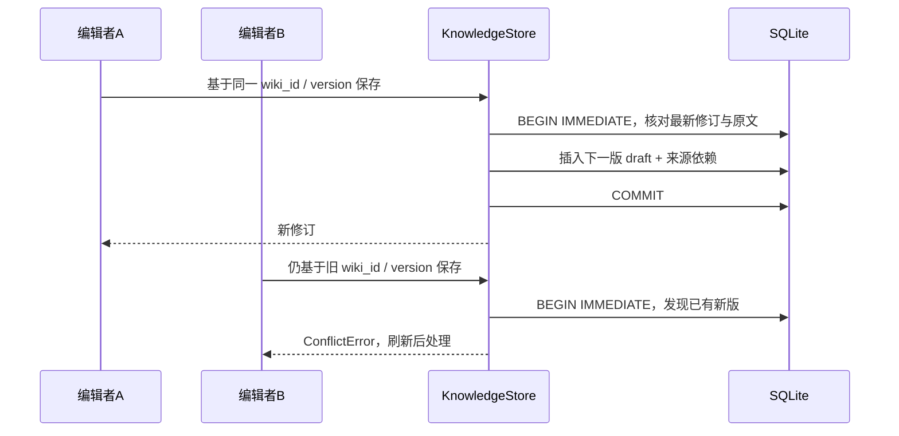

# Wiki 人工修订与并发控制

用户发现一条 Wiki 结论需要更正时，需要能修改具体文字与来源，同时保留之前发布过的内容。当前实现使用**不可变修订加乐观并发检查**：保存产生同主题的新草稿，不覆盖原页面；发布仍是独立动作。

本功能完全本地执行，不调用模型。`mode=manual` 区分人工修订、`offline` 摘录、`sample` 人工示例和 `openai` 模型编译；来源有效性检查不等于语义支持已经自动证明。

## 1. 存储接口

入口位于 [`KnowledgeStore.revise_wiki`](../zhiwiki/store.py)：

```python
revised = store.revise_wiki(
    wiki_id=base["id"],
    title="人工核对后的标题",
    claims=[{"text": "核对后的结论", "evidence_ids": [current_chunk_id]}],
    expected_version=base["version"],
    links=None,
    revision_note="核对本次变更原因。",
)
```

示例中的 `base/current_chunk_id` 必须来自本工作区实际读取结果。`expected_version` 是必填关键字参数，不能由服务端用最新版本悄悄补全，否则会丢失编辑者开始编辑时的版本依据。

| 参数 | 规则 |
|---|---|
| `wiki_id` | 编辑者打开的原修订 ID；必须存在且仍是该 slug 最新修订 |
| `title` | 非空、不含 NUL，存储层最多 300 字符；HTTP 最多 200 字符 |
| `claims` | 1–100 条；每条文字非空，最多 10,000 字符；总文字最多 100,000 字符 |
| `claims[].evidence_ids` | 每条 1–50 个原文 chunk ID；重复项去重；所有引用必须属于当前原文 |
| `expected_version` | 非 bool 的正整数；须等于原修订版本号，并且原 ID 仍为最新 |
| `links` | `None` 保留原链接；`[]` 清空；显式列表最多 100 项，slug 格式与原规则相同 |
| `revision_note` | 可选；最多 1,000 字符、不含 NUL；空白值按无备注处理 |

成功返回标准 Wiki 对象：新 ID、相同 slug、版本递增、`status=draft`、`stale=false`、`mode=manual`，以及标题、结论、来源、链接、正文与创建时间。它没有自动进入有效 Wiki 搜索。

## 2. 为什么还需要 expected_version

假设两个浏览器都打开同一主题的 v3。编辑者 A 保存出 v4 后，B 的页面仍然拿着 v3。若服务器直接按最新号再创建 v5，B 很可能基于旧内容重新写入，丢掉 A 的修订意图。

因此保存检查两个条件：原 ID 对应的版本等于 `expected_version`，并且该 ID 仍为主题最新修订。任一条件不符，就返回冲突，要求刷新并比较现有内容后再保存。重复提交已经成功的同一请求也会冲突，而不是生成两个相同新修订；接口不宣称自动合并或幂等重放。



这解决的是编辑内容的版本竞争，没有添加跨用户身份与授权；当前工作区仍是本地单用户范围。

## 3. 一笔事务内完成检查和写入

`revise_wiki` 在同一个 `BEGIN IMMEDIATE` 写事务内执行：读取 base → 核对最新 ID/版本与可编辑状态 → 核对全部原始引用 → 插入新 Wiki 和 `wiki_sources` → 返回新修订 → 提交。

`create_wiki` 与人工修订共用 `_insert_wiki_revision` 小函数。该函数只使用调用方已经打开的连接，不再创建第二笔事务，所以不会出现“先检查通过，另开事务写入时来源已经变化”的应用竞态。回读或依赖插入失败会使整笔事务回滚，不留下半成品修订。

来源检查按最多 500 个 ID 一批查询当前原文，避免每条引用单独执行 SQL，同时兼容较旧 SQLite 的参数数量限制。它只核对当前版本与原文身份，不判断结论是否准确表达了这些片段。

## 4. 哪些原页面可以编辑

| Base 情况 | 保存行为 |
|---|---|
| 最新 `draft` | 创建下一版 manual 草稿；旧草稿保留 |
| 最新 `published` | 创建下一版草稿；原发布页保持可用直到新稿单独发布 |
| 最新 `stale` | 允许修复，但新提交的所有引用必须已换成当前有效原文 |
| 旧 ID 或版本不匹配 | 冲突，拒绝写入 |
| 已被较新修订替代的归档页 | 冲突，要求从最新修订开始 |
| ID 不存在 | 未找到记录，不创建新主题 |

修复 stale 页面不能只改一句文字却继续保留任何旧来源。引用列表混入一个失效片段，整次保存就会拒绝；有效与无效来源不会被静默筛掉后部分保存。

如果来源更新与修订同时发生，二者由 SQLite 写事务排序。更新先完成时，修订看到失效引用而拒绝；修订先完成时，后续更新会将新草稿也标记失效。最终不能把依赖旧原文的新草稿当成有效页面发布。

## 5. 历史、发布与备注

保存人工修订不会修改 base 的标题、结论、来源、链接、正文或状态，也不会自动发布。如果 base 已发布且仍有效，它继续参与检索；新稿发布后，原发布版归档，新稿成为该主题有效发布版。

历史来源始终可定位。修复后的新稿引用当前片段，旧稿仍保存当时的片段 ID 和正文；导出旧稿不会被替换成新规则。

`revision_note` 当前保存到新修订的 Markdown `body` 中，放在“修订说明（维护备注，不作为知识结论）”独立段落。它不进入 `claims`，没有为了备注新增数据库列。读取时先从 title/claims/mode 重建规范正文，验证其后的固定备注段，再返回独立的 `revision_note` 字段；结论中出现相同标题不会被误识别。

详情和导出保留备注，但 Wiki 搜索与 `read_evidence` 只使用规范的有源正文，防止无来源维护说明进入模型证据。冷/暖缓存和重新打开实例都遵循该规则。目前没有修改者账户、自动 diff 或完整审计日志；未来若需要按备注筛选、记录修改者和权限，应另做明确的 schema 迁移。

备注不会自动从旧稿复制到下一次人工修订；新稿仅保留这次显式提交的备注，旧备注继续留在旧版本中。

## 6. 异常约定

[`ConflictError`](../zhiwiki/conflicts.py) 是 `ValueError` 子类，便于保留旧调用方的通用错误处理。HTTP 层已先识别该类型并映射 409，区别于输入格式错误。

| 情况 | 存储异常 | 调用方处理 |
|---|---|---|
| 原 Wiki 已被其他修订替代或 expected_version 不匹配 | `ConflictError` | 保留本地编辑文字，重新读取最新内容后比较 |
| 原文引用失效或不存在 | `ConflictError` | 重新选择有效原文，核对受影响结论 |
| 引用 Wiki、无引用、文字超长、非法链接/版本参数 | `ValueError` | 指出输入问题，修正后重试 |
| 原 Wiki ID 不存在 | `KeyError` | 返回未找到，不创建替代主题 |
| 写入/回读中其他异常 | 原异常，事务回滚 | 不当作保存成功；读取最新状态后再决定是否重试 |

来源冲突不会自动调用模型重写结论，也不会用当前资料替换旧引用后直接发布。浏览器应明确展示冲突，不把它当成网络小故障不断重试。

## 7. 工作台与 HTTP 使用

在 Wiki 详情点击“人工修订”，逐条编辑文字，用“选择原文引用”指定当前结论的来源；右侧“加入资料片段”读取所选文档片段。失效旧引用可移除，不能作为新来源选入。点击“保存为新版本草稿”后打开新草稿详情，人工核对后再使用独立发布按钮。

编辑器先检查每条结论有文字和有效引用，再提交 `POST /api/wiki/{wiki_id}/revisions`，请求字段是 `title,claims,expected_version` 和可选 `links,revision_note`，成功为 HTTP 201。这个检查帮助及时反馈，服务端事务检查仍为最终依据。冲突时显示原因并保留本地文字；异步请求代次检查防止旧页面响应覆盖新编辑器。

`GET /api/wiki/{wiki_id}` 可读取备注与历史正文；`GET /api/evidence/{wiki_id}` 排除备注。当前没有人工修订 CLI 子命令，也没有自动合并、自动解决来源冲突或直接保存成 published 的入口。

## 8. 验证记录与复现

本模块新增 [`tests/test_wiki_revision.py`](../tests/test_wiki_revision.py)，17 项测试分别在已有 Python 3.13.14 与 3.9.24 通过；另复查原存储和 Wiki 生命周期 19 项测试，两环境均通过。覆盖：

- base 保持不变、新草稿无自动发布、发布后旧版归档；
- required/严格版本参数、重复提交和两个编辑者竞争；
- stale 修复、缺失/混合旧来源、Wiki 自引用拒绝；
- links 保留/清空、备注持久化、输入上限；
- 备注不进入冷/暖检索与证据正文、结论里的同名标记不误识别；
- 插入后故障回滚、来源更新与修订竞争。

可使用现有解释器运行：

```powershell
python -m unittest discover -s tests -p test_wiki_revision.py -v
```

这里的 Python 应指向已安装的 3.9 或 3.13 解释器。测试使用临时 SQLite 工作区，不请求真实模型、不下载依赖；最新全项目验收以 [ACCEPTANCE](ACCEPTANCE.md) 为准。
